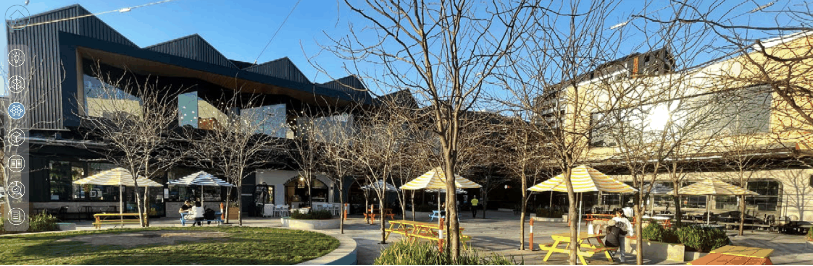
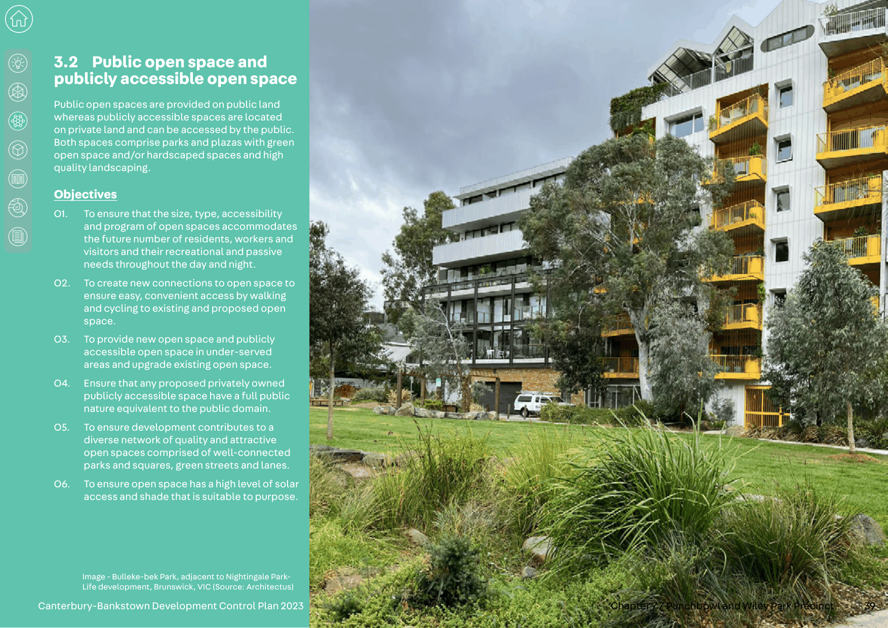

#### 4 Solar access,

#### shade, surveillance

and activation of the

public domain

Chapter 7.7 Punchbowl and Wiley Park Precinct 36

### Punchbowl and Wiley Park

### Public Domain Strategy

Lakemba Street

Shadforth Street

Highclere Avenue

#### Wiley Park

Punchbowl Road

Kelly Street

South Terrace

#### Station

rade

a Pa

ung

Ur

de

evar

oul

e B

Th

Griffiths Avenue

#### Punchbowl

Alice Street South

#### Station

#### Legend

Application of DCP

King Georges Rd

Hillcrest St

Existing open space

Punchbowl Road

Upgraded open space

Ferguson Avenue

Arthur Street

Rossmore Ave

Proposed new open space Proposed community facility M Metro station

Broadway

Major road

Viola Street

High street improvements

Canterbury Road

Priority streets for tree canopy Priority streets for cycleways Planned East-West cycle link (Sydney Metro) Proposed / enhanced pedestrian link (min. 4m) Proposed new shared lane (9m)

Figure 21. Public Domain Strategy

1:12,500

0 100 200 300 500M

N

> [Picture on page 38: a picture, saved as a picture (images/ch-07-07-punchbowl-and-wiley-park-page-38-1.gif, 150 dpi).]

#### Principles

P1. Development must contribute to the  delivery of public domain improvements in line with the Public Domain Strategy at Figure 21, including:

a)	 Wiley Park Village will be focussed on Lakemba Street and Stanlea Parade to encourage retail activity and high amenity spaces for people off busy King Georges Road. A 3m setback along these streets with slower traffic will provide for expanded footpaths, increased street tree planting and opportunities for outdoor dining.

b)	 Development along King Georges Road will be encouraged to provide vehicle access via secondary frontages along local streets to reduce the number of driveway crossings to King Georges Road. Generous landscaped setbacks with widened footpaths and a vegetated buffer will greatly improve the pedestrian environment. Image - Central green space and activated plaza, Ed-mondson Park, NSW (Source: Architectus)

c)	 Key sites are required to provide new public open spaces as they are in proximity to the highly accessible Punchbowl and Wiley Park Village character areas. See Section 6 Key sites.

d)	 Development will contribute to new pedestrian links and widen existing connections to improve access and permeability throughout the Precinct.

e)	 Streetscape and public domain enhancements will improve comfort to support active transport options and sustainability outcomes. Key streets including Arthur Street will be treelined to improve amenity and shading and provide a safer alternative for cycling away from streets with more traffic.

f) The active transport network will be expanded by the East-West Pedestrian and Cycle Link (Sydney Metro), and incorporate new cycle infrastructure within street upgrades as on Highclere Avenue, Broadway, Hillcrest Street, Ferguson Avenue, Viola Street and Alice Street South. These upgrades will work to encourage street life and use of the new Metro.

g)	 Promote shared use arrangements of open space including with school out of teaching hours. This includes the school grounds of Punchbowl Boys’ High School, Punchbowl Public School, Wiley Park Girls High School and Lakemba Public School.

> [Picture on page 39: a picture, saved as a picture (images/ch-07-07-punchbowl-and-wiley-park-page-39-1.gif, 150 dpi).]
> Words printed on the picture (title and legend, copied from the PDF):
> quality landscaping.
> space.
> Image - Bulleke-bek Park, adjacent to Nightingale Park-
> Life development, Brunswick, VIC (Source: Architectus)
