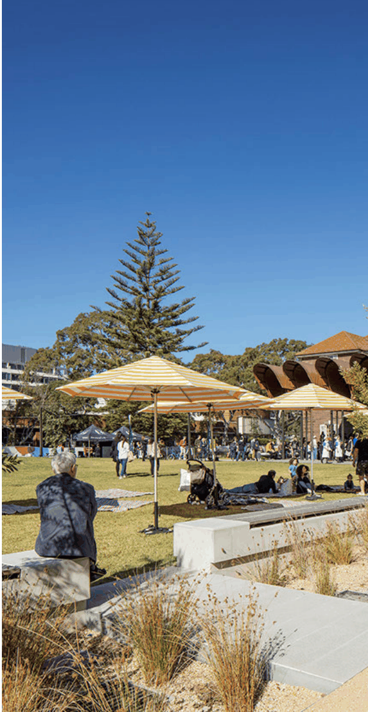
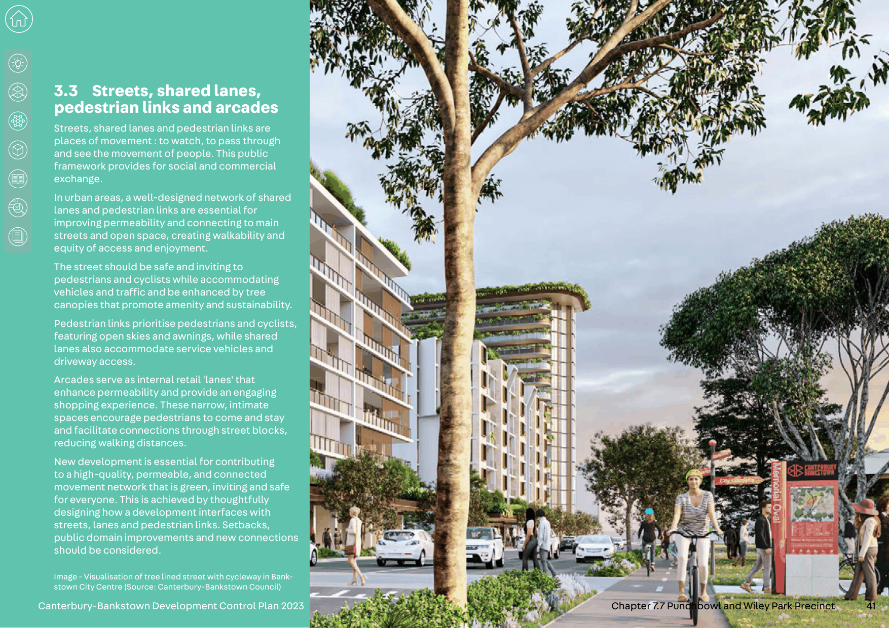

### 3.2	 Public open space and

### publicly accessible open space

Public open spaces are provided on public land whereas publicly accessible spaces are located on private land and can be accessed by the public. Both spaces comprise parks and plazas with green open space and/or hardscaped spaces and high

#### Objectives

O1. To ensure that the size, type, accessibility and program of open spaces accommodates the future number of residents, workers and visitors and their recreational and passive needs throughout the day and night.

O2. To create new connections to open space to ensure easy, convenient access by walking and cycling to existing and proposed open

O3. To provide new open space and publicly accessible open space in under-served areas and upgrade existing open space.

O4. Ensure that any proposed privately owned publicly accessible space have a full public nature equivalent to the public domain.

O5. To ensure development contributes to a diverse network of quality and attractive open spaces comprised of well-connected parks and squares, green streets and lanes.

O6. To ensure open space has a high level of solar access and shade that is suitable to purpose.

#### Principles

P1. Provide equitable access and a variety of amenity and recreational options to accommodate different community needs.

P2. The design of new publicly accessible open space and public open space should use a palette of high quality and robust materials to maximise design lifespan and create beautiful places. Landscaping treatments and material selections must respond to the local character of each space and contribute to a cohesive and unified public domain throughout the Precinct.

P3. Create and enhance natural ecologies within the urban fabric through the use of diverse native landscape species.

P4. Paths of travel through public open space must respond to ‘desire paths’ and should be lit in the evening to improve safety and accessibility for users.

P5. In high activity area where street space and footpaths are constrained, create a suitable environment for pedestrian movement and business activity by widening existing footpaths into private land.

f) A Country centred approach should be taken to the design of open space. See Section 2.3 Connecting with Country.

g)	 Consideration must be given to the reduction of urban heat and the provision of shade in the design of open space. See Section 3.6 Shade and the reduction of urban heat.

#### Controls

C1. Where required by Council, new publicly

accessible space and/or land dedication for

new or expanded public open space must be

provided in the locations identified in Figure

21 Public Domain Strategy.

C2. Development fronting open space must

engage with these publicly accessible

spaces. This can be achieved by, but is not

limited to, the following:

⚬ Ground level active frontages and edges.

⚬ Balconies addressing open space.

⚬ Garden apartments with individual entries

from the open space.

⚬ Access from development sites and lanes to

and from open space.

C3. Buildings and building basements are not

permitted to be located on, above or under

any proposed new open space. Awnings can

overhang open space.

C4. Public art must be integrated into publicly

accessible open spaces.This could include

a Connection with Country approach. The

design and placement of public art must

contribute meaningfully to the character,

identity and activation of the public domain.

> [Picture on page 40: a picture, saved as a picture (images/ch-07-07-punchbowl-and-wiley-park-page-40-60.gif, 150 dpi).]

Matron  Ruby Grant Park, Zetland (Source: Architectus)

> [Picture on page 41: a picture, saved as a picture (images/ch-07-07-punchbowl-and-wiley-park-page-41-1.gif, 150 dpi).]
> Words printed on the picture (title and legend, copied from the PDF):
> should be considered.
> Image - Visualisation of tree lined street with cycleway in Bank-
> stown City Centre (Source: Canterbury-Bankstown Council)
