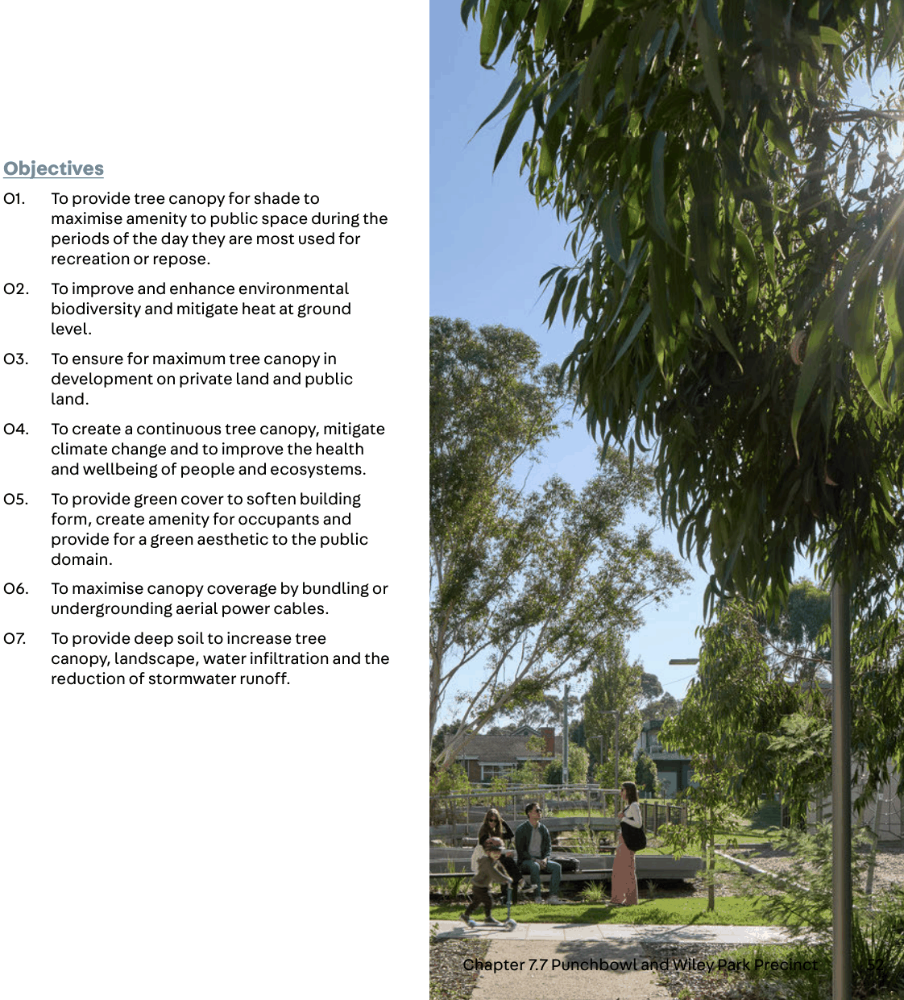
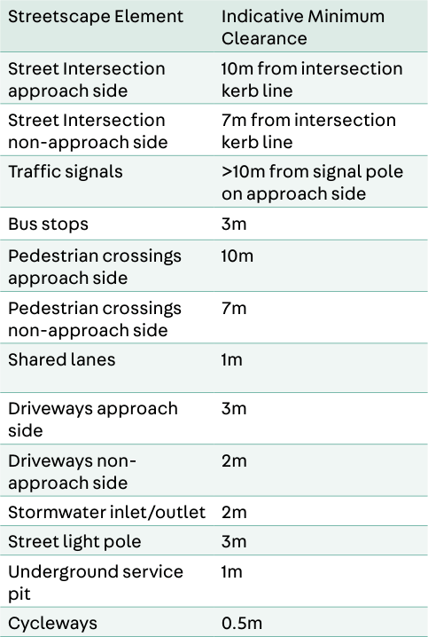
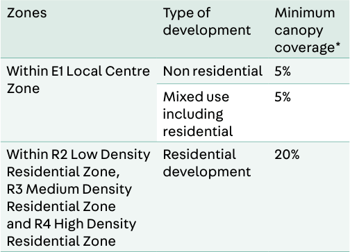
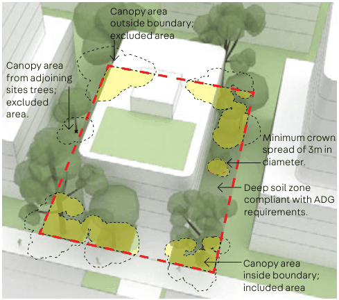
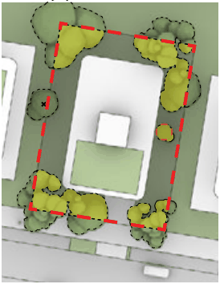

### 3.4	 Tree canopy, green cover

### and deep soil

Trees are essential for their contribution to the amenity and character of the Precinct. When appropriately selected, located, planted and maintained, trees provide a multitude of benefits to the urban environment including reducing heat gain, providing shade and mitigating climate change.

One of the most effective solutions to mitigate urban heat gain is expanding tree canopy cover. Trees provide shade, cool the environment through transpiration and reduce surface temperature in densely built areas, where heat can become trapped by concrete and asphalt. Temperature differences between locations with canopy and without canopy gaps can be significant. Greencover provides further greening and shade to buildings and to the site itself. This will protect buildings from radiant heat gain and provide a pleasing aesthetic to the public domain. Deep soil is 'landscaped area'. These areas of soil are not covered by buildings or structures. Deep soil provides for the planting of canopy trees, increases water filtration and reduces stormwater runoff. It is beneficial to co-locate deep soil with communal open space to provide shade and amenity for those using these spaces.

Image - Markham Avenue, Ashburton, VIC, Architectus (Source: Architectus)

> [Picture on page 52: a picture, saved as a picture (images/ch-07-07-punchbowl-and-wiley-park-page-52-31.gif, 150 dpi).]
> Words printed on the picture (title and legend, copied from the PDF):
> recreation or repose.
> level.
> land.
> domain.
> undergrounding aerial power cables.
> reduction of stormwater runoff.

#### Objectives

O1. To provide tree canopy for shade to

maximise amenity to public space during the

periods of the day they are most used for

O2. To improve and enhance environmental

biodiversity and mitigate heat at ground

O3. To ensure for maximum tree canopy in

development on private land and public

O4. To create a continuous tree canopy, mitigate

climate change and to improve the health

and wellbeing of people and ecosystems.

O5. To provide green cover to soften building

form, create amenity for occupants and

provide for a green aesthetic to the public

O6. To maximise canopy coverage by bundling or

O7. To provide deep soil to increase tree

canopy, landscape, water infiltration and the

#### Principles

P1. Ensure existing trees are protected and that additional trees are planted in the public and private domains.

P2. Provide tree planting appropriate to the local climate.

P3. Provide for recreational equipment, seating, landscaping, absorptive ground treatments and an integrated consistent material palette for hard landscaped areas.

P4. Ensure for adequate deep soil depth and width for the growth of large trees, shrubs and vegetation generally.

P5. In new development ensure for articulated facades for green cover. In alterations to existing buildings, provide fixed planting and rooftop greenery.

#### Controls

C1. As part of a Development Application for residential, mixed use or non-residential development, street trees are to be provided to all public frontages to the satisfaction of Council.

C2. New street trees must have a minimum pot size of 75 litres but no greater than 200 litres.

C3. Street trees should be planted with clearances as set out in Table 1.

C4. A Public Frontage Plan(PFP) shall be prepared prior to the issue of a Construction Certificate. This plan will identify:

a) All frontages of the development site

between the gutter and the building line, including the footpath, drainage, entries and other built objects.

b) Any existing trees, bus shelters, signage and other structures or services that may impede the planting of new street trees.

c) A qualified landscape architect shall prepare the PFP and specify the size in litres, the spacing and species in coordination with Council. The PFP must be prepared after test pits have been completed to ensure for services coordination

C5. Trees will be spaced depending on their size: small - 5-7m, medium 7-10m and large 10-15m.

C6. Please refer to tree base treatments in the Appendices

C7. Minimum tree canopy cover is required on private land as per Table 2 and Figure 29.

C8. Tree canopy cover refers to the layer of leaves, branches, and stems of trees that cover the ground when viewed from above, expressed as proportion of the total site area, calculated in accordance with the following:

a) Canopy area is to include the expected mature size, (crown spread at maturity), of existing and proposed trees.

b) Only trees with a minimum crown spread of 3m in diameter are to be included. Trees with a crown spread less than 3m diameter are to be excluded from tree canopy cover calculations.

c) Any overlap in canopy area is to be counted once.

d) Canopy area extending outside of site boundaries is to be excluded.

e) Canopy area extending within a development site from trees planted in adjoining sites is to be excluded.

f) Trees located over structures, including podiums and rooftops, are to be included.

C9. The design of the canopy trees should be laid out such that sufficient room is provided for the trees to achieve their desired mature

size. Canopy overlap should not exceed 25%.

C10.	 New development within the E1 Local Centre zone, must deliver 50% of the site area as ‘green cover’  which can be any combination of the following:

⚬ Deep soil zones;

⚬ Green walls where orientation is appropriate;

⚬ Layered planting on structure (including small and medium trees, as per the Apartment Design Guide);

⚬ Green roofs and awnings; or

⚬ Permanent planting on balconies and podiums, (including built-in planter boxes).

> [Picture on page 54: a map, saved as a picture (images/ch-07-07-punchbowl-and-wiley-park-page-54-1.gif, 150 dpi); the street names and other small labels are on the picture.]
> Words printed on the picture (title and legend, copied from the PDF):
> Streetscape Element Indicative Minimum
> 10m from intersection
> 7m from intersection
> \>10m from signal pole
> on approach side
> Stormwater inlet/outlet 2m
> Street light pole 3m

Table 29. Street tree planting clearances

> [Picture on page 54: a map, saved as a picture (images/ch-07-07-punchbowl-and-wiley-park-page-54-3.gif, 150 dpi); the street names and other small labels are on the picture.]
> Words printed on the picture (title and legend, copied from the PDF):
> Non residential 5%
> Within E1 Local Centre
> Within R2 Low Density
> R3 Medium Density
> and R4 High Density

\*Whether on structure or deep soil

Table 30. Minimum tree canopy cover for private land

> [Picture on page 54: a map, saved as a picture (images/ch-07-07-punchbowl-and-wiley-park-page-54-6.gif, 150 dpi); the street names and other small labels are on the picture.]
> Words printed on the picture (title and legend, copied from the PDF):
> spread of 3m in
> Deep soil zone
> compliant with ADG

#### Legend

Site boundary 3m diameter Area included in canopy area Area excluded in canopy area Deep soil zone

> [Picture on page 54: a picture, saved as a picture (images/ch-07-07-punchbowl-and-wiley-park-page-54-15.gif, 150 dpi).]

Key controls for tree canopy and deep soil for

#### Figure 31.

a residential development

Chapter 7.7 Punchbowl and Wiley Park Precinct 54
