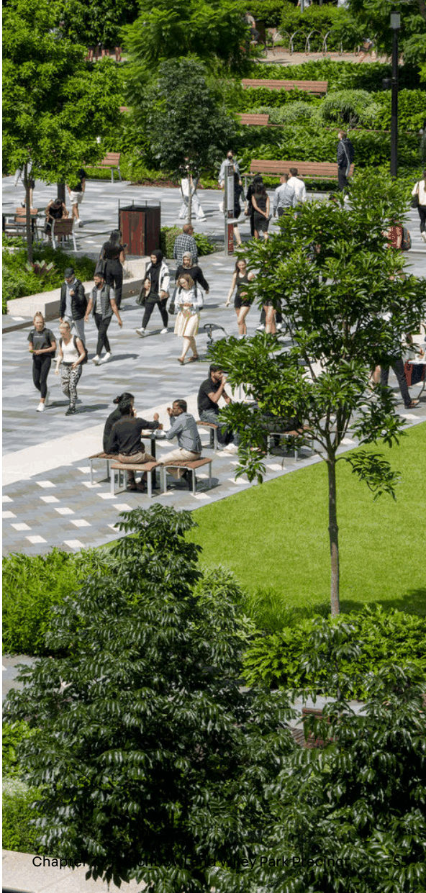

### 3.5	 Solar access to open space

#### Objectives

O1. To ensure for solar access to parks and spaces for the enjoyment of residents and visitors.

O2. To balance sunlight access to the principal useable parts of public open space with shaded areas to enable a range of activities and the planting of a variety of trees and vegetation.

O3. To maintain or maximise solar access to public space during periods of the day when they are most used.

O4. To ensure the successful growth and survival of trees and vegetation within parks and public spaces.

#### Principles

P1. Provide high levels of solar access to ensure that trees and vegetation thrive and amenity is provided for the community.

P2. Provide solar access on balance with shaded areas to ensure for amenity to all users all year around.

P3. Ensure that access to winter sun is maximised.

Image - 1 Central Courtyard, Macquarie University, NSW (Source: Architectus)

#### Controls

C1. Development Applications must

demonstrate that the hours of solar access

outlined in Figure 30 are maintained or

preferably exceeded.

C2. Where overshadowing of parks and spaces

is likely, a statement with supporting solar

access studies must be submitted by a

registered architect demonstrating that

the proposed development mitigates

overshadowing to the affected open space

or publicly accessible space.

C3. Ancillary structures such as columns,

pillars, spires, flag poles, public art, and

architectural roof features including

equipment for servicing the building, such

as plant, lift motor rooms, fire stairs and

the like, must not be excluded from any

overshadowing analysis.

> [Picture on page 55: a picture, saved as a picture (images/ch-07-07-punchbowl-and-wiley-park-page-55-47.gif, 150 dpi).]

#### Legend

Application of DCP Minimum 3 hours of sun for 50% of the open space in the winter solstice Minimum 4 hours of sun for 50% of the open space at the winter solstice Minimum 5 hours of sun for 50% of the open space at the winter solstice Potential open space locations at key site Key sites minimum solar requirements in Section 6 - Key Sites

Highclere Avenue

Kelly Street

Griffiths Avenue

#### Punchbowl

#### Station

Punchbowl Road

Arthur Street

Rossmore Ave

Viola Street

Solar access to public and publicly accessible open space

#### Figure 32.

Punchbowl Road

rade

a Pa

ung

Ur

de

evar

oul

e B

Th

Hillcrest St

Broadway

McCourt

Street

Reserve

Hillard

Street

Reserve

Lakemba Street

Shadforth Street

#### Wiley Park

#### Station

King Georges Rd

Canterbury Road

1:12,500

0 100 200 300 500M

N
