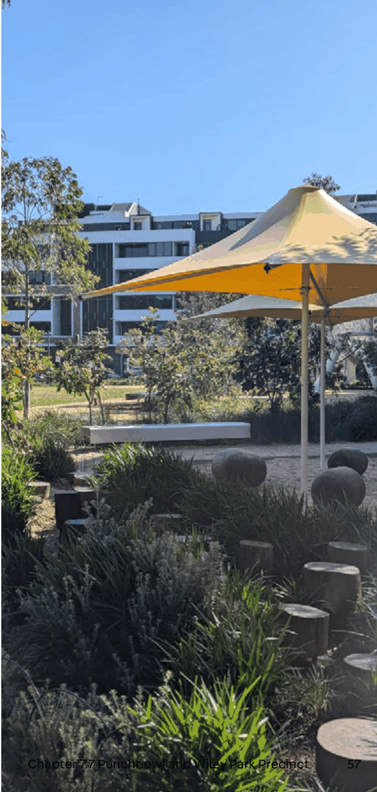
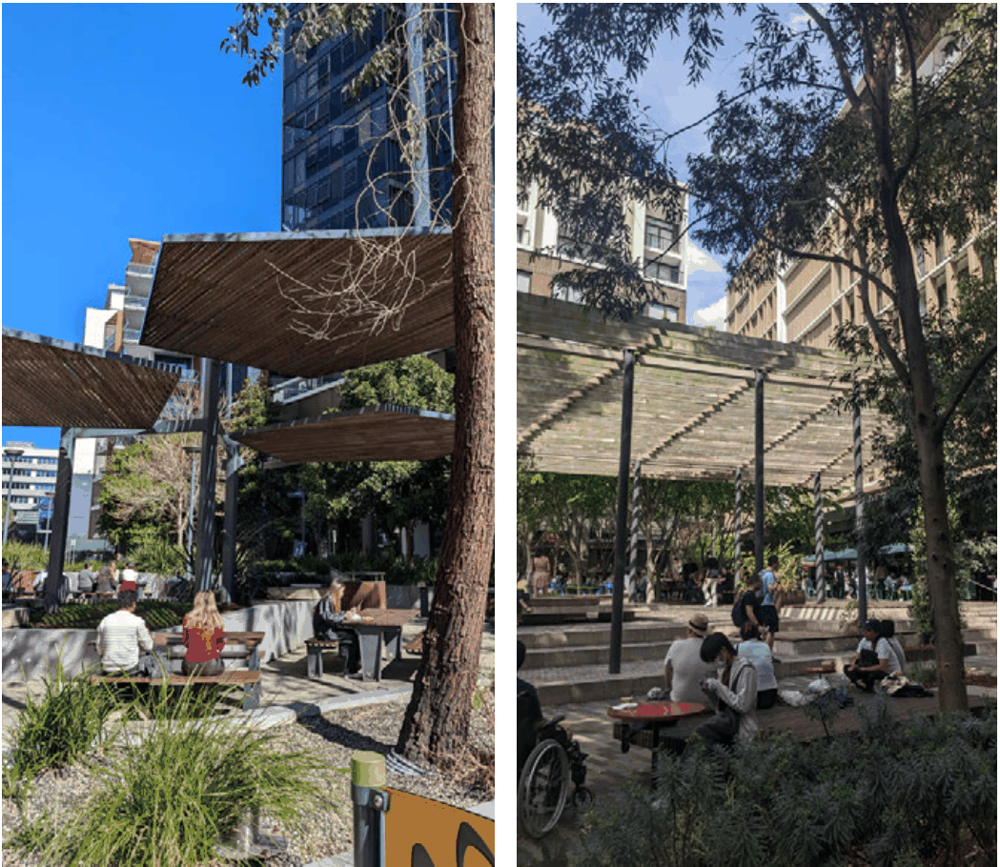
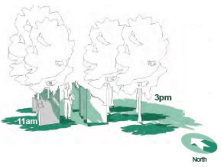
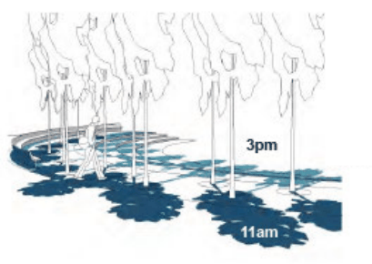
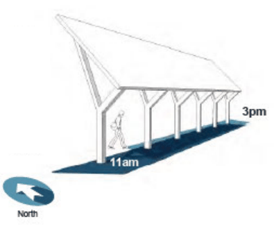
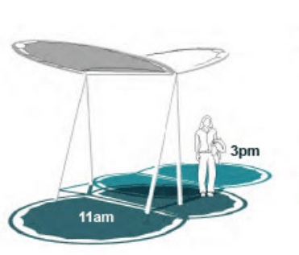

### 3.6	 Shade and the reduction

### of urban heat

Punchbowl and Wiley Park face a significant urban heat island effect due to climate change and low tree canopy cover. The combination of roads, infrastructure and buildings with limited greenery leads to increased heat absorption, raising summer temperatures to over 30.5 degrees Celsius, and even reaching 45.9 degrees in the past. Australia has one of the highest rates of skin cancer globally. Shade, provided by natural elements or structures, is essential for comfort, UV protection and to encouraging social activity. When combined with water features, permeable paving and appropriate materials, shade can effectively reduce heat

gain. Together, shade and seating while balancing solar access foster healthy, vibrant, attractive communities.

Image - Umbrellas and trees provide shading of playground at North Rosebery Park, Rosebery, NSW (Source: Architectus)

#### Objectives

O1. To ensure for refuge from hot summer sun in

public and publicly accessible open space.

O2. To create imaginative responses for shade

that integrate with playgrounds, water

features and areas for the community to

congregate in.

O3. To ensure for high amenity public and private

spaces that are pleasurable to use.

O4. To reduce the contribution of new

development to the urban heat island effect

by retaining and providing design elements

that store water, minimising impermeable

surfaces to increase rainwater infiltration

and allow for the improved cooling effects

of evaporation.

O5. To ensure the location of tree planting and

vegetation has considered the location

of where people sit and children play to

provide shade and reduce radiant heat.

O6. To improve user comfort in public domain

and space accessible to the public.

> [Picture on page 57: a picture, saved as a picture (images/ch-07-07-punchbowl-and-wiley-park-page-57-43.gif, 150 dpi).]

#### Principles

P1. Create shade linkages through implementing

shade structures, awnings to shop fronts and

planting trees.

P2. Integrate water features such as misting,

sprays and water fountains and the like

where shade is provided in public and

publicly accessible open space.

P3. Consider the location of trees and structures

and the resultant shadow that will be

created. Locate seating and areas where

people can rest in these shaded areas.

P4. Maximise greenery throughout the Precinct

to reduce urban heat.

P5. Shade paved surfaces and walls where

possible but also consider solar access in

winter months.

> [Picture on page 58: a picture, saved as a picture (images/ch-07-07-punchbowl-and-wiley-park-page-58-18.gif, 150 dpi).]

Dr Darragh Park, Mascot, NSW (Source: Architectus)

Darling Square, Haymarket, NSW (Source: Architectus)

#### Controls

C1. Retain existing trees to maintain shade. C2. Use deciduous trees in public open spaces to provide shade in summer and sun in winter.

C3. Improve cooling by locating trees to provide shade to exposed building walls, hard surfaces and pedestrian walkways.

C4. Use trees and shade structures in combination with water features to reduce temperatures in public open space and publicly accessible spaces.

C5. Store water in the landscape using fountains and water play features and the like.

C6. If a dark roof is used, green cover must cover the roof form. Consider reflectivity in the choice of roof material and the colour.

C7. Minimise the reflection of solar heat from facades by selecting appropriate materials.

C8. Ensure that play equipment is shaded to increase useability.

> [Picture on page 59: a picture, saved as a picture (images/ch-07-07-punchbowl-and-wiley-park-page-59-22.gif, 150 dpi).]

Incidental shade

> [Picture on page 59: a picture, saved as a picture (images/ch-07-07-punchbowl-and-wiley-park-page-59-24.gif, 150 dpi).]

> [Picture on page 59: a picture, saved as a picture (images/ch-07-07-punchbowl-and-wiley-park-page-59-25.gif, 150 dpi).]

Planting and water misting

> [Picture on page 59: a picture, saved as a picture (images/ch-07-07-punchbowl-and-wiley-park-page-59-27.gif, 150 dpi).]

Sheltered linkages

Incidental shade considering 3pm shade to seating

Figure 33. Design elements in the built environment to minimise urban heat
