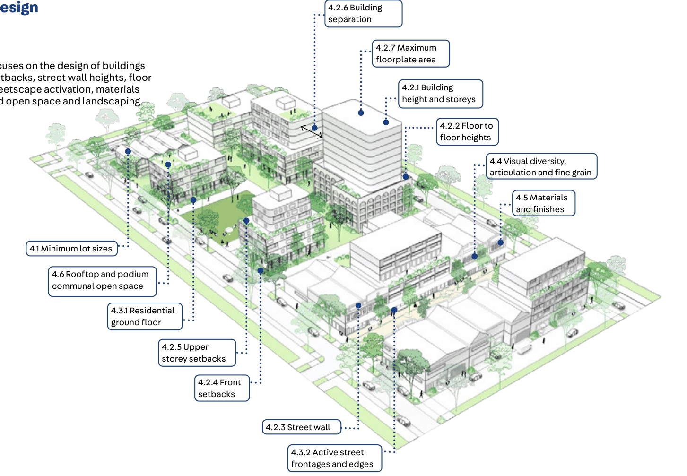

## Section 4 BUILDING DESIGN

| 4.1 | Minimum lot sizes | 62 |
|---|---|---|
| 4.2 | The building envelope | 63 |
| 4.3 | Building interface | 82 |
| 4.4 | Visual diversity, articulation and fine grain | 88 |
| 4.5 | Materials and finishes | 90 |
| 4.6 | Rooftop and podium communal open space | 92 |

### Building design

#### Overview

> [Picture on page 61: a map, saved as a picture (images/ch-07-07-punchbowl-and-wiley-park-page-61-3.gif, 150 dpi); the street names and other small labels are on the picture.]
> Words printed on the picture (title and legend, copied from the PDF):
> height and storeys
> 4.2.2 Floor to
> 4.4 Visual diversity,
> articulation and fine grain
> 4.1 Minimum lot sizes
> 4.6 Rooftop and podium
> communal open space
> 4.2.3 Street wall
> 4.3.2 Active street
> frontages and edges

This section focuses on the design of buildings and includes setbacks, street wall heights, floor plate areas, streetscape activation, materials and finishes and open space and landscaping.

Figure 32. Overview of building design controls in the Punchbowl and Wiley Park Precinct
