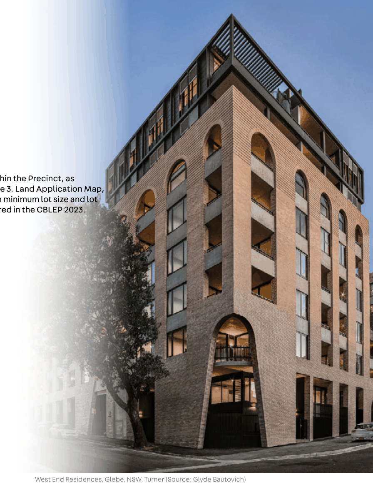

### 4.1 Minimum lot sizes

A minimum lot size for certain residential dwelling types is required to ensure lots are large enough to accommodate the development. This particularly applies to residential flat buildings to ensure that adequate frontage and amenity are provided.

#### Objectives

O1. Ensure lots are large enough to accommodate required setbacks and separation to adjoining properties, including ground floor outdoor uses such as private open space and landscaped areas, driveways, play areas, pedestrian access, set down and pick up areas, carparks and vehicle manoeuvring areas.

O2. Minimise adverse impacts of development on the amenity of the area.

O3. Require lot amalgamation to achieve minimum lot frontage and size requirements.

O4. Ensure lots are large enough to protect special attributes, including natural or cultural features, heritage items, heritage conservation areas, trees and natural topographical features.

O5. Prevent fragmentation or isolation of land.

#### Controls

> [Picture on page 62: a picture, saved as a picture (images/ch-07-07-punchbowl-and-wiley-park-page-62-27.gif, 150 dpi).]
> Words printed on the picture (title and legend, copied from the PDF):
> West End Residences, Glebe, NSW, Turner (Source: Glyde Bautovich)

C1. Development within the Precinct, as

identified in Figure 3. Land Application Map,

must comply with minimum lot size and lot

frontage as required in the CBLEP 2023.
