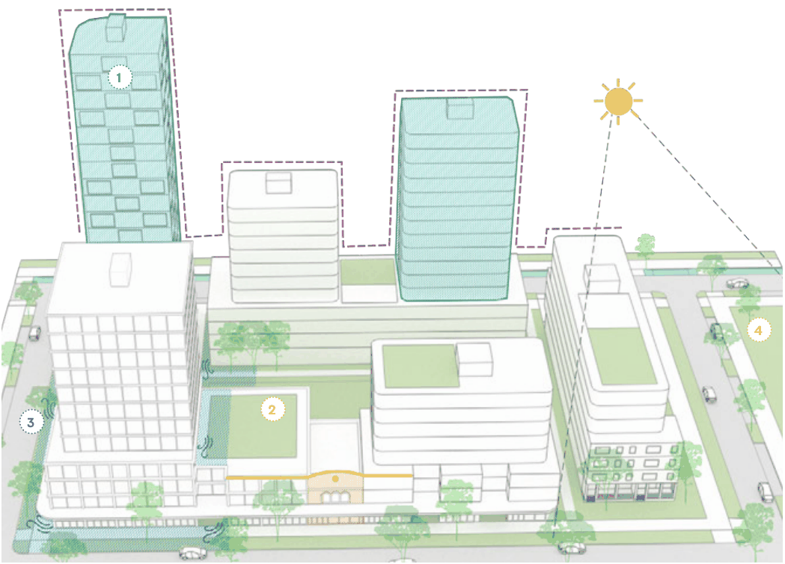
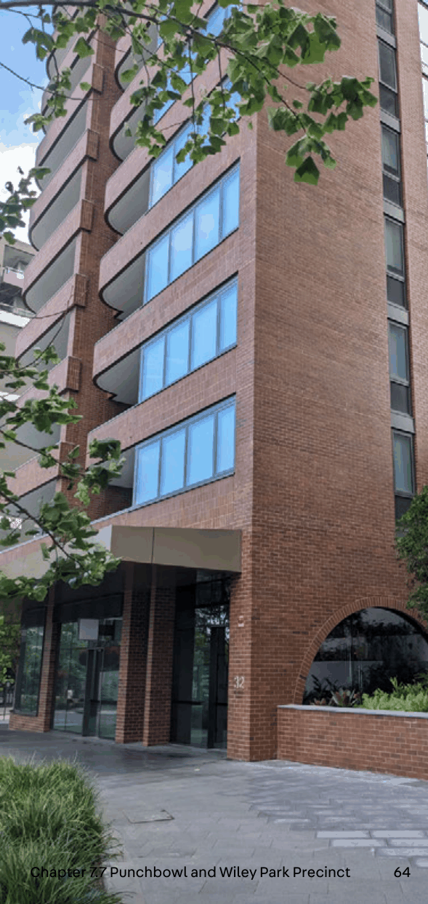
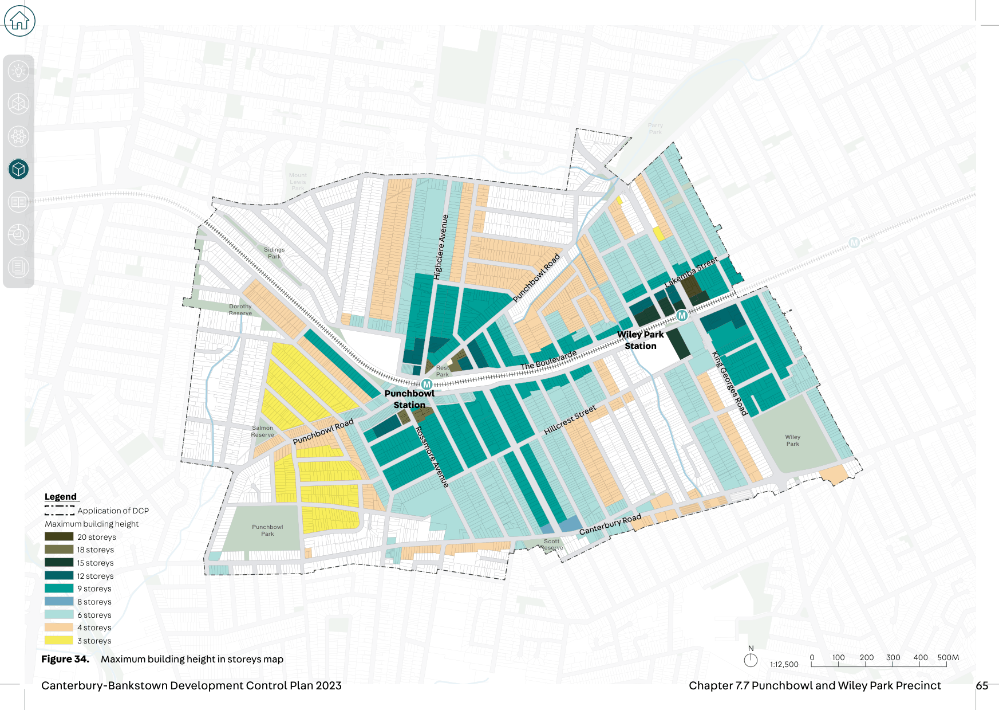

### 4.2	 The building envelope

#### 4.2.1 Building heights and storeys

The maximum building heights in the Precinct are stipulated in the CBLEP 2023. This section of the DCP provides further guidance on the bulk, scale and design of buildings, ensuring for careful consideration of impacts on streets, shared lanes, open space and pedestrian links.

#### Objectives

O1. To design taller buildings that allow for adequate provision of sunlight to streets and open space for pedestrian amenity and to allow trees to grow.

O2. To design a distinctive and legible skyline to identify the Village Centres and Metro stations.

O3. To ensure buildings are designed in consideration of wind impacts to the public domain.

O4. To design elegant slender towers that have consideration for view sharing.

O5. To ensure taller buildings express a strong architectural response defined by a clearly identified concept or idea to create a sense of place.

O6. To provide for landmark towers on prominent corners to improve the legibility of the Precinct.

> [Picture on page 63: a picture, saved as a picture (images/ch-07-07-punchbowl-and-wiley-park-page-63-29.gif, 150 dpi).]
> Words printed on the picture (title and legend, copied from the PDF):
> 1
> 4
> 2
> 3

#### 4

Slender,

#### elegant towers

well separated

#### 3

#### Solar access

#### and shade

for amenity and

plantings

#### 1

Height and

#### scale responds

to character and

context

#### 2

#### Minimise

#### wind impacts

for pedestrians

in the public

domain

Figure 33. Design guidance for the bulk, scale and design of tall buildings

#### Principles

P1. Concentrate taller buildings around the Metro stations and civic areas to maximise housing provision in well located areas.

P2. Ensure that towers over 4 or 5 storeys are setback above a podium to mitigate bulk and dominance of the street.

P3. Ensure the height and scale of new developments are site specific and developed in response to key features of the site and setting.

P4. Manage wind conditions promote outdoor planting, including green roofs, green cover and other landscaping elements as well as tables, chairs and other furniture used by building occupants on balconies and outdoor areas on buildings.

Image - Tall brick tower, Zetland, NSW, CO-AP (Source: Architectus)

#### Controls

C1. A wind impact assessment is required for:

a)	 Buildings over 25m in height.

b)	 Buildings without a podium on a corner sites.

C2. Buildings without a podium are permitted on

corner sites. In cases where a podium is not

proposed, the building is to:

a)	 Be designed to mitigate down drafts to the

public domain in accordance with a Wind

Impact Assessment report;

b)	 Be designed ‘in the round’ (i.e. consideration

of the design quality when being viewed

from within the Precinct, from the street

level, from within other buildings, from the

street and from a distance); and

c)	 Provide a high quality ground plane for

pedestrians at street level.

C3. Development must not exceed the number

of storeys shown for the site on Figure 34.

Maximum building height in storeys map.

> [Picture on page 64: a picture, saved as a picture (images/ch-07-07-punchbowl-and-wiley-park-page-64-40.gif, 150 dpi).]

> [Picture on page 65: a map, saved as a picture (images/ch-07-07-punchbowl-and-wiley-park-page-65-1.gif, 150 dpi); the street names and other small labels are on the picture.]
> Words printed on the picture (title and legend, copied from the PDF):
> Application of DCP
> Maximum building height
> Maximum building height in storeys map
> King Georges Road
> 0 100 200 300 500M

Figure 34.

Chapter 7.7 Punchbowl and Wiley Park Precinct 65
