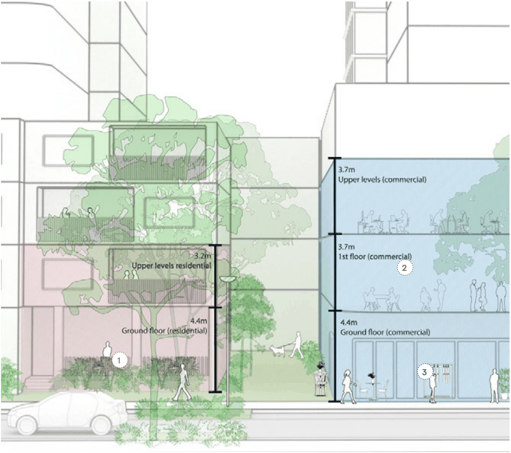
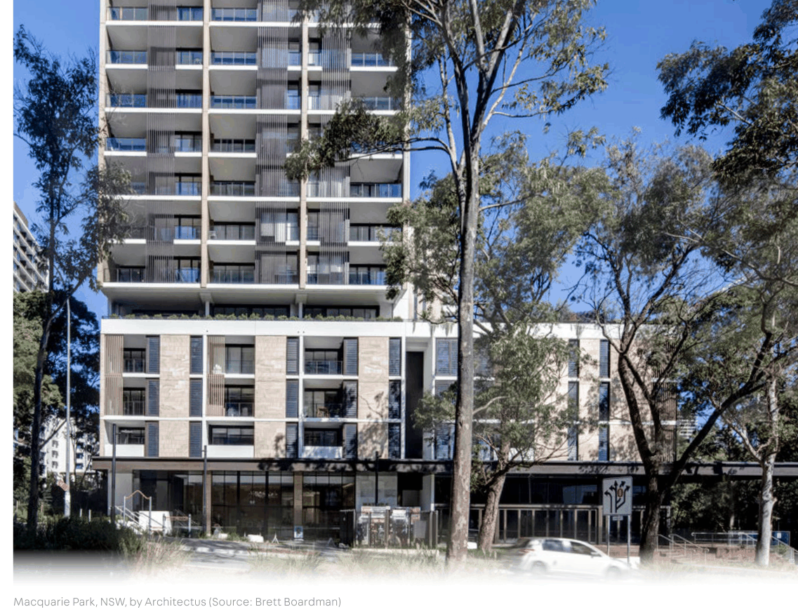

#### 4.2.2 Floor to floor height Objectives

O1. Ensure that floor to floor heights provide adequate amenity for building occupants, support a different range of uses and allow for flexibility of uses over time.

O2. To ensure the ground floor of buildings have a consistent floor to floor height to provide a well proportioned and quality interface to the public domain.

#### Principles

P1. Where the site has a single frontage, the entry to the basement for a HRV waste truck will require a higher clearance. This change in height should be integrated into the design to ensure for a quality facade.

> [Picture on page 66: a picture, saved as a picture (images/ch-07-07-punchbowl-and-wiley-park-page-66-17.gif, 150 dpi).]
> Words printed on the picture (title and legend, copied from the PDF):
> 1
> 2
> 3

#### 1

#### Provide amenity

for building occupants

Enable adaptivity and

#### flexibility for changing uses

#### 2

#### 3

#### Consistent ground floor

#### height along street frontages

Key design guidance for floor to floor heights to ensure amenity, flexibility and a consistent street wall

#### Figure 35.

#### Controls

C1. Development must comply with the minimum floor to floor heights shown in Table 3. This control does not apply to dwelling house, dual occupancy, semi-detached dwellings or multi-dwelling housing development.

C2. Waste truck entries should be located on secondary frontages, where possible.

C3. Where sites have a single frontage, the basement entry will require a 4.5m clearance. Dark materials and finishes should be used to recess and integrate the entry to the basement and any service cupboards.

> [Picture on page 67: a picture, saved as a picture (images/ch-07-07-punchbowl-and-wiley-park-page-67-16.gif, 150 dpi).]
> Words printed on the picture (title and legend, copied from the PDF):
> Macquarie Park, NSW, by Architectus (Source: Brett Boardman)

| Floor-to-floor-height (m) | Ground Floor | First Floor (Commercial) | Upper Levels | Lift Core (rooftop levels) |
|---|---|---|---|---|
| Residential | 4.4m | N/A | 3.2m | 3m |
| Commercial | 4.4m | 3.7m | 3.7m | 3m |
| Mixed Use Commercial / Residential | 4.4m | 3.7m | 3.3m | 3m |

Minimum floor-to-floor heights

#### Table 3.

Waste truck access  a Heavy Rigid Vehicle (HRV) requires a  4.5m clearance.
