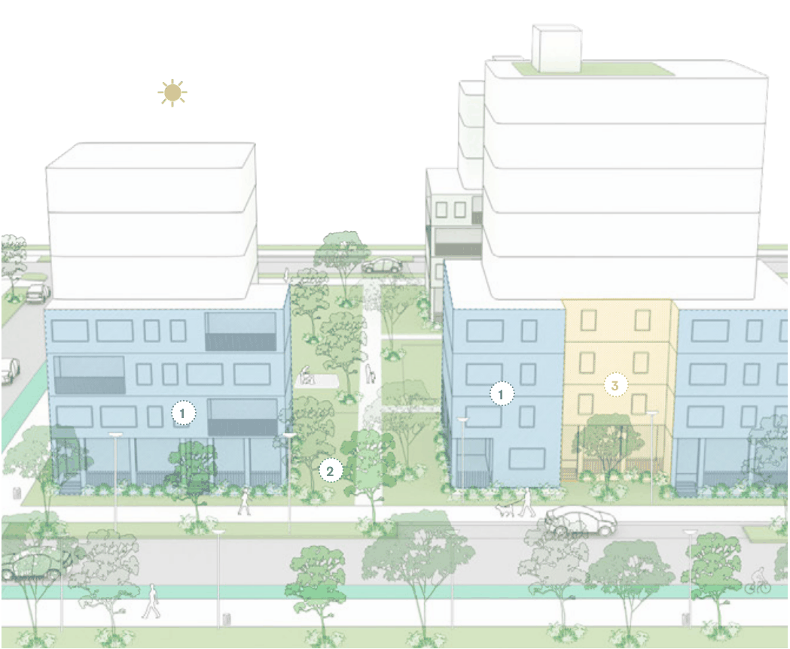

#### 4.2.3 Street wall

Together with the public domain, the street wall with active street frontage is the built element that shapes the way most of the city is experienced. The street wall provides spatial enclosure and must operate in concert with other street walls or podiums to form a satisfying and rich experience of the public spaces of the city or place for the community. Interruptions or erosions of the street wall generally work to undermine the vitality and definition of the street wall and are not favoured.

#### Objectives

O1. To ensure that the visual relationship between the street and public space is reinforced.

O2. To design the street wall to achieve fine grain modulation to create visual interest and variety while ensuring for consistency in streetscape character.

O3. To create a vertical rhythm and visual interest to reduce the scale of building mass.

O4. To implement an articulation zone within podiums and facades to allow architectural form to develop.

> [Picture on page 68: a picture, saved as a picture (images/ch-07-07-punchbowl-and-wiley-park-page-68-25.gif, 150 dpi).]
> Words printed on the picture (title and legend, copied from the PDF):
> 1
> 1
> 2
> 3
