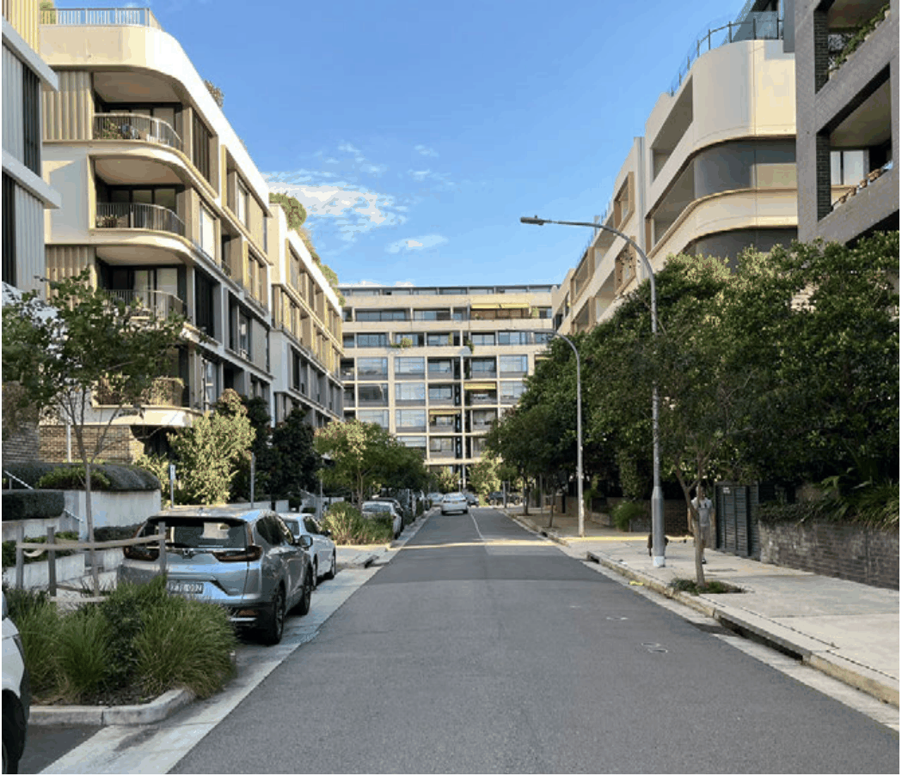
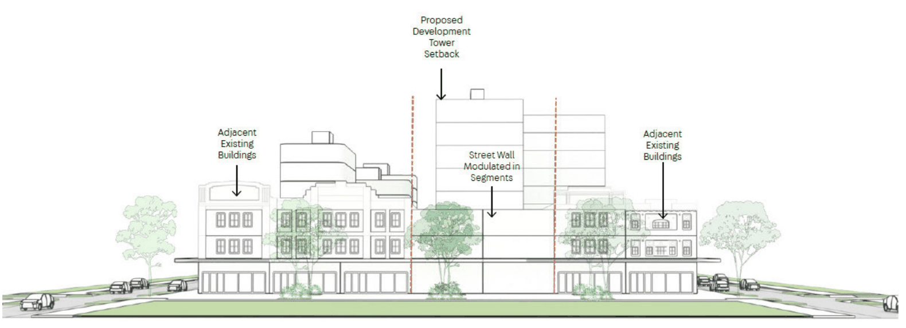

#### 1 Appropriate scale,

#### detail and character

that responds to its context

#### 2

#### Define the space

and interface with

the street and public

spaces

#### 3

#### Provide an articulation

#### zone modulation and ver-

tical rhythm

Key design guidance for a four storey residential street wall that defines the street edge

#### Figure 4.

#### Principles

P1. Street wall design should reflect the context and interface with a particular street typology as set out in Section 3.

P2. Design the street wall to provide an appropriate human scale, material quality and detail.

P3. Minimise large expanses of inactive frontage.

P4. Retain and sensitively integrate existing heritage and historic pre 1950 shopfronts into new development.

#### Controls

C1. Street wall heights must be consistent with Figure 38. For Council to consider a variation to a street wall height it must be demonstrated by the following:

a)	 A street wall elevation at 1:500 scale in context showing existing buildings on the same block with consideration given to the proposed heights; and

b)	 A detailed street wall elevation at 1:200 scale that includes the buildings immediately adjacent.

> [Picture on page 69: a picture, saved as a picture (images/ch-07-07-punchbowl-and-wiley-park-page-69-25.gif, 150 dpi).]

A consistent  street wall appropriate for medium density residential context, Erskineville, NSW  (Source: Architectus)

> [Picture on page 70: a picture, saved as a picture (images/ch-07-07-punchbowl-and-wiley-park-page-70-1.gif, 150 dpi).]

Elevation showing how new development is seamlessly integrated into the existing street wall

#### Figure 5.

C2. Where a street frontage length of an individual building exceeds 45m in length, it is to appear broken into two or more buildings each with different architectural characters. This outcome could be achieved through the following articulation design considerations or through other alternative design considerations to the reasonable satisfaction of Council:

a)	 Vertical elements must be separated by indentations at a scale legible in the street and use a varied architectural expression and materiality.

b)	 In cases where there is a range of heights in a street wall, prioritise the lower range along laneways, pedestrian links, and areas with high pedestrian activity.

C3. Existing pre-1950 historic shopfront street walls in civic streets are to be sensitively integrated into new development.

C4. Where the adjacent built form context is of a lower scale and not anticipated to change, development must provide a transition to the lower scaled built form and include appropriate articulation to fit with the context.

C5. For sites including or adjacent to heritage items, development must transition in scale and height and provide adequate separation and appropriate articulation to respect the established scale of the heritage item or context.

C6. Datums derived from listed heritage buildings on the site or on an adjoining property — that is, the heights of the main ridgelines (or parapets in the case of commercial buildings), top plates/eaves level (or awnings of commercial buildings) and ground floor levels (street or natural ground levels)—must be used to ensure composition of height and scale is visually harmonious.

#### Legend

Application of DCP 3 storeys

4 storeys

5 storeys

Figure 6. Street wall height map

Highclere Avenue

#### Punchbowl

#### Station

Punchbowl Road

Rossmore Avenue

Punchbowl Road

de

evar

oul

e B

Th

Hillcrest Street

Canterbury Road

Lakemba Street

#### Wiley Park

#### Station

King Georges Road

1:12,500

0 100

N

200 300 500M

Chapter 7.7 Punchbowl and Wiley Park Precinct 71
