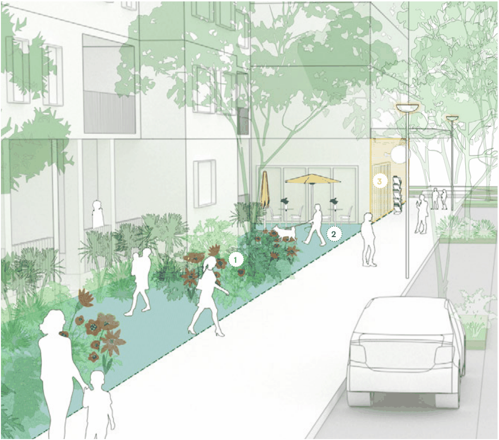

#### 4.2.4 Front setbacks Objectives

O1. To define streets, public spaces and key elements that include heritage and landscape features.

O2. To allow flexibility in setbacks where appropriate, minimising impacts on surrounding properties and the public domain.

O3. To enable sensory engagement with the street.

O4. To encourage setbacks that reinforce the desired future character of the area.

O5. To utilise front setbacks to provide privacy and amenity.

O6. To create lively destinations in the Precinct that caters for the growth in population and provides space for outdoor trading and dining, lingering, and increased tree canopy.

> [Picture on page 72: a picture, saved as a picture (images/ch-07-07-punchbowl-and-wiley-park-page-72-20.gif, 150 dpi).]
> Words printed on the picture (title and legend, copied from the PDF):
> 1
> 3
> 2

#### Landscape setbacks

for plantings and visual

privacy in residential areas

#### 1
