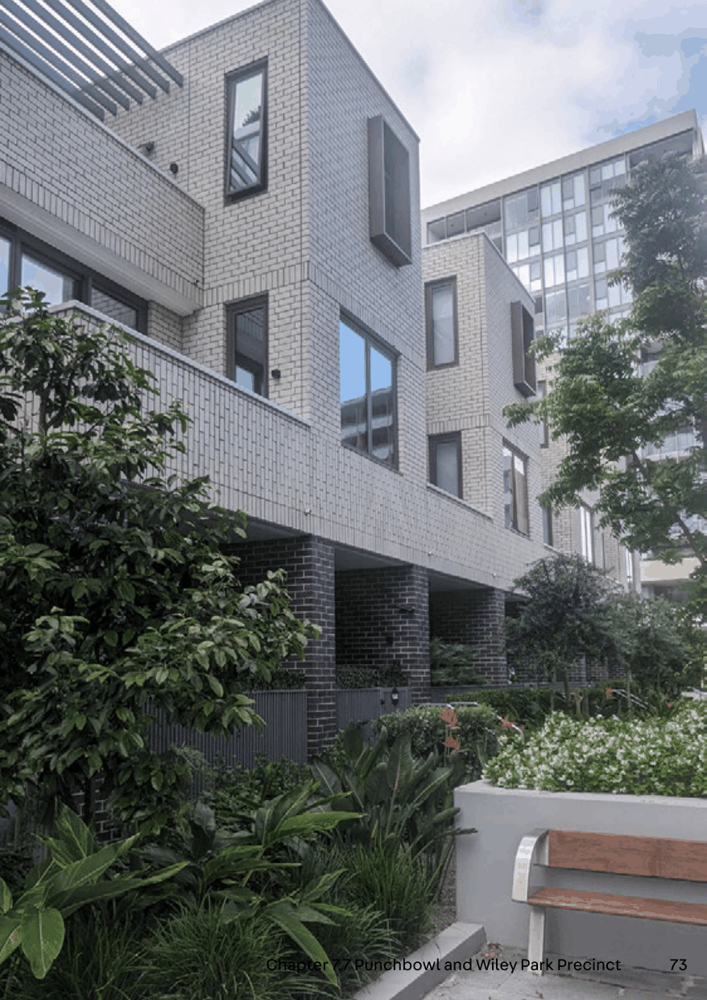

#### 3 Urban street edge with

active frontages in Village

Centres

Key design guidance for ground level setbacks to provide amenity, contribute to deep soil and planting, provide

#### Figure 7.

activation and respond to context.

#### Principles

P1. Reinforce the Punchbowl and Wiley Park Village Centres by creating a defined urban street edge.

P2. To allow flexibility in response to context only where amenity and environmental impacts are minimal.

#### Controls

C1. Front setbacks are to be consistent with Figure 40.

C2. For land with no mapped front setbacks, the following controls apply:

a)	 For land designated in Area 1 (low-rise living character area), front, side and rear setbacks are to be provided in accordance with Chapter 5 Residential Accommodation of CBDCP 2023.

Image - Garden apartments with landscaping in setback, Fuse Street, Zetland (Source: Architectus)

> [Picture on page 73: a picture, saved as a picture (images/ch-07-07-punchbowl-and-wiley-park-page-73-20.gif, 150 dpi).]

#### LEGEND

Application of DCP 0m

3m

5m

6m

1 Area 1 - refer to Chapter 5

Residential Accommodation CBDCP 2023

Figure 8. Front setbacks map

Highclere Avenue

#### Punchbowl

#### Station

Punchbowl Road

Rossmore Avenue

Punchbowl Road

de

evar

oul

e B

Th

Hillcrest Street

Canterbury Road

Lakemba Street

#### Wiley Park

#### Station

King Georges Road

1:12,500

0 100

N

200 300 500M

Chapter 7.7 Punchbowl and Wiley Park Precinct 74
