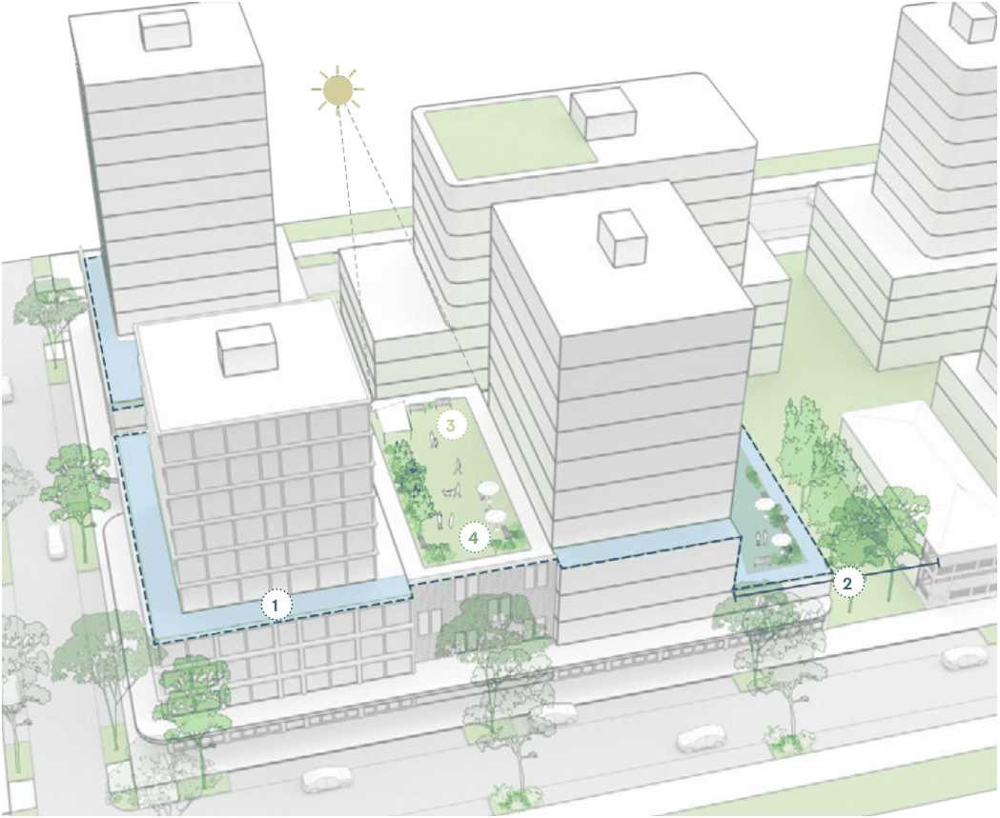
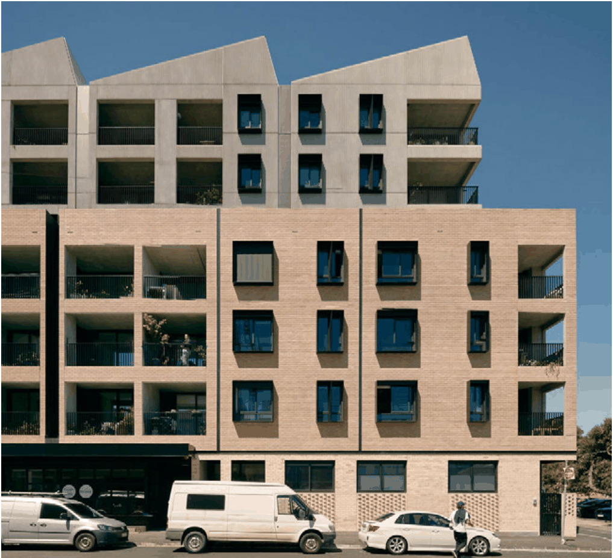

#### 4.2.5 Upper storey setbacks Objectives

O1. To ensure buildings are setback above street walls to reinforce the scale of streets, mitigate wind down drafts to pedestrians and dominance of the public domain.

O2. To ensure that upper storey setbacks allow for the enjoyment of sun and daylight within public spaces, provide for views of the sky and allow trees to grow.

O3. To provide for appropriate transition and sympathetic response to lower-scaled buildings and significant elements within the local context.

O4. To create opportunities for tree canopy, planting and outdoor open space on podiums.

#### Principles

P1. Clearly delineate the street wall by using upper storey setbacks and create a visual break in tall building facades.

P2. Encourage green cover and useable spaces on podiums and rooftops.

P3. Promote generous commercial, communal and residential balconies on upper storey setbacks.

P4. The taller portion of the building is setback above a podium to ensure the bulk and scale is sympathetic to existing and future development and to streets. This mitigates dominance to pedestrians at street level.

> [Picture on page 75: a picture, saved as a picture (images/ch-07-07-punchbowl-and-wiley-park-page-75-32.gif, 150 dpi).]
> Words printed on the picture (title and legend, copied from the PDF):
> 3
> 4
> 1
> 2

#### 1

#### Towers setback

above podiums

provide a lower scale

to streets

#### 2

#### Maximise sun light

and views to the sky

#### 3

#### Provide

transition in

built form to

respect context

#### 4

#### Activate podiums

for outdoor open space and plantings

Key design guidance for setbacks above street walls to reduce bulk and scale to streets, provide appropriate

#### Figure 9.

height transitions, ensure for amenity and allow for podium outdoor activation.

#### Controls

C1. Upper storey setbacks are to be consistent with Figure 42.

C2. Building envelopes may require a deeper upper storey setback to protect sunlight and limit shadowing of neighbouring streets, properties, parks, and open space. A deeper upper storey setback may also be required for heritage items to ensure heritage significance is not compromised.

C3. Where there is no upper storey setback shown on the map, the upper storey setback of existing development immediately adjoining the site should be adopted. Where there is insufficient existing development adjoining the site, the applicant is to demonstrate why the proposed setback is appropriate by giving consideration to the Principles and Objectives.

> [Picture on page 76: a picture, saved as a picture (images/ch-07-07-punchbowl-and-wiley-park-page-76-20.gif, 150 dpi).]

A four storey street wall with upper storey setbacks provides a reduced building scale appropriate for the street and local context, Breese Street, Brunswick, VIC, by Breathe Architects (Source: Tom Ross)

#### LEGEND

Application of DCP

3m

5m

Figure 10. Upper storey setbacks map

Highclere Avenue

#### Punchbowl

#### Station

Punchbowl Road

Rossmore Avenue

Punchbowl Road

de

evar

oul

e B

Th

Hillcrest Street

Canterbury Road

Lakemba Street

#### Wiley Park

#### Station

King Georges Road

1:12,500

0 100

N

200 300 500M

Chapter 7.7 Punchbowl and Wiley Park Precinct 77
