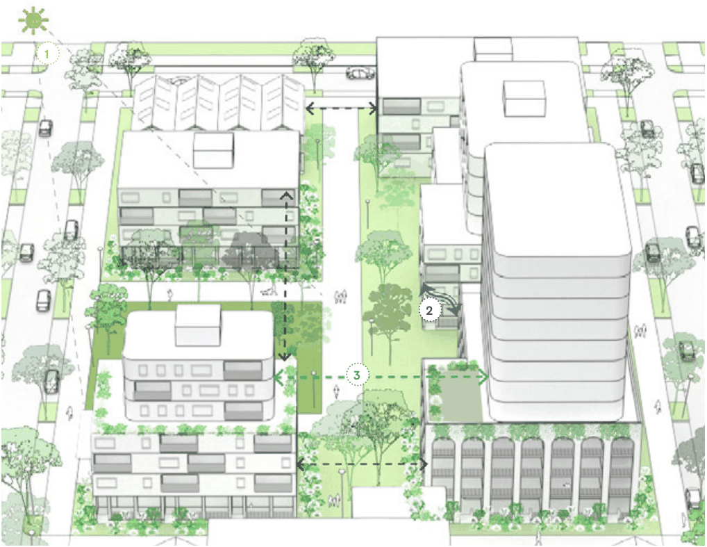

#### 4.2.6 Building separation Objectives

O1. To ensure sunlight penetrates through to street level to protect the amenity of pedestrians and allow street trees to grow.

O2. To ensure that taller buildings are not overwhelming and overcrowded and appear as distinct elements within the skyline with space around them.

O3. To provide adequate privacy, access to light, air and outlook to the sky for the occupants of buildings, neighbouring properties and future buildings.

O4. To ensure development does not unfairly limit the re-development potential of adjoining sites in the future.

#### Principles

P1. Building design should avoid using multiple upper-level setback ‘steps’ that result in a ‘wedding cake’ or a ‘ziggurat’ appearance.

P2. Maintain adequate separation distances between buildings on the same site to protect access to sunlight and sky views and improve air circulation between buildings.

P3. Provide separation to enable a building to be seen from all sides and to allow for articulation that responds to orientation.

> [Picture on page 78: a picture, saved as a picture (images/ch-07-07-punchbowl-and-wiley-park-page-78-28.gif, 150 dpi).]
> Words printed on the picture (title and legend, copied from the PDF):
> 1
> 2
> 3

Ensure sunlight for

amenity and plantings

#### 1
