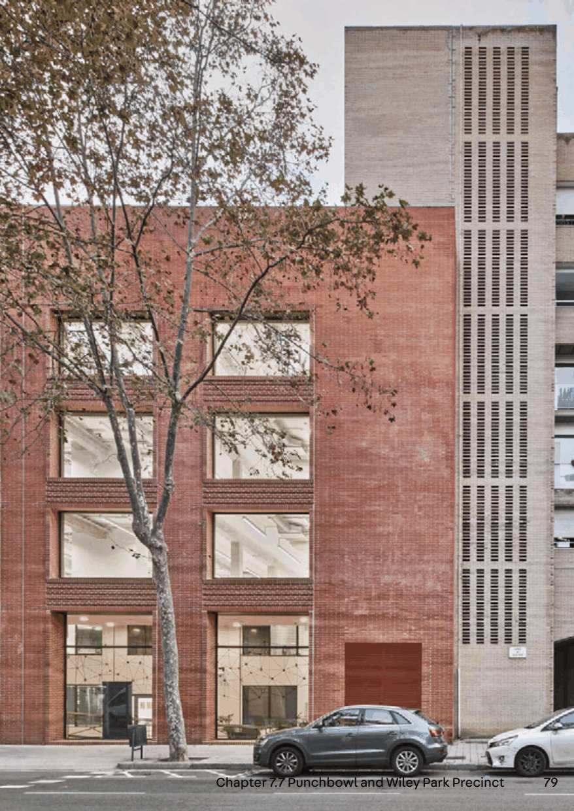

#### 2 Views and privacy

as well as air flow

#### 3

#### Appropriate upper storey

#### setbacks to provide desired

building separations

Key design guidance for building separation to ensure amenity, visual privacy, views, air circulation and sunlight

#### Figure 11.

#### Controls

C1. Minimum building separation distances for non-residential uses are outlined in Table 4.

| Storeys | Up | 5-8 | 9+ |
|---|---|---|---|
| to | 4 storeys | storeys | storeys |
| Non- residential uses | 3m | 6m | 9m (or 12m for tall buildings of 25m or more) |
| Commercial developments adjoining single purpose residential uses* | 6m | 9m | 12m |

\* Notes: ⚬ In  high streets where there are blank party walls, no separation is

required. ⚬ Commercial developments include business premises, childcare

centres, educational establishments and places of worship. Single

purpose residential uses include residential flat buildings, boarding

houses, multi-dwelling housing and single dwelling houses. ⚬ For residential apartment development, please refer to the

Apartment Design Guide (ADG)

Table 12. Minimum building separation for non-residential uses

Image - Joan Miro Office Building, Barcelona, Spain (Source: Jose Hevia)

> [Picture on page 79: a picture, saved as a picture (images/ch-07-07-punchbowl-and-wiley-park-page-79-17.gif, 150 dpi).]
