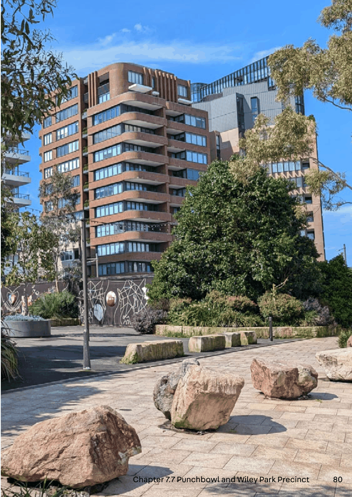
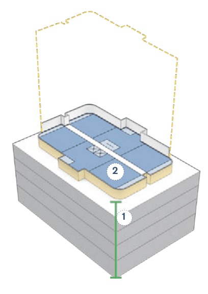

#### 4.2.7 Maximum floorplate area Objectives

O1. To ensure towers are not bulky, provide good amenity to building occupants and appear slender, elegant and well-proportioned when view from streets and from distance.

O2. To allow for views to the sky from streets and lanes.

O3. To reduce building bulk and minimise its impact on streets, public spaces, and street trees by mitigating adverse effects such as overshadowing and urban heat gain.

O4. To ensure floor plates are limited to a certain area and configuration in accordance with use.

#### Principles

P1. Shallow floorplates and glazing to southern facades are favourable for providing excellent natural daylight.

P2. Achieve living and working environments with good internal amenity and minimise the need for artificial cooling and heating.

Image - Slender tower, Zetland, NSW, CO-AP (Source: Architectus)

> [Picture on page 80: a picture, saved as a picture (images/ch-07-07-punchbowl-and-wiley-park-page-80-25.gif, 150 dpi).]

#### Controls

C1. The maximum floor plate area for any levels 25m above ground level must be:

a)	 800m² GFA for residential flat buildings, residential accommodation within shop top housing, serviced apartments and self-contained hotels.

b)	 1,500m² GFA for non-residential.

c)	 Any exceedance of the above maximum floor plates in (a) or (b) would be required to consider the following as applicable: ⚬ The objectives of this clause; ⚬ A specific or specilised tenant need or use;

⚬ Appropriate articulation and building modulation to break down the perceived bulk;

⚬ Maximum number of apartments per floor under the Apartment Design Guide; ⚬ Not detrimentally impacting on the required sunlight access of key public spaces if this chapter of the DCP; and ⚬ Best practice design outcomes.

> [Picture on page 81: a picture, saved as a picture (images/ch-07-07-punchbowl-and-wiley-park-page-81-24.gif, 150 dpi).]
> Words printed on the picture (title and legend, copied from the PDF):
> 2
> 1
