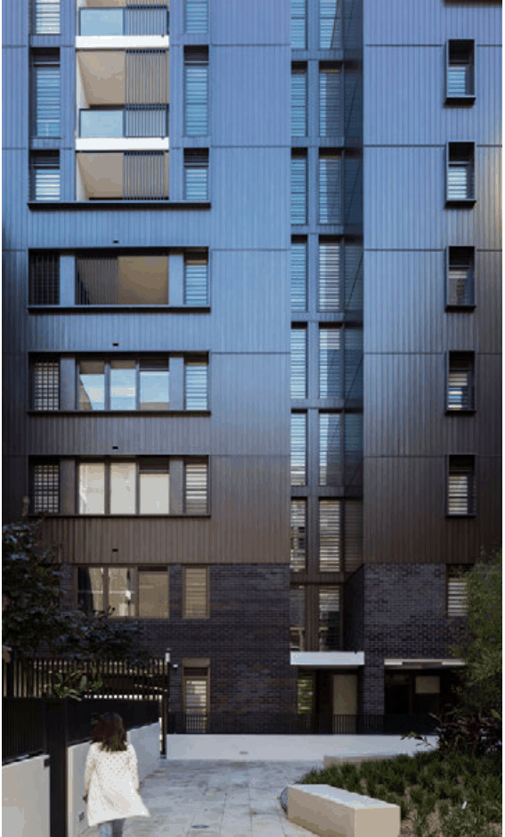

#### 2 Slender towers

for residential buildings with a

maximum of 800m² of GFA

Figure 13. Floorplate controls for towers seek to

ensure good functionality, circulation, amenity, solar

access and maximise views to the sky.

> [Picture on page 81: a picture, saved as a picture (images/ch-07-07-punchbowl-and-wiley-park-page-81-33.gif, 150 dpi).]

New life, Darling Harbour, Ultimo, NSW by Architectus (Source: Architectus)
