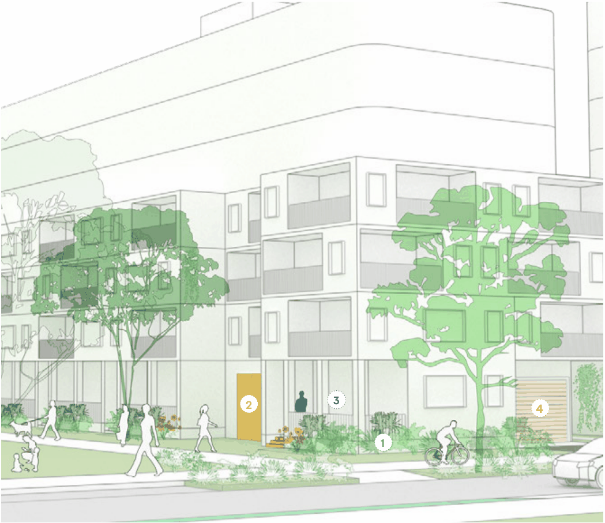
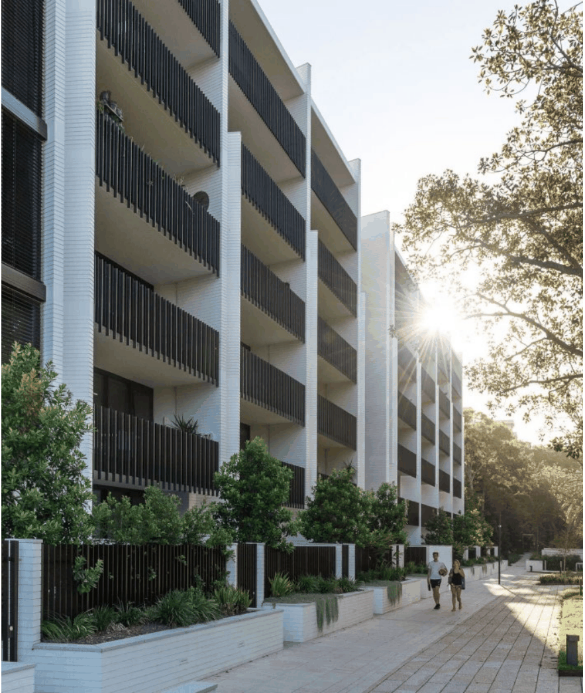

### 4.3	 Building interface

#### 4.3.1 Residential ground floor Objectives

O1. To establish new canopy trees within setbacks that contribute to the character of the street and provide residents amenity and privacy.

O2. To provide ownership and identity to residents by providing individual entries along the ground floor frontage out to the public domain.

O3. To provide for surveillance of public and publicly accessible space.

O4. To encourage detailed attention to the design and to selection of materials at the lower level of residential buildings.

#### Principles

P1. Provide individual courtyards to ground floor apartments.

P2. Existing and proposed tree canopy should be contained within front setbacks to provide residents amenity and privacy and to offer greenery to the public domain.

> [Picture on page 82: a picture, saved as a picture (images/ch-07-07-punchbowl-and-wiley-park-page-82-24.gif, 150 dpi).]
> Words printed on the picture (title and legend, copied from the PDF):
> 2
> 3
> 1
> 4

#### 1

Deep soil and

vegetation for

tree canopy and

landscape buffers

#### 2

#### Ground entrances

have direct access to

public space

#### 3

#### Ground level

#### apartments

provide passive

surveillance

#### 4

Servicing and

basement access

screened and inset

behind setbacks

Key design guidance for the residential ground floor frontage to provide amenity, landscaping, visual privacy,

#### Figure 14.

passive surveillance and access

#### Controls

C1. A minimum of 3 metres depth of deep soil shall be allocated from the front boundary. Canopy trees must be planted in this area 2 metres away from the front building line to achieve at least 8 metres mature height and spread, at the rate of 1 canopy tree for every 8 lineal metres of frontage. The number of trees to be planted will be rounded up to the next whole number.

C2. The first tree will be planted at the intersection of the front and side boundary. The medium to large sized trees will be spaced and planted from this origin point.

C3. All ground floor apartments shall have individual entries and individual courtyard for private open space.

> [Picture on page 83: a picture, saved as a picture (images/ch-07-07-punchbowl-and-wiley-park-page-83-18.gif, 150 dpi).]

Apartments with landscaped front setback. The Moreton, Bondi, NSW, smart design studio (Source: Ross Honeysett)
