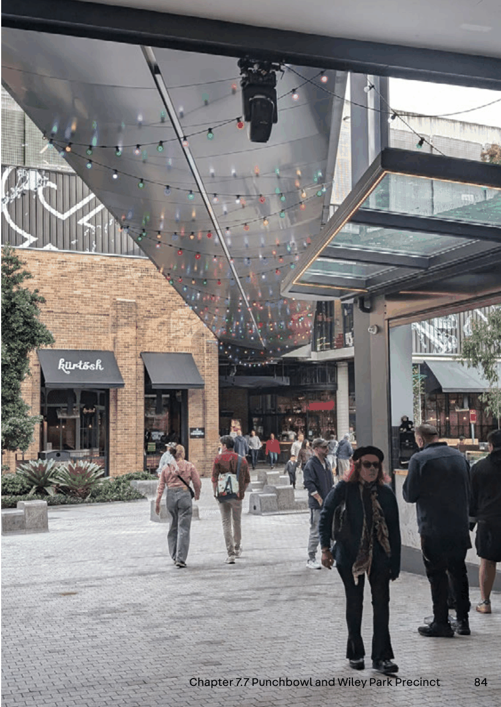
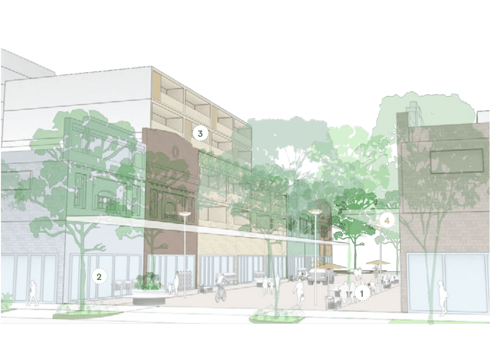
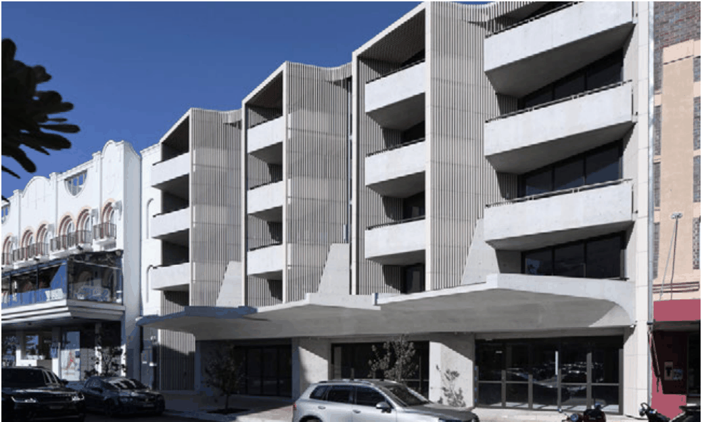

#### 4.3.2 Active street frontages and edges

Active street frontages are continuous  retail and business uses with frequent openings that engage with the street and public space, creating a lively, welcoming environment that encourages pedestrian activity.  To create a human and scale,' active street frontages should feature a fine grain of narrow shopfronts with services and utilities positioned away from the primary frontage. Active edges are incidental active uses along a frontage. While secondary to active street frontages, they contribute positively to the public domain. For example, Canterbury Road would primarily includes business uses that will have less foot traffic but still provide occasional active use to service workers and pedestrians along this street. In residential areas, an active edge could include a café or corner shop, on a lane, pedestrian link or open space, with the remainder of the ground floor frontage being garden apartments with individual entries. Active uses typically include retail, customer service areas, cafes, restaurants and outdoor dining areas. To enhance the pedestrian comfort and encourage street life, active street frontages must incorporate continuous awnings. Awnings should also be provided along active edges, where possible, although they do not need to extend along the entire length of the frontage.

Image - Active frontages along sharedway at Marrickville Metro, Marrickville, NSW (Source: Architectus)

> [Picture on page 84: a picture, saved as a picture (images/ch-07-07-punchbowl-and-wiley-park-page-84-33.gif, 150 dpi).]

#### Objectives

O1. To encourage finer grained narrow frontages with a high standard of design to create varied experiences that provide views into and out of shops.

O2. To ensure that Punchbowl Road, The Boulevarde and Lakemba Street have a high quality and engaging public realm.

O3. To ensure that the interface and amenity of Canterbury Road is improved for pedestrians.

O4. To ensure frontages along key streets, pedestrian links, lanes and open spaces provide both active and passive surveillance.

O5. To encourage people to linger and enjoy public space.

O6. To ensure that building services do not dominate the pedestrian experience and are designed as an integrated part of the building form.

O7. To create opportunities to enjoy the positive aspects of climate and shield people from the negative such as wind, rain and heat.

O8. To provide secondary active edges that create vitality and interest on frontages with less foot traffic.

> [Picture on page 85: a picture, saved as a picture (images/ch-07-07-punchbowl-and-wiley-park-page-85-28.gif, 150 dpi).]
> Words printed on the picture (title and legend, copied from the PDF):
> 2
> 3
> 1
> 4

#### Active uses

glazed shop fronts with openings, outdoor dining  and market stalls

#### 1

#### Fine grain for visual

interest, human scale and varied experiences

#### 3

#### 2

Design guidance for active frontages along key streets

#### Figure 15.

#### Active and passive

#### surveillance provides

'eyes on the street'

#### 4

#### Continuous

#### awnings

for shelter and protection

Chapter 7.7 Punchbowl and Wiley Park Precinct 85

#### Principles

P1. Vehicle entries are located away from key pedestrian areas.

P2. Awnings are to be used along active street frontages and edges to provide comfort and amenity.

P3. Shopfronts utilise lighting in the evenings when people are using public space for safety and activation.

#### Controls

C1. The location of active street frontages and active edges are shown on Figure 47.

C2. Vehicle access and loading is to be located away from primary pedestrian areas.

C3. Extend the concrete structural frame to form the awning at street level to shield pedestrians on active street frontages.

C4. Awnings are to be provided to active street frontages and extend 3m over the footway to provide protection from inclement weather and hot sun. Awnings must:

a)	 Integrate with the built form;

b)	 Not be double height;

c)	 Be non-reflective and not glazed; and

d)	 Be harmonious with adjacent awnings and gutters and integrate downpipes and lighting.

C5. Awning should be provided to active edges where ever possible.

> [Picture on page 86: a picture, saved as a picture (images/ch-07-07-punchbowl-and-wiley-park-page-86-30.gif, 150 dpi).]

Examples of awning design as an extension of the buildings structure, smart design studio (Source: Romello Pereia)

| Minimum active street frontage required for each frontage facing the public domain | 60% of the width of each public domain frontage. |
|---|---|
| Active uses facing the public domain | Entries or display windows to shops and/or food and drink premises or other uses, customer service areas and activities which provide pedestrian interest and interaction. |
| Minimum 'grain' of shop front | 10 tenancy entries per 100m. |
| tenancies | Where a single or larger tenancy is proposed with a single entrance, the facade must give the appearance of being visually broken up into finer grain tenancies and allow for separate tenancy entrances in the future. |
| Provision of awnings | Awnings are to be provided to all active street frontages. |

Table 16. Active street frontage design guidance

#### Legend

Application of DCP

Active street frontage

Active edge

Key site to include active

edges, subject to detail design

- See Section 6 Key sites

Figure 17. Active street frontages and edges map

Highclere Avenue

#### Punchbowl

#### Station

Punchbowl Road

Rossmore Avenue

Punchbowl Road

de

evar

oul

e B

Th

Hillcrest Street

Canterbury Road

Lakemba Street

#### Wiley Park

#### Station

King Georges Road

1:12,500

0 100

N

200 300 500M

Chapter 7.7 Punchbowl and Wiley Park Precinct 87
