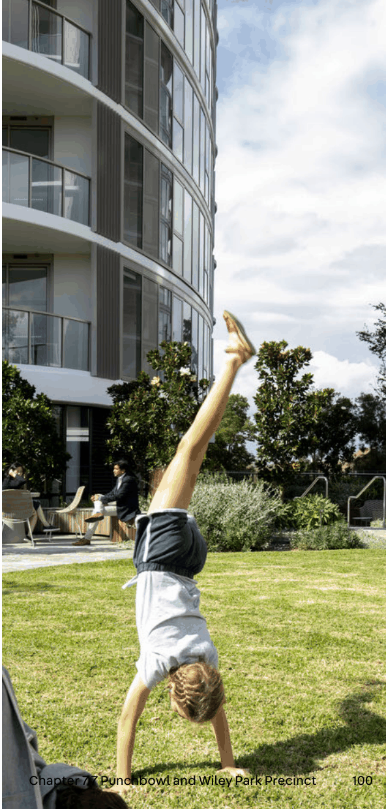

### 5.4	 Sustainability

#### 5.4.1 Urban cooling and

### environmental sustainability

#### Overview

Urban heat or the Urban heat Island effect refers to the higher temperatures experienced in urban areas compared to rural or natural areas. As more development occurs, the build-up of heat in the environment occurs through heat being trapped in streets, increased hard surfaces, reduced vegetation and heat from air conditioning units.

#### Objectives

O1. To reduce the contribution of development to urban heat.

O2. To improve comfort for residents, workers and visitors in the local urban environment.

O3. To improve the passive comfort of dwellings and reduce the reliance on mechanical systems for amenity.

O4. To reduce the greenhouse gas emission release to the atmosphere through leakage, or improper disposal, of synthetic refrigerant gases with high Global Warming Potential (GWP).

Image - The Langston Sydney, NSW, by Architectus (Source: Brett Broadman)

#### Controls

C1. Glazing in the external facade of an enclosed

balcony or wintergarden must have a solar

absorption of less than 10%.

C2. Solar absorption of glazing must be marked

on plans, and verified through inclusion of

window specifications with DA.

C3. All new air conditioning and refrigeration

equipment are to use refrigerants with a

GWP of less than 10 if the equipment can be

supplied on similar terms to conventional

systems. Confirmation prior to the release of

the construction certificate is required.

C4. Solid fuel heating and cooking systems are

not permitted in any development.

C5. Gas cooktops, gas ovens or gas internal

space heating systems are not permitted

in any residential development. Instead,

electric systems must be installed and

clearly marked on development application

plans.

C6. Basement carparks must be contained

within building footprints and allow for deep

soil beneath forecourts and courtyards for

large canopy tree planting.

The compliance of a Development Application with

the controls in 5.4 is to be shown on the drawings

and plans submitted with the Development

Application and included in the Statement of

Environmental Effects.

> [Picture on page 100: a picture, saved as a picture (images/ch-07-07-punchbowl-and-wiley-park-page-100-57.gif, 150 dpi).]
