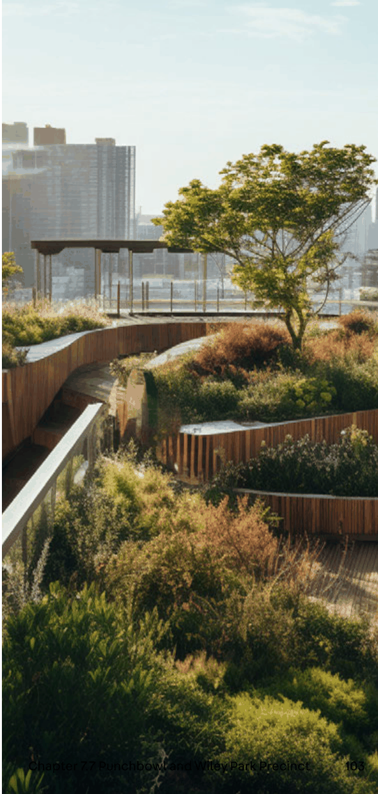

#### 5.4.2 Reduction of the Urban Heat

### Island Effect

#### Objectives

O1. To minimise the reflection of solar heat downward from the building façade into private open space or the public domain.

O2. To reduce the contribution of development to urban heat and to improve user comfort in the local urban environment.

O3. To avoid or minimise the impact of heat rejection from air conditioning and refrigeration systems on the urban heat island effect and user comfort in private open space and the public domain.

The compliance of a Development Application with the controls in 5.4 is to be shown on the drawings and plans submitted with the Development Application and included in the Statement of Environmental Effects.

#### Controls

C1. The extent of the vertical façade of street walls (or if no street wall, as measured from the first 12 metres from the ground plane) that comprise Reflective Surfaces must demonstrate a minimum percentage of shading as defined in Table 7 as calculated at the relevant time of year in Table 9 and Table 10.

C2. The extent of the vertical façade of the tower (above the street wall or if no street wall, as measured above the first 12 metres from the ground plane) that comprise Reflective Surfaces must demonstrate a minimum percentage of shading as defined in Table 8 as calculated at the relevant time of year in Table 9 and Table 10.

C3. Compliance with C1 and C2 above is demonstrated on 21 December on the eastfacing façade at 10 AM, northeast and southeast facing façade at 11.30 AM, north-facing façade at 1 PM, northwest and southwest facing façade at 2.30 PM and the west-facing façade at 4 PM as shown in Table 9.

C4. Compliance with C1 and C2 above is demonstrated on 21 July on the northeastfacing façade at 10 AM, north northeast facing façade at 11.30 AM and 1 PM, and northwest facing façade at 2.30 PM and 4 PM as shown in Table 10.

C5. Shading may be provided by:

a) External feature shading with non-reflective surfaces.

b) Intrinsic features of the building form such as reveals and returns.

c) Shading from vegetation such as green walls, where requirements for upkeep is covered by a positive covenant.

C6. Where it is demonstrated that shading cannot be achieved in accordance with C1- C4, development must provide:

a) A maximum external solar reflectance as defined in Table 8 is required for all Reflective surfaces;

b) Applicants must provide elevations illustrating facade surface areas, indicating the location of any shading devices and external finishes, and the solar reflectance value of the cladding;

c) Applicants must submit technical information that verifies the solar reflectance value of the cladding; and

d) Additional deep soil requirements to offset and reduce urban heat. The additional requirements will be determined by Council on a case by case basis.

C7. Shadow diagrams must be submitted with the development application quantifying the extent of shading at 10 AM, 11.30 AM, 1 PM,

2.30 PM and 4 PM on 21 December and 21 June for each relevant façade. Shadows from existing buildings, structures and vegetation are not considered in the calculations. These shadow diagrams are required in addition to, and not instead of, the requisite shadow diagrams to assess solar amenity and compliance with ADG requirements. Note: Refer to Table 9 and Table 10 for sun angles corresponding to shading reference times. Calculation of RSR for each relevant façade must also be submitted with the Development Application.

C8. Where surfaces on rooftops or podiums are used for communal open space or other active purposes, the development must demonstrate at least 50% of the accessible roof area complies with one or a combination of the following:

a) Be shaded by a shade structure, or/and;

b) Be shaded by a solar panel or/and;

c) Be covered by vegetation consistent with the controls on Green Roofs or Walls or/and;

d) Provide shading through canopy tree planting, to be measured on the extent of the canopy cover 2 years after planting.

C9. Where surfaces on rooftops or podiums are not used for private or public open space,

| Part A - Street Wall |  |  |
|---|---|---|
| Reflective <30% Surface Ration | 30-70% | ≥70% |
| (RSR) |  |  |
| Minimum 0 Shading (%) | 1.5*RSR-45 | 75 |
| Part B - Tower |  |  |
| Reflective <30% Surface Ration | 30-70% | ≥70% |
| (RSR) |  |  |
| Minimum 0 Shading (%) | 0.8*RSR-24 | 75 |

Table 51. Shading Requirements

| Reflective Surface Ration | <30% | 30-70% | ≥70% |
|---|---|---|---|
| (RSR) |  |  |  |
| Maximum | No | 62.5- | 10 |
| External Solar Reflectance (%) | Maximum | 0.75*RSR |  |

Table 52. Maximum External Surface Reflection

| Facade Orientation | Sun Angles - 21 December (Summer Solstice) |
|---|---|
| East ± 22.50 | 10 am AEDT Sun Elevation: 510 Azimuth: 660 |
| Northeast / Southeast | 11:30 am AEDT |
| ± 22.50 | Sun Elevation: 690 Azimuth: 660 |
| North ± 22.50 | 1 pm AEDT Sun Elevation: 800 Azimuth: 3520 |
| Northeast / Southeast | 2:30 pm AEDT |
| ± 22.50 | Sun Elevation: 670 Azimuth: 2900 |
| West ± 22.50 | 4 pm AEDT Sun Elevation: 480 Azimuth: 2720 |

Table 53. Sun Angles during Summer Solstice

Facade Orientation

Northeast ± 300

North northeast ± 22.50

North northwest ± 22.50

Northwest ± 22.50

Northwest ± 22.50

Sun Angles - 21 July (Winter Solstice)

10 am AEDT

Sun Elevation: 280 Azimuth: 320

11:30 am AEDT Sun Elevation: 350 Azimuth: 90

1 pm AEDT

Sun Elevation: 300 Azimuth: 3430

2:30 pm AEDT Sun Elevation: 250 Azimuth: 3210

4 pm AEDT

Sun Elevation: 120 Azimuth: 3040

Sun Angles during Winter Solstice

#### Table 54.

for solar panels or heat rejection plant,

the development must demonstrate the

following:

a) Materials used have a minimum solar

reflectivity index (SRI) of 82 if a horizontal

surface or a minimum SRI of 39 for sloped

surface greater than 15 degrees.

b) 75% of the total roof or podium surface be

covered by vegetation.

c) A combination of (a) and (b) for the total roof

surface.

d) Applicants must provide a plan illustrating

all roof surface areas, indicating the location

of any green roofs, flat mounted PV panels,

and the SRI value of the roofing.

e) Applicants must submit technical

information that verifies the SRI performance

of roofing.

C10.	 Residential apartments within a mixed-use

development or residential flat building

must incorporate efficient heating,

ventilation and cooling systems which reject

heat from a centralised source on the upper-

most roof.

C11. No heat rejection units shall be located

on the street wall frontage on the primary

street.

> [Picture on page 103: a picture, saved as a picture (images/ch-07-07-punchbowl-and-wiley-park-page-103-55.gif, 150 dpi).]
