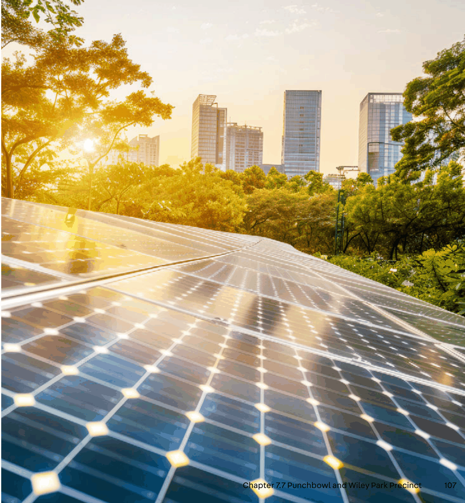

#### 5.4.6 Solar energy requirements

#### Objectives

O1. Maximise the on-site collection of renewable energy.

O2. Minimise the consumption of electricity generated from non-renewable resources.

#### Controls

C1. Development must include the installation of a solar PV system of no less capacity than:

a) For sites with multiple electricity meters; rooftop photovoltaic (solar) panel system is connected to the common meter and the system is sized to offset 90-100% of estimated base building maximum demand.

b) For sites with a central electricity meter; the rooftop photovoltaic (solar) panels systems is sized to offset 30% of estimated maximum demand.

C2. With any DA plans submitted, the roof plan must show the area(s) allocated to PVs and necessary access requirements for cleaning and routine maintenance. PV solar panels must be setback at least 2m from the edge of the build roof or parapet.

> [Picture on page 107: a picture, saved as a picture (images/ch-07-07-punchbowl-and-wiley-park-page-107-25.gif, 150 dpi).]
