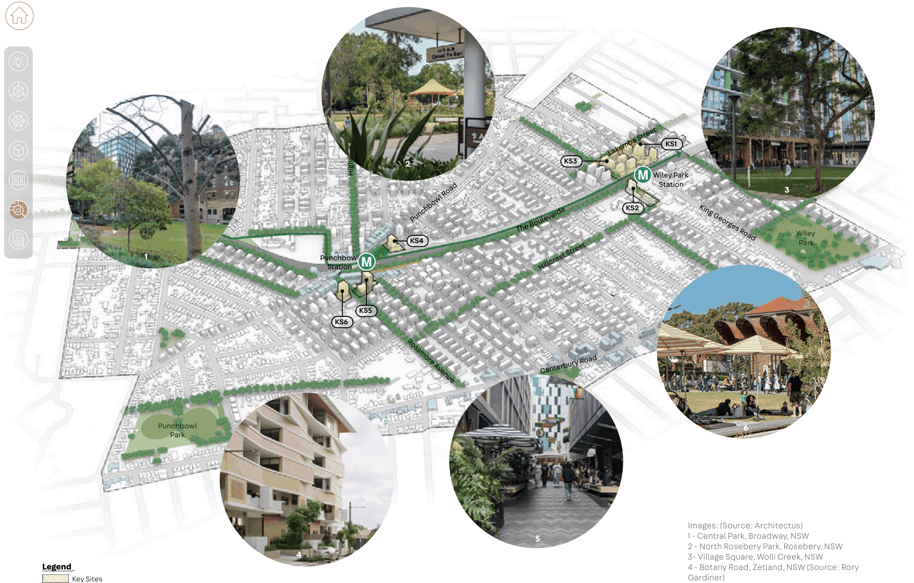
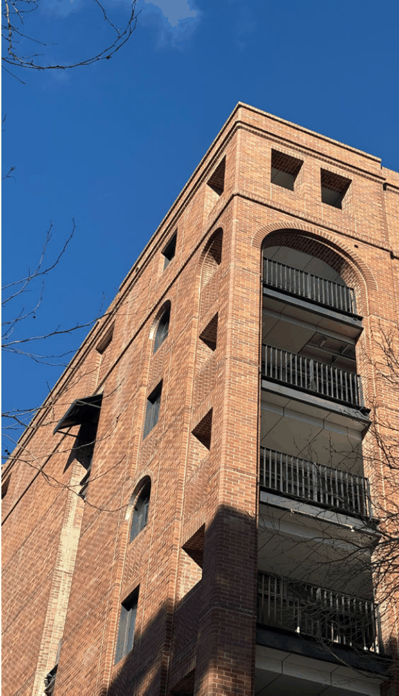
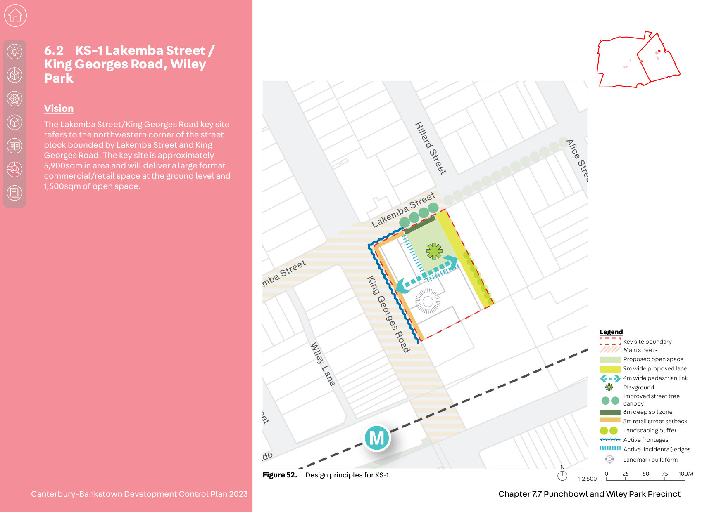

### 6.1 Key sites overview

### 6.1

The following sites have been identified as having a pivotal role in the realisation of the vision  and objectives for the Punchbowl and Wiley Park Precinct.

The key sites will be a catalyst for development of the Precinct and present an opportunity for examples of design excellence, an integrated response to Connection with Country principles and the reflection of Punchbowl and Wiley Parks history and heritage through building form and materiality. The development on key sites will share a common language that is place based. To ensure for optimal outcomes for Punchbowl and Wiley Park and an efficient process for applicants, it is essential to engage with Council early in the Development Application process. Council will have an expectation to see detailed analysis of the site, the context and an understanding of the Aboriginal and European history of Punchbowl and Wiley Park.

To ensure for a 'fine grained' approach to key sites, Council encourages the subdivision of large sites into smaller lots that are contextual to the

site. If this cannot be achieved, then a variety of different buildings should be introduced of varying architectural character, scale and height to provide individual identity for residents and visitors.

#### Objectives

O1. Ensure that development is unique to the character, climate and demography of the Punchbowl and Wiley Park Precinct.

O2. To achieve Design Excellence by creating inspirational key sites with high quality innovative architecture that are sustainably built, reference history and heritage, offer community benefit and provide new publicly accessible and private spaces that contribute positively to the Precincts sense of place.

O3. Ensure that the principles of Connecting with Country are intrinsically represented in these sites.

O4. Ensure development does not compromise or reduce solar access to parks.

O5. Integrate shared lanes and pedestrian links, expand the public domain, improve pedestrian and cyclist permeability and connect to existing and new open space.

O6. Provide for a range of heights on key sites to create an interesting and diverse skyline.

O7. Ensure that the interface of these larger sites activates the public domain and invites the public into new publicly accessible spaces.

O8. Ensure that podiums are articulated to appear as smaller parts to create a positive fine grained and exciting experiences at street level.

O9. Ensure street blocks present as a group of buildings and not as a single building.

O10.	 Ensure for a common language between older buildings and new development by using existing materials that are characteristic in the Precinct. These materials are long lasting and need little maintenance such as masonry, face brick and natural building materials generally.

O11. Integrate landscape as an key part of the building form, open space and the development generally. Extend tree canopy and deep soil and provide for green cover to reduce urban heat gain.

> [Picture on page 110: a map, saved as a picture (images/ch-07-07-punchbowl-and-wiley-park-page-110-1.gif, 150 dpi); the street names and other small labels are on the picture.]
> Words printed on the picture (title and legend, copied from the PDF):
> 9/17/25, 8:59 AM
> King Georges Road
> Images: (Source: Architectus)
> 1 - Central Park, Broadway, NSW
> 2 - North Rosebery Park, Rosebery, NSW
> 3- Village Square, Wolli Creek, NSW
> 4 - Botany Road, Zetland, NSW (Source: Rory

#### Station M

#### M

N

5 - Steam Mill Lane, Haymarket, NSW

Axonometric view of Punchbowl and Wiley Park Precinct identifying key sites with indicative massing of potential future development

#### Figure 50.

https://afasiaarchzine.com/wp-content/uploads/2022/07/Candalepas-Associates-.-Botany-Road-Residential-Complex-.-ZETLAND-Rory-Gardiner-… 1/1

6 - Matron Ruby Grant Park, Zetland, NSW

#### General controls applicable to all key sites

In the event of any inconsistency between this section and other parts of this DCP, these provisions prevail to the extent of any inconsistency.

#### Controls

C1. The design and delivery of key sites will take a Country centred approach in accordance with the guidelines and controls at Section

2.3 of this Chapter.

C2. An Aboriginal consultant shall be engaged during the site and context analysis and design development stage of the project. The consultant will be involved in the finalisation of the design and provide a statement to be submitted with the DA describing how Connecting with Country principles form an integral part of the development. The same consultant will be maintained throughout the DA process.

C3. Where appropriate, refer to section 3.3 for specifications for cycleways, shared lanes, pedestrian links and arcades.

C4. Key sites should provide up to 25% tree canopy and up to 50% green cover.

C5. Key sites will reflect the masonry heritage character of the Punchbowl and Wiley Park Precinct through the choice of materials and finishes in the development. By doing so, new development will be tied into older development and reinforce the Precincts character.

C6. Contemporary design is invited using a

palette of face brickwork or exposed

concrete structure with brickwork and

masonry with detailing in higher quality

materials such as timber, metal and copper.

Render, Alucobond, curtain walls and glazed

awnings and balustrades are not supported.

C7. Building articulation is to minimise different

materials and colours and aim for simplicity

not complexity. A response to orientation

should be implemented to provide for the

articulation of each façade and to reduce

heat gain to buildings. This can be achieved

by the western facade being more closed

and shaded with vertical blades to control

heat, while the northern facade has deep

eaves and horizontal shading and is more

open to the sun.

C8. To mitigate urban heat, permeable paving

will be used in association with understorey

planting with canopy trees. Water features

including misting sprays, fountains and

design elements that store water in the

landscape should be provided. Publicly

accessible shared lanes and pedestrian links

will be shaded appropriately.

C9. Building facades should be shaded by trees

to reduce heat gain and show depth and

shadow as described in Section 4.4 and 4.5.

> [Picture on page 111: a picture, saved as a picture (images/ch-07-07-punchbowl-and-wiley-park-page-111-62.gif, 150 dpi).]

Group GSA LAHC, Glebe NSW (Source: Glyde Bautovich)

#### Key Sites Map

Highclere Ave

#### 4

#### Punchbowl Station

#### 5

#### 6

Rossmore Ave

#### Legend

Application of DCP

1 Lakemba Street/King Georges Road, Wiley Park

2 Sydney Water Pumping Station, Wiley Park

3 Wiley Park Village Centre West, Wiley Park

4 Existing Punchbowl Children's Centre, Punchbowl

5 Punchbowl Community Centre, Punchbowl

6 Rossmore Avenue, Punchbowl

Figure 51. Key sites map

Punchbowl Rd

de

evar

oul

e B

Th

Hillcrest St

Canterbury Rd

Lakemba St

#### 1

#### 3

#### Wiley Park Station

#### 2

King Georges Rd

1:12,500

0 100

N

200 300 500M

Chapter 7.7 Punchbowl and Wiley Park Precinct 112

> [Picture on page 113: a map, saved as a picture (images/ch-07-07-punchbowl-and-wiley-park-page-113-1.gif, 150 dpi); the street names and other small labels are on the picture.]
> Words printed on the picture (title and legend, copied from the PDF):
> 1,500sqm of open space.
> King Georges Road
> Alice Street S
> Key site boundary
> Proposed open space
> 9m wide proposed lane
> 4m wide pedestrian link
> Improved street tree
> 6m deep soil zone
> 3m retail street setback
> Active (incidental) edges
> Landmark built form
> 0 25 50 75 100M

Figure 52. Design principles for KS-1
