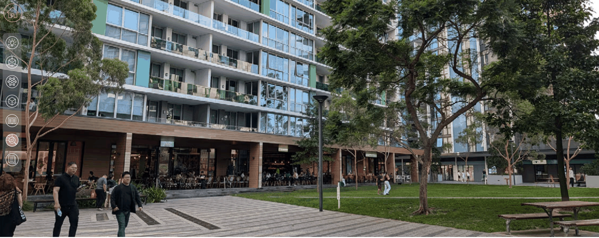

### 6.2	 KS-1 Lakemba Street /

### King Georges Road, Wiley

### Park

#### Vision

The Lakemba Street/King Georges Road key site

refers to the northwestern corner of the street

block bounded by Lakemba Street and King

Georges Road. The key site is approximately

5,900sqm in area and will deliver a large format

commercial/retail space at the ground level and

Kin

> [Picture on page 114: a picture, saved as a picture (images/ch-07-07-punchbowl-and-wiley-park-page-114-1.gif, 150 dpi).]

#### Design Principles

P1. Deliver a 1,500sqm open space with 50% of the park to achieve at least 2 hours of solar on June 21st (winter solstice) to ensure optimal conditions for the growth of the trees and landscape and also for the usability of the park.

P2. Deliver tree lined streets along  Lakemba Street through the provision of new tree planting, landscaping and high quality paving.

Image - Village Square, Wolli Creek, NSW (Source: Architectus)

P3. Provide a retail ground setback along Lakemba Street and King Georges Road featuring space for active uses including outdoor dining as well as landscaping and high quality paving, enhancing amenity, pedestrian movement and activation of the public domain.

P4. Provide a landscaped buffer along the laneway.

P5. Create a striking landmark tower on King Georges Road, characterised by its unique and innovative architectural design that stands out in the skyline.

P6. Provide high quality active frontages along identified streets.

P7. Provide high quality landscape design to the podium rooftop reflecting Connecting to Country principles, enhancing local amenity, establishing habitat, and supporting passive cooling of the urban environment.
