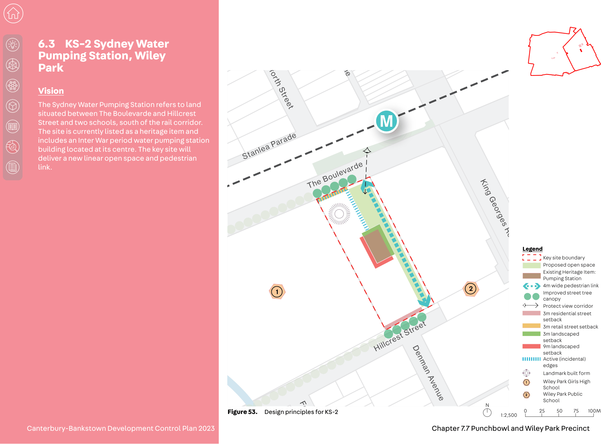
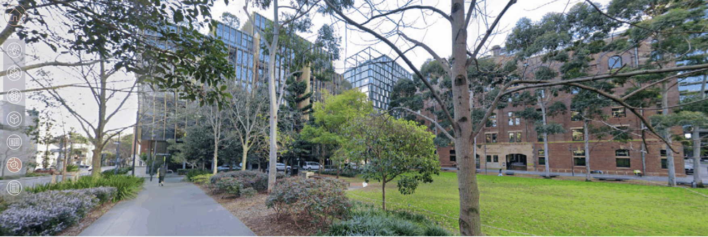
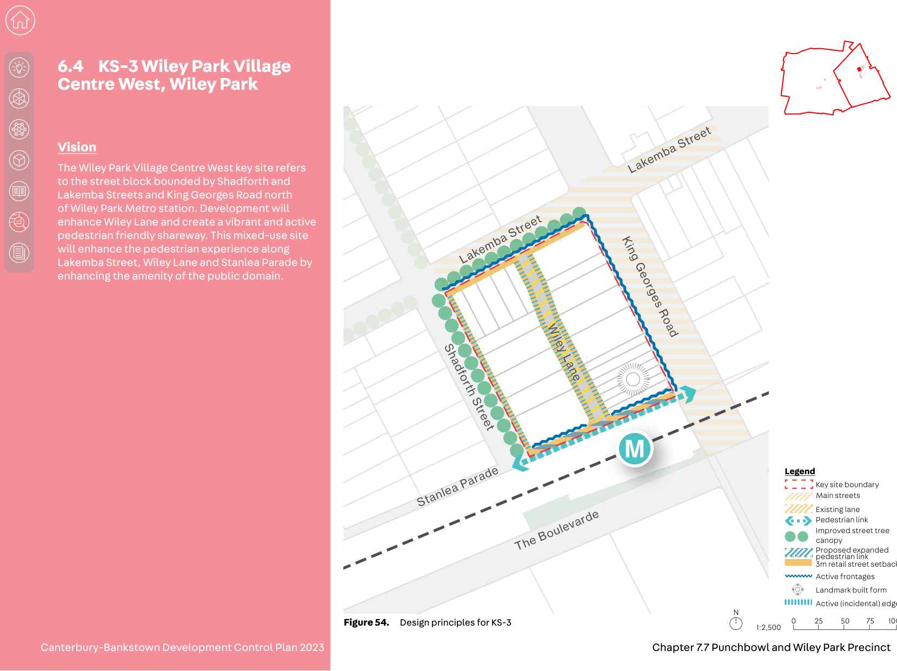

### 6.3	 KS-2 Sydney Water

### Pumping Station, Wiley

### Park

#### Vision

The Sydney Water Pumping Station refers to land situated between The Boulevarde and Hillcrest Street and two schools, south of the rail corridor. The site is currently listed as a heritage item and includes an Inter War period water pumping station building located at its centre. The key site will deliver a new linear open space and pedestrian

treet

L

> [Picture on page 115: a map, saved as a picture (images/ch-07-07-punchbowl-and-wiley-park-page-115-14.gif, 150 dpi); the street names and other small labels are on the picture.]
> Words printed on the picture (title and legend, copied from the PDF):
> King Georges Road
> Key site boundary
> Proposed open space
> Existing Heritage Item:
> 4m wide pedestrian link
> Improved street tree
> Protect view corridor
> 3m residential street
> 3m retail street setback
> Landmark built form
> 1 Wiley Park Girls High
> 2 Wiley Park Public
> 0 25 50 75 100M

Figure 53. Design principles for KS-2

> [Picture on page 116: a picture, saved as a picture (images/ch-07-07-punchbowl-and-wiley-park-page-116-1.gif, 150 dpi).]

#### Design Principles

P1. Deliver a 1,000sqm open space that achieves a minimum solar access for 4 hours (for 50% of the site) on June 21st to ensure optimal conditions for the growth of the trees and landscape and also the usability of the park. The pedestrian link is to connect to the publicly accessible open space.

P2. A Heritage Conservation Management Plan should accompany the proposal to ensure the development has a sensitive interface in terms of bulk and scale, its uses, landscaping and materials.

P3. Deliver tree lined streets along  The Boulevarde and Hillcrest Street through the provision of new tree planting, landscaping and high quality paving.

Image - Central Park, Broadway, NSW (Source: Architectus)

P4. Protect the view corridor towards the pumping station from the north.

P5. Adaptively reuse the pumping station building as apart of the sites re-development.

P6. Provide a landscaped buffer between the pumping station, open space and any future development of the site.

P7. Provide a new north-south through site link between The Boulevarde and Hillcrest Street to improve pedestrian and cycle connectivity.

P8. Development interfacing The Boulevarde and the open space should provide incidental active uses along these edges.

P9. Provide a retail ground level setback along The Boulevard featuring space for active uses including outdoor dining as well as landscaping and quality paving, enhancing amenity, pedestrian movement and activation of the public domain.

P10. Create ground-level apartments that interface with the open space and the pedestrian link featuring private landscaping, deep soil, and direct street access, enhancing amenity, access and passive surveillance of the public domain.

P11. Design a place based new building fronting The Boulevarde that is sensitive to the heritage item.

P12. Provide a quality landscaped rooftop enhancing local amenity and supporting passive cooling of the urban environment.

> [Picture on page 117: a map, saved as a picture (images/ch-07-07-punchbowl-and-wiley-park-page-117-1.gif, 150 dpi); the street names and other small labels are on the picture.]
> Words printed on the picture (title and legend, copied from the PDF):
> King Georges Road
> Key site boundary
> Improved street tree
> 3m retail street setback
> Landmark built form
> Active (incidental) edges
> 0 25 50 75 100M
> King Georges Road

Figure 54. Design principles for KS-3
