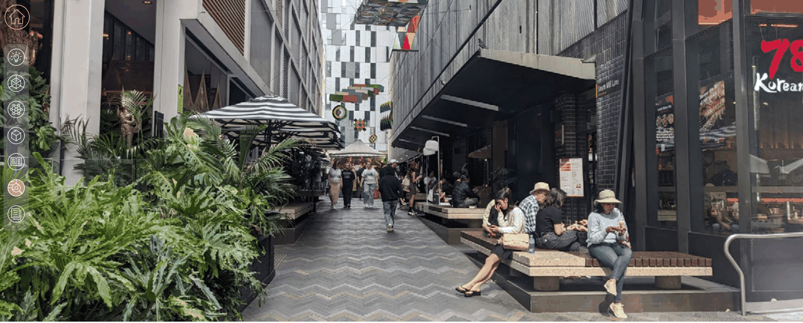
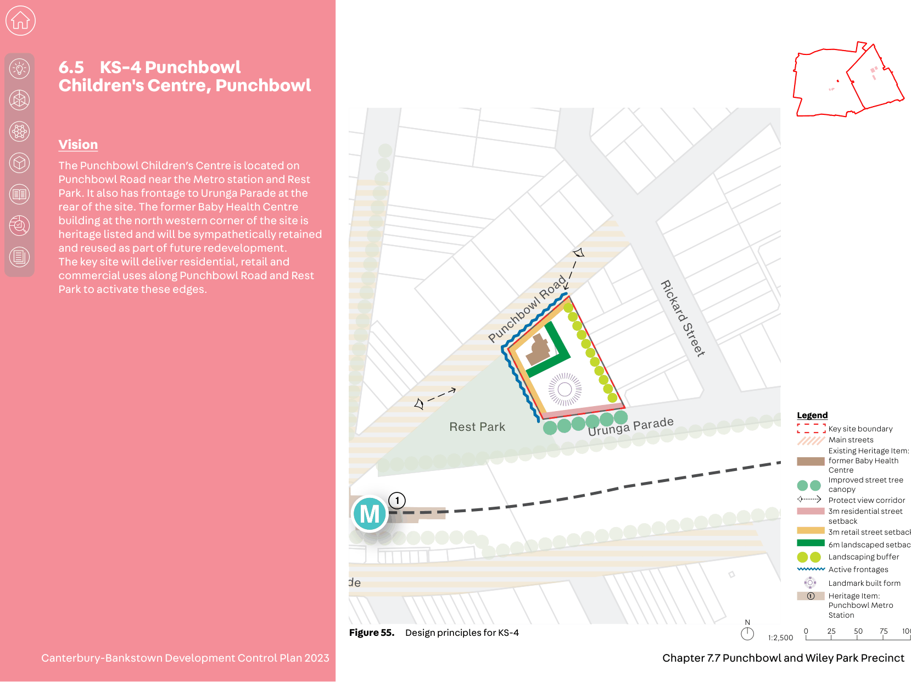

### 6.4	 KS-3 Wiley Park Village

### Centre West, Wiley Park

#### Vision

The Wiley Park Village Centre West key site refers to the street block bounded by Shadforth and Lakemba Streets and King Georges Road north of Wiley Park Metro station. Development will enhance Wiley Lane and create a vibrant and active pedestrian friendly shareway. This mixed-use site will enhance the pedestrian experience along Lakemba Street, Wiley Lane and Stanlea Parade by enhancing the amenity of the public domain.

Alice Street S

Chapter 7.7 Punchbowl and Wiley Park Precinct 117

> [Picture on page 118: a picture, saved as a picture (images/ch-07-07-punchbowl-and-wiley-park-page-118-1.gif, 150 dpi).]

#### Design Principles

P1. Deliver tree lined streets along  Lakemba Street and Shadforth Street through new tree planting, landscaping and high quality paving.

P2. Enhance Wiley Lane to become a pedestrianised shareway with incidental active uses along the edges.

P3. Provide a retail ground level setback along Lakemba Street with space for active uses including outdoor dining as well as landscaping and high quality paving.

Image - Steam Mill Lane, Haymarket, NSW (Source: Architectus)

P4. Enhance, improve and widen the existing Stanlea Parade pedestrian link by providing space for active uses including outdoor dining. Provide landscaping and high quality paving and enhance amenity, pedestrian and cyclist movement and activation of the public domain.

P5. Create a landmark building at the corner of King Georges Road and Stanlea Parade, which is high quality and reflective of place.

P6. Provide high quality active frontages along identified streets.

P7. Development interfacing Shadforth Street and Wiley Lane should provide incidental active uses along these edges.

P8. Provide high quality landscape design on the rooftop reflecting Connecting with Country principles, enhancing local amenity and supporting passive cooling of the urban environment.

> [Picture on page 119: a map, saved as a picture (images/ch-07-07-punchbowl-and-wiley-park-page-119-1.gif, 150 dpi); the street names and other small labels are on the picture.]
> Words printed on the picture (title and legend, copied from the PDF):
> Key site boundary
> Existing Heritage Item:
> former Baby Health
> Improved street tree
> Protect view corridor
> 3m residential street
> 3m retail street setback
> 6m landscaped setback
> Landmark built form
> 1 Heritage Item:
> 0 25 50 75 100M
> Van Dyke Place

Figure 55. Design principles for KS-4
