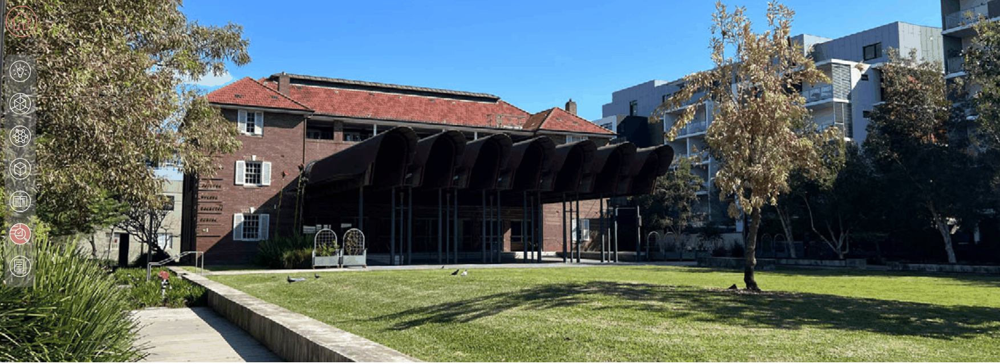
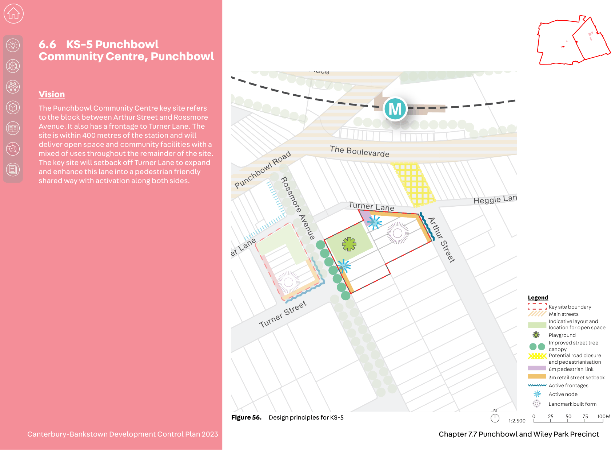

### 6.5	 KS-4 Punchbowl

### Children's Centre, Punchbowl

#### Vision

The Punchbowl Children’s Centre is located on

Punchbowl Road near the Metro station and Rest

Park. It also has frontage to Urunga Parade at the

rear of the site. The former Baby Health Centre

building at the north western corner of the site is

heritage listed and will be sympathetically retained

and reused as part of future redevelopment.

The key site will deliver residential, retail and

commercial uses along Punchbowl Road and Rest

Park to activate these edges.

A

> [Picture on page 120: a picture, saved as a picture (images/ch-07-07-punchbowl-and-wiley-park-page-120-1.gif, 150 dpi).]

#### Design Principles

P1. A Heritage Conservation Management Plan should accompany the proposal to ensure the development is sensitive in bulk and scale, uses, landscaping, materials and the location of the new buildings do not negatively impact the heritage item.

P2. Deliver a tree lined street along  Urunga Parade through the provision of new tree planting, landscaping and high quality paving.

P3. Protect the view corridor towards the former Baby Health Centre from the north-east and south-west directions along Punchbowl Road. Ensure all new buildings on the site are located behind the rear building line of the heritage item.

P4. Adaptively reuse the former Baby Health Centre building as apart of the sites re-development.

P5. Provide a landscaped buffer between the former Baby Health Centre and any future development of the site.

P6. Provide a retail ground level setback along Punchbowl Road and Rest Park featuring space for active uses including outdoor dining as well as landscaping and high quality paving, enhancing amenity, pedestrian movement and activation of the public domain.

P7. Create ground level apartments that interface with the Urunga Parade featuring private landscaping, deep soil and direct street access, enhancing amenity, access and passive surveillance of the public domain. Ensure rail noise is mitigated.

P8. Provide high quality active frontages along identified streets.

P9. Create a landmark tower along Urunga Parade, informed by its heritage context.

P10. Provide high quality landscape design on the rooftop reflecting Connecting with Country principles, enhancing local amenity, establishing habitat, and supporting passive cooling of the urban environment.

Image - Matron Ruby Grant Park, Zetland, NSW (Source: Architectus)

> [Picture on page 121: a map, saved as a picture (images/ch-07-07-punchbowl-and-wiley-park-page-121-1.gif, 150 dpi); the street names and other small labels are on the picture.]
> Words printed on the picture (title and legend, copied from the PDF):
> Van Dyke Place
> Key site boundary
> Indicative layout and
> location for open space
> Improved street tree
> Potential road closure
> 6m pedestrian  link
> 3m retail street setback
> Landmark built form
> 0 25 50 75 100M

Figure 56. Design principles for KS-5
