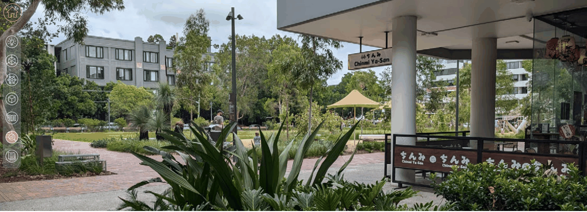

### 6.6	 KS-5 Punchbowl

### Community Centre, Punchbowl

#### Vision

The Punchbowl Community Centre key site refers

to the block between Arthur Street and Rossmore

Avenue. It also has a frontage to Turner Lane. The

site is within 400 metres of the station and will

deliver open space and community facilities with a

mixed of uses throughout the remainder of the site.

The key site will setback off Turner Lane to expand

and enhance this lane into a pedestrian friendly

shared way with activation along both sides.

et

et

Matthews Street

> [Picture on page 122: a picture, saved as a picture (images/ch-07-07-punchbowl-and-wiley-park-page-122-1.gif, 150 dpi).]

#### Design Principles

P1. Deliver a 250sqm open space that achieves a minimum solar access for 2 hours (for 50% of the site) on June 21st to ensure optimal conditions for the growth of trees and landscape and also for usability of the park.

P2. Deliver tree lined streets along  Rossmore Avenue through new tree planting, landscaping and high quality paving.

P3. Provide a retail ground level setback along Turner Lane, Arthur Street and Rossmore Avenue providing space for active uses including outdoor dining as well as landscaping and high quality paving.

Image - North Rosebery Park, Rosebery, NSW (Source: Architec-tus)

P4. Provide a new north-south through site link between Turner Lane and the open space to improve pedestrian connectivity.

P5. Provide high quality active frontages along identified street.

P6. Development interfacing the proposed lane and open space should provide space for a retail premise to allow for active surveillance of the public domain.

P7. Design a distinctive building along Arthur Street, characterised by its unique and innovative architectural design.

P8. Provide high quality landscape design on the rooftop reflecting Connecting with Country principles, enhancing local amenity, establishing habitat, and supporting passive cooling of the urban environment.
