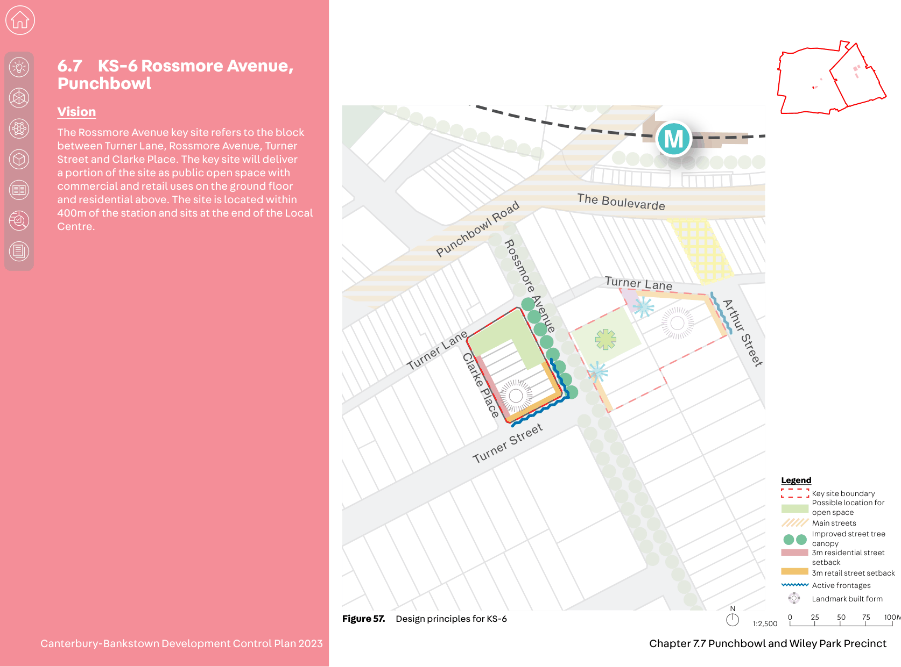
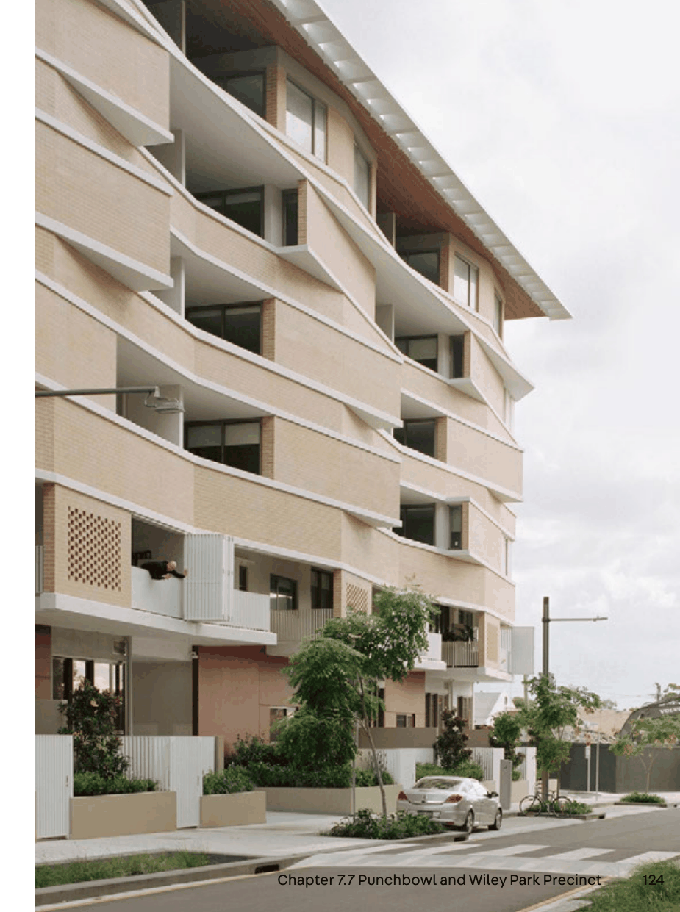

### 6.7	 KS-6 Rossmore Avenue,

### Punchbowl

#### Vision

The Rossmore Avenue key site refers to the block between Turner Lane, Rossmore Avenue, Turner Street and Clarke Place. The key site will deliver a portion of the site as public open space with commercial and retail uses on the ground floor and residential above. The site is located within 400m of the station and sits at the end of the Local

ne

> [Picture on page 123: a map, saved as a picture (images/ch-07-07-punchbowl-and-wiley-park-page-123-12.gif, 150 dpi); the street names and other small labels are on the picture.]
> Words printed on the picture (title and legend, copied from the PDF):
> Key site boundary
> Possible location for
> Improved street tree
> 3m residential street
> 3m retail street setback
> Landmark built form
> 0 25 50 75 100M
> Design principles for KS-6

Figure 57.

Urunga Pa

Van

#### Design Principles

P1. Deliver a 500sqm open space that achieves a minimum solar access for 2 hours (for 50% of the site) on June 21st to ensure optimal conditions for the growth of the trees and landscape and also for the usability of the park.

P2. Deliver a tree lined street along Rossmore Avenue through new tree planting, landscaping and high quality paving.

P3. Provide a retail ground level setback along Rossmore Avenue featuring space for active uses including outdoor dining as well as landscaping and high quality paving.

P4. Provide high quality active frontages along identified streets.

P5. Create ground level apartments that interface with the street featuring private landscaping, deep soil and direct street access from the street, enhancing amenity, access and passive surveillance of the public domain.

P6. Create a quality building along Turner Street, characterised by its unique and innovative architectural design.

P7. Provide high quality landscape design on the rooftop reflecting Connecting with Country principles, enhancing local amenity, establishing habitat, and supporting passive cooling of the urban environment.

Image - Botany Road, Zetland, NSW, Candalepas Associates (Source: Rory Gardiner)

> [Picture on page 124: a picture, saved as a picture (images/ch-07-07-punchbowl-and-wiley-park-page-124-33.gif, 150 dpi).]
