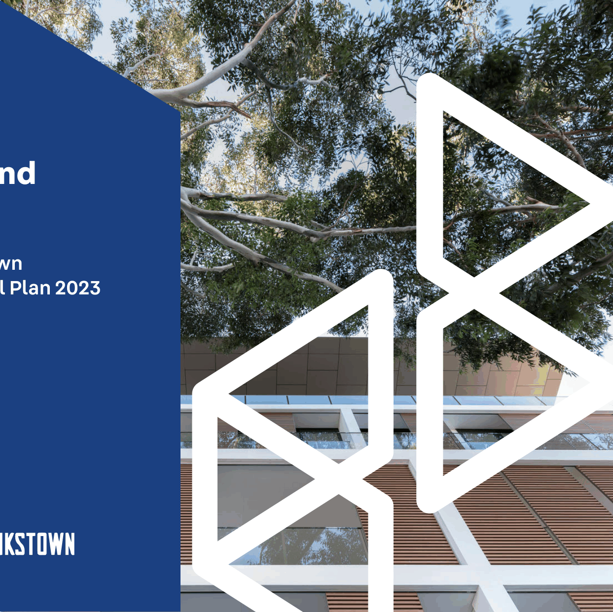
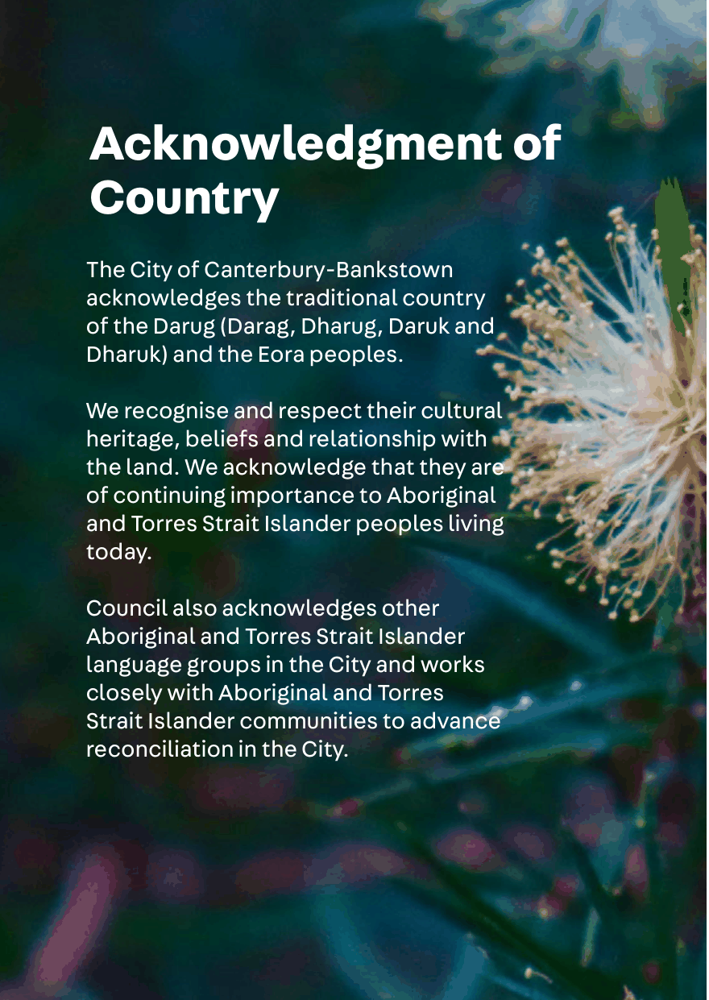

# Canterbury-Bankstown Development Control Plan 2023 - Chapter 7.7 Punchbowl and Wiley Park

> This chapter is split into 69 section file(s), one per numbered heading, in the order they appear in the PDF.

Source PDF: [2026.04.24 - DCP 2023 - AMENDMENT 14 - Chapter 7.7 - Punchbowl and Wiley Park - website.pdf](https://planfortomorrow.sharepoint.com/sites/Planfortomorrow/Shared%20Documents/00%20NSW-Planning-Resources/dcp/canterbury-bankstown-development-control-plan-2023/ch-07-07-punchbowl-and-wiley-park/2026.04.24%20-%20DCP%202023%20-%20AMENDMENT%2014%20-%20Chapter%207.7%20-%20Punchbowl%20and%20Wiley%20Park%20-%20website.pdf)

### Chapter 7.7

Punchbowl and

### Wiley Park

### Canterbury-Bankstown

> [Picture on page 1: a picture, saved as a picture (images/ch-07-07-punchbowl-and-wiley-park-page-1-5.gif, 150 dpi).]

### Development Control Plan 2023

### March 2026

### Final

> [Picture on page 2: a picture, saved as a picture (images/ch-07-07-punchbowl-and-wiley-park-page-2-1.gif, 150 dpi).]

Acknowledgment of

### Country

### The City of Canterbury-Bankstown

### acknowledges the traditional country

of the Darug (Darag, Dharug, Daruk and

### Dharuk) and the Eora peoples. We recognise and respect their cultural

heritage, beliefs and relationship with the land. We acknowledge that they are

### of continuing importance to Aboriginal

### and Torres Strait Islander peoples living

### today. Council also acknowledges other

### Aboriginal and Torres Strait Islander

### language groups in the City and works

### closely with Aboriginal and Torres

### Strait Islander communities to advance

### reconciliation in the City.

### We’re committed to creating a liveable

### and loveable City for all our residents

#### Great Cities

We believe in creating vibrant, dynamic, and diverse communities that offer opportunities for people to connect, pursue their passions, and contribute to the world around them.

#### Naturally Green

We protect and prioritise nature in and around our city to enhance environmental sustainability and improve the quality of life for our residents.

#### Design Excellence

We encourage buildings, spaces, and objects that are both beautiful and practi-cal, enhancing the beauty, accessibility, and safety of our built environment.

#### People First

We prioritise the needs, preferences, and aspirations of our community in all aspects of urban planning and design, creating supportive and enriching places people love.

#### Community

We engage with our community to ensure their needs and aspirations are reflect-ed in the outcome, creating sustainable, resilient, vibrant, diverse, and inclusive places.

#### Sustainability

We seek designs that reduce negative impacts on the environment while also promoting social and economic well-being.

#### Net-Zero

We encourage our community to design buildings and places that produce as much renewable energy as they consume, reducing greenhouse gas emissions, lowering energy bills, and increasing resilience to environmental shocks and stresses.

Explore the design for

### Punchbowl and Wiley Park Precinct DCP

Punchbowl and Wiley Park Village Centres, along with other significant Centres in the Canterbury-Bankstown Local Government Area have an area specific Development Control Plan (DCP). This DCP contains the following parts:

### Introduction

### Understanding Place Public Domain Design

### Building Design

### General Provisions

### Key Sites

> The PDF's contents list (page numbers of the printed document) is not repeated here - see Sections below.

<!-- sections -->
## Sections

1. [1 INTRODUCTION](01-introduction.md)
2. [1.1 Application of this Chapter](02-1-1-application-of-this-chapter.md)
3. [1.2 Vision for Punchbowl and](03-1-2-vision-for-punchbowl-and.md)
4. [1.3 How to read this DCP](04-1-3-how-to-read-this-dcp.md)
5. [2 UNDERSTANDING PLACE](05-2-understanding-place.md)
6. [2.1 Structure Plan](06-2-1-structure-plan.md)
7. [2.2 Character Areas](07-2-2-character-areas.md)
8. [2.2.1 Punchbowl Village](08-2-2-1-punchbowl-village.md)
9. [2.2.2 Wiley Park Village](09-2-2-2-wiley-park-village.md)
10. [2.2.3 Urban living](10-2-2-3-urban-living.md)
11. [2.2.4 Mid-rise living](11-2-2-4-mid-rise-living.md)
12. [4.2.3 Street wall and Section 4.2.5 Upper storey](12-4-2-3-street-wall-and-section-4-2-5-upper.md)
13. [2.2.5 Low-rise living](13-2-2-5-low-rise-living.md)
14. [2.2.6 Canterbury Road](14-2-2-6-canterbury-road.md)
15. [2.3 Connecting with Country](15-2-3-connecting-with-country.md)
16. [3 PUBLIC DOMAIN DESIGN](16-3-public-domain-design.md)
17. [3.1 Public domain strategy](17-3-1-public-domain-strategy.md)
18. [3 Tree canopy and](18-3-tree-canopy-and.md)
19. [4 Solar access,](19-4-solar-access.md)
20. [3.2 Public open space and](20-3-2-public-open-space-and.md)
21. [3.3 Streets, shared lanes,](21-3-3-streets-shared-lanes.md)
22. [3.4 Tree canopy, green cover](22-3-4-tree-canopy-green-cover.md)
23. [3.5 Solar access to open space](23-3-5-solar-access-to-open-space.md)
24. [3.6 Shade and the reduction](24-3-6-shade-and-the-reduction.md)
25. [4 BUILDING DESIGN](25-4-building-design.md)
26. [4.1 Minimum lot sizes](26-4-1-minimum-lot-sizes.md)
27. [4.2.1 Building heights and storeys](27-4-2-1-building-heights-and-storeys.md)
28. [4.2.2 Floor to floor height Objectives](28-4-2-2-floor-to-floor-height-objectives.md)
29. [4.2.3 Street wall](29-4-2-3-street-wall.md)
30. [1 Appropriate scale,](30-1-appropriate-scale.md)
31. [4.2.4 Front setbacks Objectives](31-4-2-4-front-setbacks-objectives.md)
32. [2 Setbacks reflect](32-2-setbacks-reflect.md)
33. [3 Urban street edge with](33-3-urban-street-edge-with.md)
34. [4.2.5 Upper storey setbacks Objectives](34-4-2-5-upper-storey-setbacks-objectives.md)
35. [4.2.6 Building separation Objectives](35-4-2-6-building-separation-objectives.md)
36. [2 Views and privacy](36-2-views-and-privacy.md)
37. [4.2.7 Maximum floorplate area Objectives](37-4-2-7-maximum-floorplate-area-objectives.md)
38. [1 Above 25m](38-1-above-25m.md)
39. [2 Slender towers](39-2-slender-towers.md)
40. [4.3.1 Residential ground floor Objectives](40-4-3-1-residential-ground-floor-objectives.md)
41. [4.3.2 Active street frontages and edges](41-4-3-2-active-street-frontages-and-edges.md)
42. [4.4 Visual diversity,](42-4-4-visual-diversity.md)
43. [1 Fine grain](43-1-fine-grain.md)
44. [2 Variety in](44-2-variety-in.md)
45. [3 Long podiums](45-3-long-podiums.md)
46. [4.5 Material and finishes](46-4-5-material-and-finishes.md)
47. [4.6 Rooftop and podium](47-4-6-rooftop-and-podium.md)
48. [5 GENERAL PROVISIONS](48-5-general-provisions.md)
49. [5.1 Dwelling mix and flexible](49-5-1-dwelling-mix-and-flexible.md)
50. [5.2.1 On-site parking](50-5-2-1-on-site-parking.md)
51. [5.3 Underground floor space](51-5-3-underground-floor-space.md)
52. [5.4.1 Urban cooling and](52-5-4-1-urban-cooling-and.md)
53. [5.4.2 Reduction of the Urban Heat](53-5-4-2-reduction-of-the-urban-heat.md)
54. [5.4.3 Energy efficient (BASIX](54-5-4-3-energy-efficient-basix.md)
55. [5.4.4 Water efficiency](55-5-4-4-water-efficiency.md)
56. [5.4.5 Electric Buildings](56-5-4-5-electric-buildings.md)
57. [5.4.6 Solar energy requirements](57-5-4-6-solar-energy-requirements.md)
58. [6 KEY SITES](58-6-key-sites.md)
59. [6.1 Key sites overview](59-6-1-key-sites-overview.md)
60. [6.2 KS-1 Lakemba Street /](60-6-2-ks-1-lakemba-street.md)
61. [6.3 KS-2 Sydney Water](61-6-3-ks-2-sydney-water.md)
62. [6.4 KS-3 Wiley Park Village](62-6-4-ks-3-wiley-park-village.md)
63. [6.5 KS-4 Punchbowl](63-6-5-ks-4-punchbowl.md)
64. [6.6 KS-5 Punchbowl](64-6-6-ks-5-punchbowl.md)
65. [6.7 KS-6 Rossmore Avenue,](65-6-7-ks-6-rossmore-avenue.md)
66. [7 APPENDIX](66-7-appendix.md)
67. [7.1 Definitions](67-7-1-definitions.md)
68. [7.2 Figures List](68-7-2-figures-list.md)
69. [7.3 Table list](69-7-3-table-list.md)
