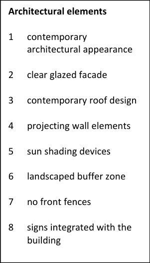
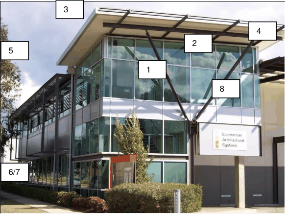

### 2.2 Development must provide:

(a) a minimum 5m setback to the primary and secondary street frontages; and

(b) a minimum 6m setback to all other site boundaries.

2.3 Council may increase the minimum setbacks to the side and rear boundaries:

(a) to maintain reasonable solar access or visual privacy to neighbouring dwellings; or

(b) to avoid an easement or tree dripline on the site or adjoining sites.

#### Facade design

2.4 Development must articulate the facades to achieve a unique and contemporary architectural appearance that:

(a) unites the facades with the whole building form;

(b) composes the facades with an appropriate scale and proportion that responds to the use of the building and the desired contextual character;

(c) combines high quality materials and finishes;

(d) considers the architectural elements shown in Figure 2a; and

(e) considers any other architectural elements to Council's satisfaction.

> [Picture on page 7: a picture, saved as a picture (images/ch-08-01-general-requirements-page-7-3.gif, 150 dpi).]
> Words printed on the picture (title and legend, copied from the PDF):
> Architectural elements
> 1 contemporary
> architectural appearance
> 2 clear glazed facade
> 3 contemporary roof design
> 4 projecting wall elements
> 5 sun shading devices
> 6 landscaped buffer zone
> 7 no front fences
> 8 signs integrated with the
> building

> [Picture on page 7: a picture, saved as a picture (images/ch-08-01-general-requirements-page-7-4.gif, 150 dpi).]
> Words printed on the picture (title and legend, copied from the PDF):
> 3
> 4
> 2
> 5
> 1
> 8
> 6/7

Figure 2a: Architectural elements

2.5 Development must architecturally treat blank walls that can be viewed from the street and adjoining residential zoned land by incorporating public art, variation in building materials and/or other architectural design methods which reflect contemporary and interesting design.

2.6 The street facade of development on corner sites should incorporate architectural corner features to add visual interest to the streetscape.

2.7 Development should restrict the use of the first storey (i.e. the ground floor) to commercial or other non-residential uses:

(a) to maintain employment floor space in the enterprise corridors; and

(b) to maintain active street frontages in the enterprise corridors.

2.8 Development may have predominantly glazed facades provided it does not cause significant glare nuisance.

#### Blank walls

2.9 Large areas of blank, minimally or poorly articulated walls are not acceptable. Measures to avoid this may include windows, awnings, sun shading devices, pergolas, green walls, public art or a recognisable increased setback to the upper storey.

2.10 Blank walls are not permitted where facing the public domain.

2.11 The maximum length of any blank wall must not exceed 5m.

2.12 The maximum height of a blank wall must not exceed 3m.

2.13 Where adjacent development is unlikely to occur in the short term, blank side walls should include public art or murals.

#### Roof design

2.14 Development must incorporate a high quality roof design that:

(a) achieves a unique and contemporary architectural appearance; and

(b) combines high quality materials and finishes.

#### Awnings
