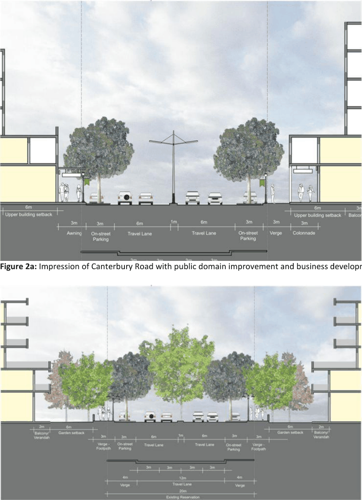
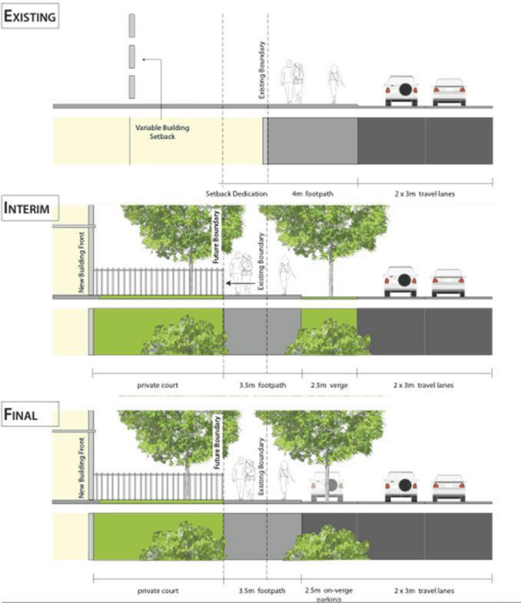
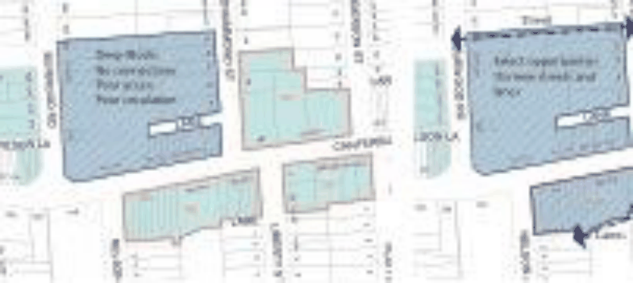
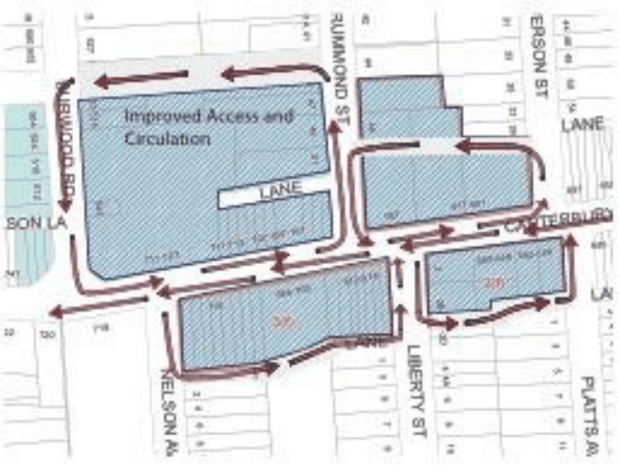

#### C5 Urban Residential (R4–High Density Residential)

Comprise residential buildings ranging in height from three to five storeys. The smaller scale buildings are appropriate to areas where the existing building stock is uniformly one to two storeys or to narrow infill sites. Residential apartment buildings are setback 6m from the street creating a private, landscaped forecourt.

The naturalistic landscaping of the forecourt, combined with street tree planting over time, will substantially green Canterbury Road and create a green break between more intensive land use activities of the Urban Core, Urban Centre and Urban General areas. Residential apartment buildings are setback 6m from the new front property line which in turn is setback 2m from the existing street boundary to allow for footpath/verge/on-street parking improvements.

Note: The following diagrams illustrate how a number of the Canterbury Road Corridor public domain outcomes can be achieved.

> [Picture on page 7: a picture, saved as a picture (images/ch-08-02-canterbury-road-enterprise-corridor-page-7-1.gif, 150 dpi).]

Figure 2a: Impression of Canterbury Road with public domain improvement and business development

Figure 2b: Impression of Canterbury Road with public domain improvement and residential development

> [Picture on page 8: a picture, saved as a picture (images/ch-08-02-canterbury-road-enterprise-corridor-page-8-1.gif, 150 dpi).]

Figure 2c: The transformation of Canterbury Road through interim works that are achievable in stages

> [Picture on page 9: a picture, saved as a picture (images/ch-08-02-canterbury-road-enterprise-corridor-page-9-1.gif, 150 dpi).]

Figure 2d: Typical road structure (refer to Figure 2e below)

> [Picture on page 9: a picture, saved as a picture (images/ch-08-02-canterbury-road-enterprise-corridor-page-9-3.gif, 150 dpi).]

Figures 2e: How a typical road structure might be improved over time with left turn circulation (refer to Figure 2d above)

## SECTION 3–SITE PLANNING
