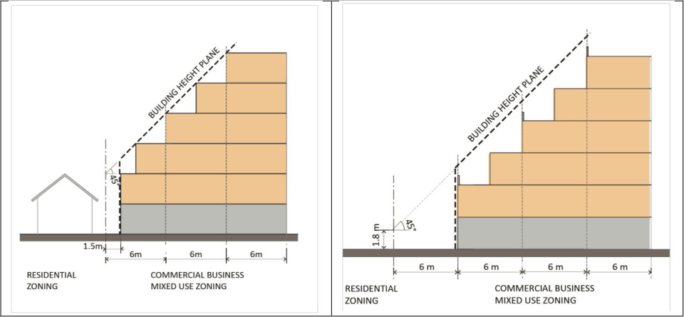

### 4.2 Setbacks

#### Objectives

O1 To establish the desired spatial proportions of the street and define the street edge.

O2 To minimise building size and bulk by setting back upper storeys.

O3 To minimise amenity impacts on adjoining properties.

O4 To encourage increased setbacks along Canterbury Road to provide for possible future implementation of street parking and assist in reducing traffic noise impacts.

O5 To allow for flexible design and building articulation by permitting minor encroachments.

#### Development controls

General

C1 Where a setback applies, buildings are to provide articulated and varied facades that do not result in a ziggurat appearance (i.e. do not have the form of a terraced structure with successive receding storeys).

Front setbacks

C2 Development must comply with the minimum front setbacks as follows:

| Location | Number of storeys at the street and setback | Upper level (podium) setback |
|---|---|---|
| E1 Zone along Canterbury Road and any secondary frontage | 1–4 storeys minimum setback of 3m from street boundary Basements to be 3m from street boundary | Above 4 storeys an additional 5m |
| E3 Zone along Canterbury Road (identified as ‘Area 9’ on the Special provisions Map) and any secondary frontage | 1–4 storeys minimum setback of 3m from street boundary | Above 4 storeys an additional 5m |
| E3 Zone along Canterbury Road (not identified as ‘Area 9’ on the Special provisions Map) and any secondary frontage | 1–3 storeys minimum setback of 3m from street boundary Basements to be 3m from street boundary | N/A |

Side setbacks

setbacks

are not required in the E1 zone when the desired character is for a continuous street frontage.

On boundary with residential zone – side setback

C4 Establish a 45 degree height plane projected at 1.5m from the residential boundary.

C5 Provide minimum 1.5m setback to the residential zone boundary.

C6 A two storey limit on the boundary with residential zone applies (refer to Figure 3a).

On boundary with residential zone – rear setback

C7 Establish a 45 degree height plane projected at 6m from the residential zone boundary.

C8 Provide minimum 6m setback to the residential zone boundary.

C9 A two storey limit on the boundary with residential zone applies (refer to Figure 3b).

C10 A setback to a rear lane is not required.

> [Picture on page 13: a picture, saved as a picture (images/ch-08-02-canterbury-road-enterprise-corridor-page-13-1.gif, 150 dpi).]

Figure 4a: Building height plane side

Figure 4b: Building height plane rear

Exceptions

C11 The following minor building elements may project into the minimum side setback area:

(a) roof eaves, awnings, pergolas and patios;

(b) stair or ramp access to the ground floor; and

(c) rainwater tanks.
