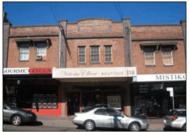
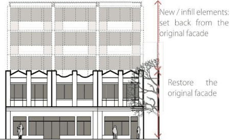

### 5.3 Facade treatment

#### Objectives

O1 To encourage articulated building design to reduce the appearance of scale, enhance visual interest and ensure a diversity of built form.

O2 To encourage vertical and horizontal building elements that contribute to streetscape modulation and enhance the pedestrian experience.

O3 To protect features of existing buildings that influence streetscape and local character.

O4 To ensure that front setbacks are consistent with the existing streetscape where this has been maintained.

O5 To ensure alterations and additions complement the architectural character of the existing building.

O6 To ensure all elements of the facade and roof are integrated into the architectural form and detail of the building.

O7 To achieve building emphasis on corner sites to strengthen the legibility of the urban structure.

#### Development controls

Facade design: New building forms and design features shall not mimic traditional features, but should reflect these in a contemporary design. Avoid long spans of blank walls along street frontages and address both street frontages with facade treatment, and articulation of elevations on corner sites. Incorporate contrasting elements in facades. Emphasise corner sites by using treatments to make the sites visually prominent. Retention of traditional facades will be given precedence over emphasising corner sites. Treatments may include:

(i) wrap around balconies;

(ii) vertical elements; and

(iii) changes in materials or colours. Use a harmonious range of high quality materials, finishes and detailing:

(i) define a base, middle and top related to the overall proportion of the building;

(ii) express key datum lines using cornices, change in materials or change in setback;

(iii) express the variation in floor to floor height, particularly at lower levels;

(iv) articulate building entries with awnings, porticos, recesses, blade walls and projecting bays;

(v) use a variety of window types to create a rhythm or express building uses and use recessed balconies and deep windows to create shadows, adding visual depth to the facade;

(vi) detail balustrades to reflect the type and location of the balcony and its relationship to the facade;

(vii) incorporate architectural features which give human scale at street level, including entrances, awnings, colonnades, pergolas and fences;

(viii) use colour, variation in the types of materials and arrangement of facade elements and materials to articulate different parts of a building – a

material palette can include brickwork, rendered masonry, sheet materials, glazing, sandstone and treated metals and timbers; and

(ix) incorporate horizontal and/or vertical elements, such as indentations in the facade plane, string courses and bandings, window openings and building entrances.

Consideration in the design of commercial premises is to be made for mechanical ventilation required by potential future food shops and restuarants. Mechanical ventilation is to be located behind the building facade. Alternatively, ventilation for future uses must be considered in the facade design. Design facades to reflect the orientation of the site using elements such as sun shading devices, light shelves and bay windows. Modulate the wall alignment with a step in of at least 1m. Refer to existing datum lines for any new developments integrated to heritage and/or existing buildings, such as eave and parapet line, as a guide to aligning the height to levels of adjoining development. Use a solid to void ratio of 50%, with each facade measured independently. Disharmony arises when the range of solid to void is extreme. Do not include shopfronts in the 50% solid to void ratio calculation. Locate and proportion windows to minimise scale and bulk of new building.

C2 Period facades:

(a) Traditional facades should be integrated into the overall design of new development.

(b) Pre-1950 shop front facades are to be maintained in the parts of the E1 zone where building height is five storeys or less (infill development is permitted behind so that the traditional main street character of the centres is maintained).

(c) Where the permitted height is greater than five storeys, facades do not need to be retained.

> [Picture on page 17: a picture, saved as a picture (images/ch-08-02-canterbury-road-enterprise-corridor-page-17-30.gif, 150 dpi).]

C3 Consent for demolition of pre-1950s shopfront facades will only be granted in exceptional circumstances and only if it can be demonstrated that: the structural condition or size of the existing facade makes it unsuitable for maintaining; the existing facade does not contribute positively to the character of a centre; and there will be improvement in the design outcome with a replacement facade.

> [Picture on page 18: a picture, saved as a picture (images/ch-08-02-canterbury-road-enterprise-corridor-page-18-1.gif, 150 dpi).]

C4 Paint existing facades (where appropriate) in a colour scheme that is sympathetic to the period and style of the building. Original unpainted surfaces, particularly face brick, are to remain unpainted.

C5 Design additional storeys (above the building base) so they do not compete with the aesthetic character and dominance of the existing facade. The preferred design approach is for additions to be contemporary in style and distinct in form and character from the facade to be retained. Vertical elements should be used to break up the mass of the additions.

C6 Where existing facades are retained, remove any uncharacteristic or intrusive additions and reconstruct, restore or repair with existing building fabric. If sufficient historical material is not available, use new fabric sympathetic to the period and style of the building and facade.

C7 Additions to retained facades should incorporate the following in the composition of the new upper facade:

(a) traditional external finishes for walls, such as exposed dark brickwork and render, or painted concrete;

(b) vertical window and door opening, columns, and colour to create vertical elements;

(c) parapets and window hoods;

(d) recessed balconies and deep windows to create shadow lines;

(e) high solid to void ratio; and

(f) individual smaller shop front, or articulation to reflect the fine grain pattern of the traditional shopping streets.

C8 Design upper levels so they do not compete with the aesthetic character and dominance of the street level facade.

C9 On land adjoining railway or busy roads, address all requirements in the Development Near Rail Corridors and Busy Roads – Interim Guideline (NSW Department of Planning and Environment).

C10 Balconies: Do not allow balconies and voids to dominate publicly visible facades (excluding glass shop fronts and colonnades in business centres). Use balconies in moderation and integrate them into the overall composition of the facade – do not use a monotonous or repetitive configuration of balconies.

Where possible place balconies facing an internal courtyard and do not place all balconies on an external facade. Use balcony types that respond to the street context, building orientation and residential amenity. Use lightweight materials and construction for balconies. Support verandas and balconies with slender metal or timber frames, rather than concrete columns or masonry piers. Construct balcony balustrades with glass panels, open metal framing, board or sheet cladding, rather than entirely of masonry, or break up significantly blank walls of masonry with panels.
