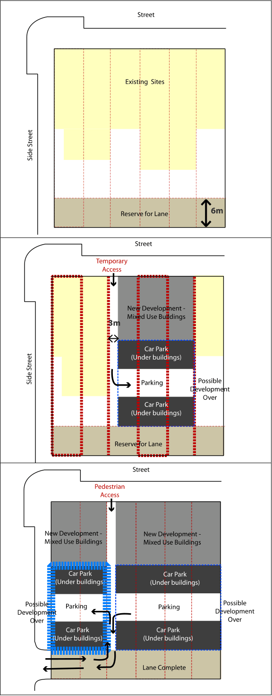

### 6.1 Laneways

#### Objectives

O1 To create a new rear lane system that will improve streetscape and pedestrian safety, and encourage active street frontages.

#### Development controls

New laneways are identified for some town centres. Refer to the relevant chapter for controls relating to specific centres. Where sites are to be redeveloped and a new lane is identified over private land, creation of the laneway is required even if the laneway cannot be immediately utilised.

Where creation of a laneway is identified an area of land 6m wide is required for the laneway. This land can be taken into account for the purposes of calculating setbacks.

Where the laneway has resulted in the severing of land, concessions will be available to compensate for offset the loss of development potential through the development process.

On sites were a laneway is identified, they are to be amalgamated and developed to create the lane to get full development potential.

Sites with no connection to the laneway system will need to provide temporary access from street 3m wide. This can be converted to a pedestrian accessway once the lane is connected to the street.

The land forming the laneway must be subdivided and dedicated to Council prior to release of any Occupation Certificate (including an interim certificate).

The developer will be responsible for either construction of the laneway to Council’s specifications or paying a developer contribution for its construction. If the laneway is not immediately required then the land must be suitably paved. If not immediately required the land can also be leased from Council for a nominal amount and used for car parking or other suitable purposes.

Figure 6a: Land prior to lane formation

Figure 6b: Creation of temporary access street

Figure 6c: Finalisation of new lane

> [Picture on page 22: a picture, saved as a picture (images/ch-08-02-canterbury-road-enterprise-corridor-page-22-5.gif, 150 dpi).]
