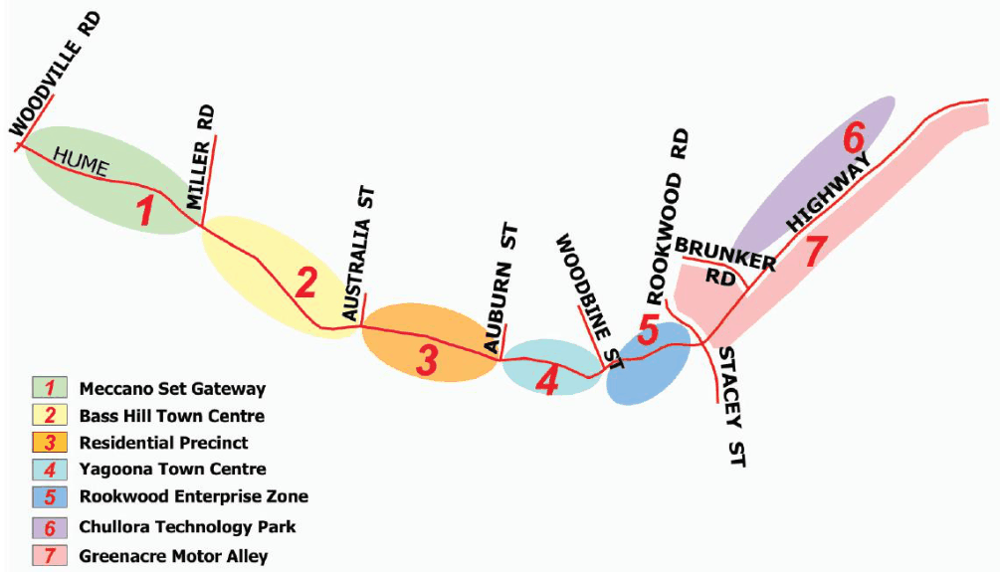

## Chapter 8 Employment Lands

### 8.3 Hume Highway Enterprise Corridor

June 2023 (Amended April 2025)

Welcome to the

### City of Canterbury-Bankstown

#### Great Cities

We believe in creating vibrant, dynamic, and diverse communities that offer opportunities for people to connect, pursue their passions, and contribute to the world around them.

#### Naturally Green

We protect and prioritise nature in and around our city to enhance environmental sustainability and improve the quality of life for our residents.

#### Design Excellence

We encourage buildings, spaces, and objects that are both beautiful and practical, enhancing the beauty, accessibility, and safety of our built environment.

#### People First

We prioritise the needs, preferences, and aspirations of our community in all aspects of urban planning and design, creating supportive and enriching places people love.

#### Community

We engage with our community to ensure their needs and aspirations are reflected in the outcome, creating sustainable, resilient, vibrant, diverse, and inclusive places.

#### Sustainability

We seek designs that reduce negative impacts on the environment while also promoting social and economic well-being.

#### Net-Zero

We encourage our community to design buildings and places that produce as much renewable energy as they consume, reducing greenhouse gas emissions, lowering energy bills, and increasing resilience to environmental shocks and stresses.

#### Join us in creating a City that's liveable, loveable, and sustainable for all!

#### CONTENTS

Section 1 – Introduction ......................................................................................................... 4

Section 2 – Desired character ................................................................................................ 6

Section 3 – Remembrance Driveway Landscape Corridor ..................................................... 8

Section 4 – Rookwood Village Centre .................................................................................. 10

Section 5 – 139–159 Hume Highway, Greenacre ................................................................ 15

Section 6 – 167 Hume Highway, Greenacre ........................................................................ 19

Section 7 – 225–243A Hume Highway, Greenacre .............................................................. 34

Section 8 – 315 Hume Highway, Bankstown ....................................................................... 38

## SECTION 1–INTRODUCTION

#### Explanation

The Hume Highway Enterprise Corridor is a national and historical landmark.

Commissioned by Governor Macquarie in 1813, the Hume Highway today functions as:

• A national highway linking Sydney with Canberra and Melbourne.

• A front door to Canterbury-Bankstown, with over 62,000 motorists travelling through the municipality (via the Hume Highway) every day.

• A major investment and employment zone for Canterbury-Bankstown, with major corporations and multinational companies.

In addition, there are many national, state and regional significant features located along the Hume Highway Enterprise Corridor as it passes through Canterbury-Bankstown. These include the Remembrance Driveway landscape corridor, the Dunc Grey Velodrome and Olympic cycling venue, the Meccano Set intersection and the historic Water Tower at the Stacey Street intersection.

Connective City 2036 and Council’s Employment Lands Strategy identify the Hume Highway Enterprise Corridor as employment lands that support the delivery of jobs and urban services to meet community needs. Key actions are to protect and enhance these employment lands to provide a greater range of jobs, and to boost these places as quality locations to do business.

The Canterbury-Bankstown Local Environmental Plan 2023 and Canterbury-Bankstown Development Control Plan 2023 combine to regulate effective and orderly development, consistent with Connective City 2036.

The Canterbury-Bankstown Local Environmental Plan 2023 is Council's principal planning document. It provides objectives, zones and development standards such as lot sizes, floor space ratios and building heights.

The Canterbury-Bankstown Development Control Plan 2023 supports the LEP by providing additional objectives and development controls to enhance the function, design and amenity of certain precincts within the Hume Highway Enterprise Corridor. Note: If applicable to an application, the development controls of Chapter 8.3 of this DCP will prevail if there is an inconsistency with any other development controls in this DCP.

#### Objectives

O1 To ensure the Hume Highway Enterprise Corridor provides a distinctive and high quality environment for employment and economic activities.

O2 To ensure development is compatible with the centres hierarchy and the desired character of the Hume Highway Enterprise Corridor.

O3 To enhance the amenity for people who work in, live in and visit the Hume Highway Enterprise Corridor.

O4 To facilitate ecologically sustainable development.

O5 To enhance the Remembrance Driveway landscape corridor.

O6 To provide specific guidelines for key development sites.

## SECTION 2–DESIRED CHARACTER

#### Explanation

The Hume Highway Enterprise Corridor is a national and historical landmark that will continue to function as a significant economic asset for Canterbury-Bankstown. The vision is to promote the image of Canterbury-Bankstown by reinforcing the Remembrance Driveway landscape corridor. The built form will supplement the landscape corridor, with multi-storey enterprise activities along the highway.

While there are seven precincts of distinctive functional and physical character within the local centre as shown in Figure 2a, this chapter is specific to the Rookwood Village Centre and Greenacre Motorway Alley, together with the Remembrance Drive Landscape Corridor. These precincts offer an effective base to implement the desired character and development controls at the local level.

> [Picture on page 6: a picture, saved as a picture (images/ch-08-03-hume-highway-enterprise-corridor-page-6-13.gif, 150 dpi).]

Figure 2a: Precinct Plan

#### Desired character
