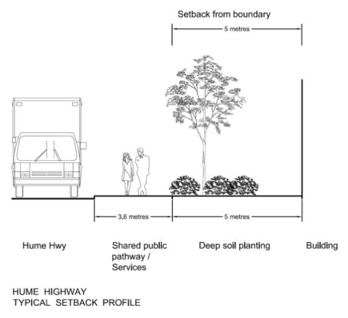
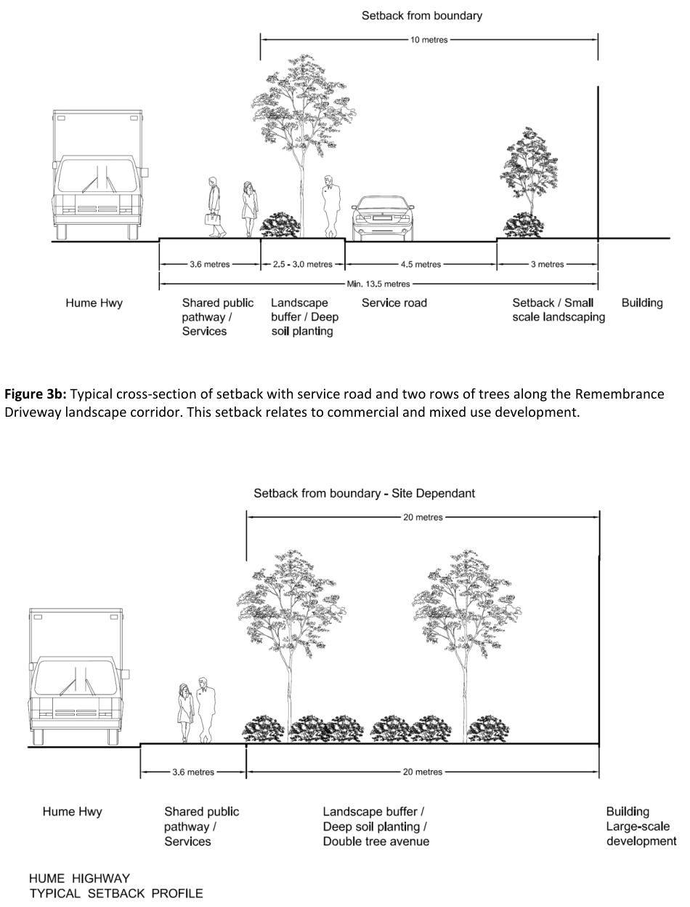
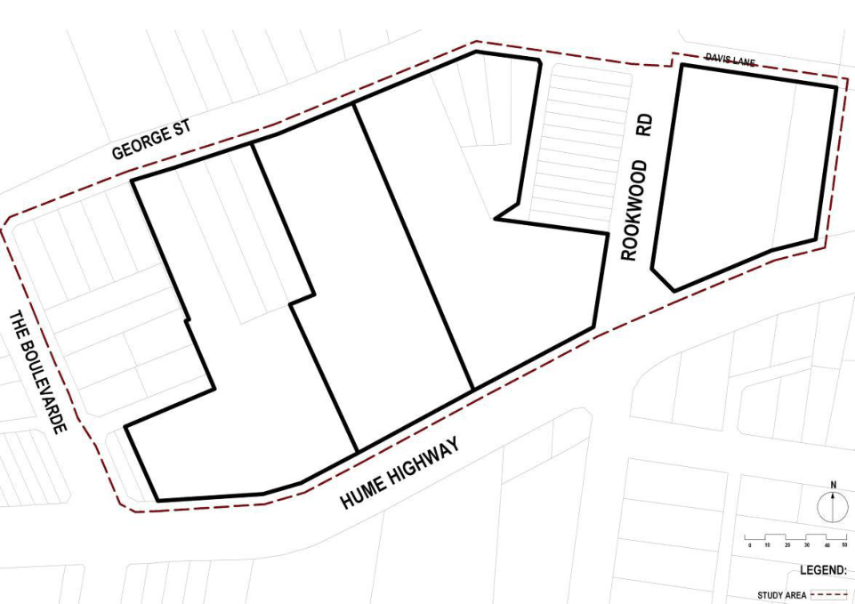
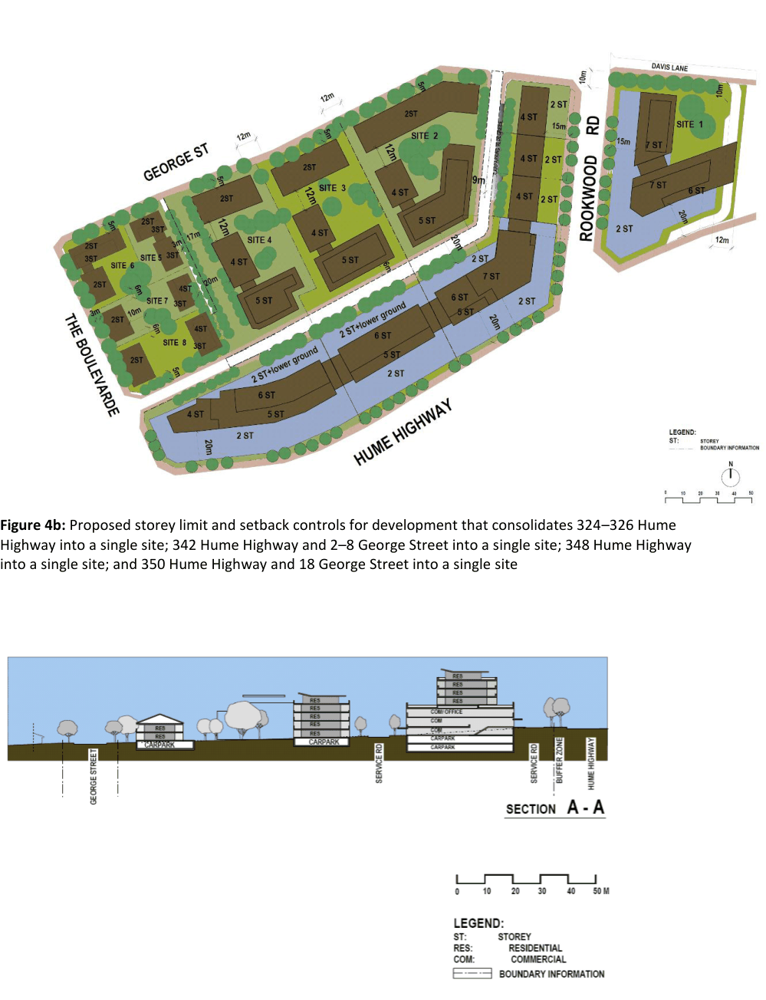
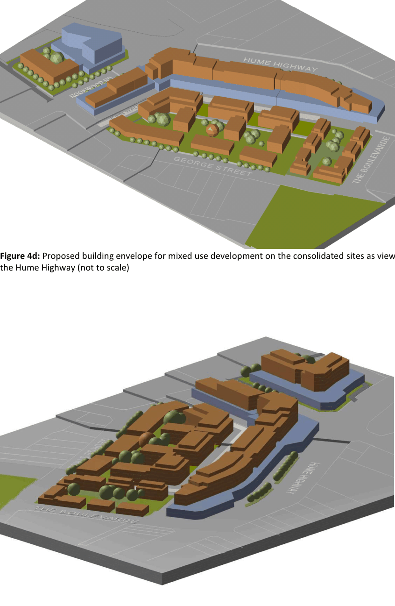
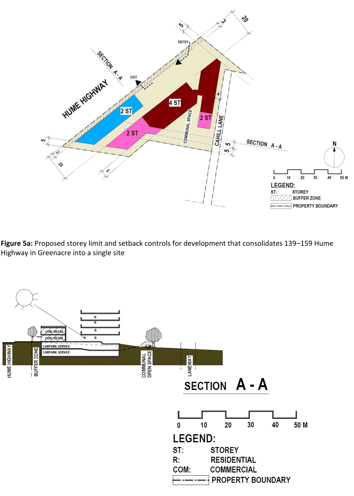
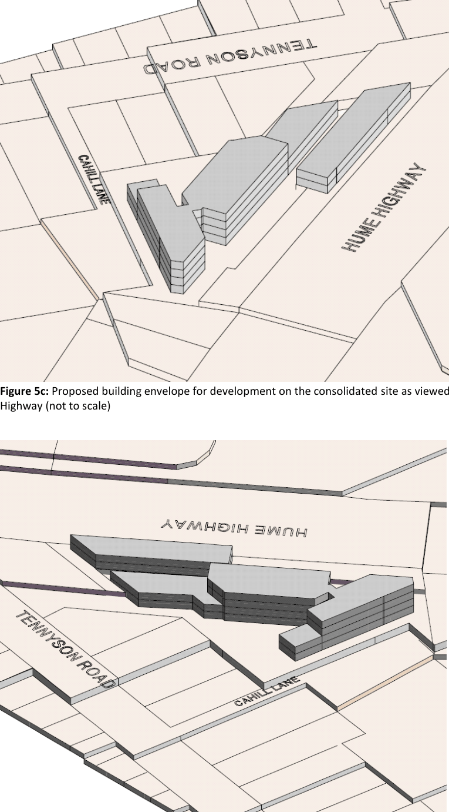

#### C3 Greenacre Motor Alley

The Greenacre Motor Alley is an employment zone that will:

• enable a mix of high technology industries, businesses, car yards and highway related uses in a landscaped setting; and

• allow opportunities for residential flat buildings on large sites where the residential use is setback from the Hume Highway and do not impact on neighbours to the south.

## SECTION 3–REMEMBRANCE DRIVEWAY LANDSCAPE CORRIDOR

#### Explanation

The Remembrance Driveway is a landscape corridor along the Hume and Federal Highways to commemorate the Australian Forces who have served since World War I. The Remembrance Driveway extends from Macquarie Place, Sydney to the Australian War Memorial, Canberra. The section of Remembrance Driveway that passes through Canterbury-Bankstown is the primary landscape feature that characterises the Hume Highway Enterprise Corridor.

#### Objectives

O1 To enhance the Remembrance Driveway landscape corridor by providing a landscape buffer zone to the Hume Highway.

#### Development controls

3.1 This clause applies to sites within Zone E3 Productivity Support that adjoin the Hume Highway. Development must plant a 75 litre tree at 5m intervals along the length of the Hume Highway boundary of the site, and must select the trees from the list in Appendix 1.

> [Picture on page 8: a picture, saved as a picture (images/ch-08-03-hume-highway-enterprise-corridor-page-8-17.gif, 150 dpi).]

Figure 3a: Typical cross-section of setback with single row of trees along the Remembrance Driveway landscape corridor. This setback relates to commercial and mixed use development.

> [Picture on page 9: a picture, saved as a picture (images/ch-08-03-hume-highway-enterprise-corridor-page-9-1.gif, 150 dpi).]

Figure 3b: Typical cross-section of setback with service road and two rows of trees along the Remembrance Driveway landscape corridor. This setback relates to commercial and mixed use development.

Figure 3c: Typical cross-section of setback with two rows of trees along the Remembrance Driveway landscape corridor. This setback relates to residential flat buildings.

## SECTION 4–ROOKWOOD VILLAGE CENTRE

#### Explanation

Connective City 2036 and Council’s Employment Lands Strategy identify the Rookwood Road Village as employment lands that promote good design and amenity for workers, residents and visitors.

Good design provides a solid basis for a high quality, comfortable environment for people. It achieves a building form that is appropriate to the desired character of the street and surrounding buildings. It achieves a building form that defines the public domain, provides internal amenity and considers neighbours’ amenity.

Good design also recognises that together landscape and buildings operate as an integrated and sustainable system, resulting in attractive developments with good amenity. Good landscape design enhances the development’s environmental performance by retaining positive natural features which contribute to the local context, and providing deep soil zones for vegetation and urban heat/water management.

As part of the design process, applicants must note that a building envelope is not a building, but a three dimensional shape that may determine the bulk and siting of a building. After allowing for building articulation and other development controls, the achievable floor space of a development is likely to be less than the building envelope.

#### Objectives

O1 To provide the Hume Highway Enterprise Corridor with environments that are safe, well-landscaped and achieve high amenity.

O2 To promote business frontages to the Hume Highway.

O3 To provide storey limits.

O4 To achieve good design in terms of building form, bulk, architectural treatment, visual amenity and landscape.

O5 To ensure the building form and design provide appropriate amenity to people who work in, live in and visit the enterprise corridors.

O6 To require setbacks to the Hume Highway that improves the amenity of dwellings in terms of air quality and acoustic privacy.

O7 To provide a landscape buffer zone to the Hume Highway that enhances the Remembrance Driveway landscape corridor and improves the amenity of development.

O8 To provide deep soil zones to manage urban heat and water, and to allow for and support healthy plant and tree growth.

O9 To ensure development is compatible with the prevailing suburban character and amenity of neighbouring residential areas.

#### Development controls

4.1 Council may apply the storey limit (not including basements) shown in Figure 4b to land within Zone E3 Productivity Support only if it is satisfied that:

(a) development will consolidate all adjoining lots shown edged with a heavy black line in Figure 4a into a single site; and

(b) development will provide a two storey buffer along the George Street boundary of the site. Council does not allow development with four or more storeys to have attics.

If in Council's opinion a development does not satisfy this clause, a two storey limit will apply to each lot.

> [Picture on page 11: a picture, saved as a picture (images/ch-08-03-hume-highway-enterprise-corridor-page-11-13.gif, 150 dpi).]

Figure 4a: Council may apply Figure 4b to land within Zone E3 Productivity Support only if it is satisfied that a development consolidates 324–326 Hume Highway into a single site; 342 Hume Highway and 2–8 George Street into a single site; 348 Hume Highway into a single site; and 350 Hume Highway and 18 George Street into a single site (as shown edged with a heavy black line)

4.2 Development within Zone E1 Local Centre must comply with the storey limit shown in Figure 4b and must ensure development does not exceed four storeys. Council does not allow development with four storeys to have attics.

4.3 Development must comply with the minimum setbacks shown in Figure 4b and must ensure:

(a) dwellings are setback a minimum 20m from the Hume Highway boundary of the site;

(b) commercial and other non-residential development are setback a minimum 5m from the Hume Highway boundary of the site; and

(c) development provides appropriate solar access to neighbouring land within Zone R4 High Density Residential.

4.4 This clause applies to 324–326 Hume Highway, Bankstown. The minimum setback for dwellings to the Hume Highway boundary of the site may reduce to 10m provided Council is satisfied that there is appropriate amenity protection for residents in relation to air quality and acoustic privacy. Otherwise the minimum 20m setback will continue to apply.

4.5 Development must provide a minimum 5m wide landscape buffer zone to the Hume Highway boundary of the site to enhance the Remembrance Driveway landscape corridor.

4.6 Vehicle access to the sites may be permitted from George Street, Davis Lane, John Wall Lane and Kearns Lane.

4.7 Development on one or more of the sites at 342–350 Hume Highway, Bankstown must create a shared rear lane for vehicle access and servicing purposes.  The proposed rear lane should connect with John Wall Lane and Kearns Lane as shown in Figure 4b.

> [Picture on page 13: a picture, saved as a picture (images/ch-08-03-hume-highway-enterprise-corridor-page-13-1.gif, 150 dpi).]

Figure 4b: Proposed storey limit and setback controls for development that consolidates 324–326 Hume Highway into a single site; 342 Hume Highway and 2–8 George Street into a single site; 348 Hume Highway into a single site; and 350 Hume Highway and 18 George Street into a single site

Figure 4c: Proposed storey limit for mixed use development on the consolidated sites

> [Picture on page 14: a picture, saved as a picture (images/ch-08-03-hume-highway-enterprise-corridor-page-14-1.gif, 150 dpi).]

Figure 4d: Proposed building envelope for mixed use development on the consolidated sites as viewed from the Hume Highway (not to scale)

Figure 4e: Proposed building envelope for mixed use development on the consolidated sites as viewed from George Street at the rear (not to scale)

## SECTION 5–GREENACRE MOTOR ALLEY (139–159 HUME HIGHWAY IN GREENACRE)

#### Explanation

Good design provides a solid basis for a high quality, comfortable environment for people. It achieves a building form that is appropriate to the desired character of the street and surrounding buildings. It achieves a building form that defines the public domain, provides internal amenity and considers neighbours’ amenity.

As part of the design process, applicants must note that a building envelope is not a building, but a three dimensional shape that may determine the bulk and siting of a building. After allowing for building articulation and other development controls, the achievable floor space of a development is likely to be less than the building envelope.

#### Objectives

O1 To provide the Hume Highway Enterprise Corridor with environments that are safe, well-landscaped and achieve high amenity.

O2 To promote business frontages to the Hume Highway.

O3 To provide storey limits.

O4 To achieve good design in terms of building form, bulk, architectural treatment, visual amenity and landscape.

O5 To ensure the building form and design provide appropriate amenity to people who work in, live in and visit the enterprise corridors.

O6 To require setbacks to the Hume Highway that improves the amenity of dwellings in terms of air quality and acoustic privacy.

O7 To provide a landscape buffer zone to the Hume Highway that enhances the Remembrance Driveway landscape corridor and improves the amenity of development.

O8 To provide deep soil zones to manage urban heat and water, and to allow for and support healthy plant and tree growth.

O9 To ensure development is compatible with the prevailing suburban character and amenity of neighbouring residential areas.

#### Development controls

5.1 Council may apply the storey limit (not including basements) shown in Figure 5a to the site at 139–159 Hume Highway in Greenacre only if it is satisfied that:

(a) development will consolidate all the lots into a single site; and

(b) development within 20m of the Hume Highway boundary of the site does not exceed two storeys; and

(c) development in the remaining area of the site does not exceed four storeys. Council does not allow development with four storeys to have attics.

If in Council's opinion a development does not satisfy this clause, a two storey limit will apply to each lot.

5.2 Development must comply with the minimum setbacks shown in Figure 5a and must ensure:

(a) dwellings are setback a minimum 20m from the Hume Highway boundary of the site;

(b) commercial and other non-residential development are setback a minimum 3m from the Hume Highway boundary of the site; and

(c) development provides appropriate solar access to the existing dwellings that adjoin the side and rear boundaries of the site.

5.3 Development must provide a minimum 3m wide landscape buffer zone to the Hume Highway boundary of the site to enhance the Remembrance Driveway landscape corridor.

5.4 Vehicle access to the site may be permitted from the Hume Highway.

> [Picture on page 17: a picture, saved as a picture (images/ch-08-03-hume-highway-enterprise-corridor-page-17-1.gif, 150 dpi).]

Figure 5a: Proposed storey limit and setback controls for development that consolidates 139–159 Hume Highway in Greenacre into a single site

Figure 5b: Proposed storey limit for development on the consolidated site

> [Picture on page 18: a picture, saved as a picture (images/ch-08-03-hume-highway-enterprise-corridor-page-18-1.gif, 150 dpi).]

Figure 5c: Proposed building envelope for development on the consolidated site as viewed from the Hume Highway (not to scale)

Figure 5d: Proposed building envelope for development on the consolidated site as viewed from Cahill Lane at the rear (not to scale)

## SECTION 6–GREENACRE MOTOR ALLEY (167 HUME HIGHWAY IN GREENACRE)

#### INTRODUCTION
