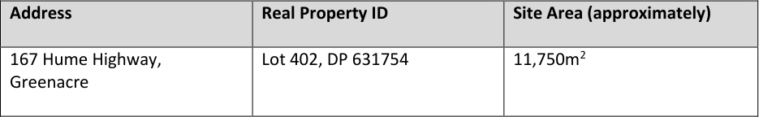
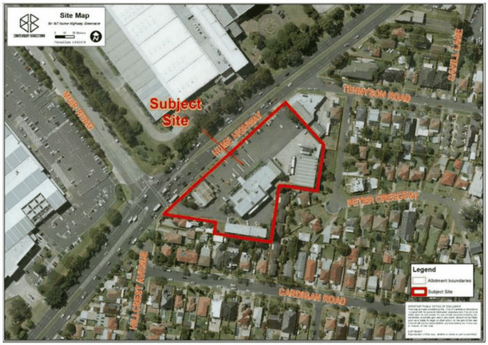

### 6.1 Land to which this section applies

This section of the DCP applies to the following properties as shown in Figure 6a below.

#### Table 1: Subject Site

> [Picture on page 19: a picture, saved as a picture (images/ch-08-03-hume-highway-enterprise-corridor-page-19-7.gif, 150 dpi).]
> Words printed on the picture (title and legend, copied from the PDF):
> Real Property ID
> Site Area (approximately)
> Address
> Lot 402, DP 631754
> 11,750m2
> 167 Hume Highway,
> Greenacre

> [Picture on page 19: a picture, saved as a picture (images/ch-08-03-hume-highway-enterprise-corridor-page-19-8.gif, 150 dpi).]

Figure 6a: 167 Hume Highway, Greenacre
