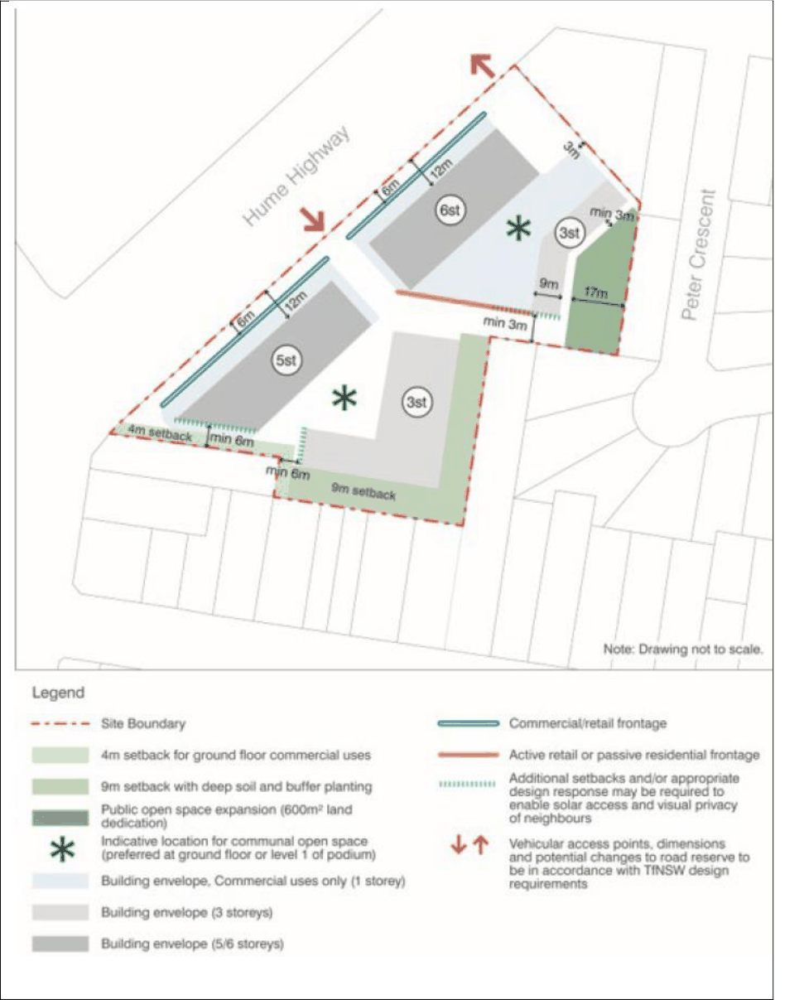

### 6.4 Key design principles and indicative structure plan

This section sets out the key design principles and priorities to guide future applications for the site. Council may consider amendments to the indicative structure plan that is consistent with the desired character and the overarching key design principles for the site.

(a) Create an active highway related commercial frontage: Provide floor plates suitable for commercial uses mandated by the LEP, that are consistent with highway related commercial purposes.

(b) Improve permeability and access to the site: Improve site permeability and access for the residents and workers of the subject site by providing appropriate building layout and good design to allow easy access, effective orientation and clear wayfinding.

(c) Provide a landscaped setback along Hume Highway: Provide a landscaped buffer zone to Hume Highway in order to enhance the ‘Remembrance Driveway’ landscape corridor and to improve the amenity of development.

(d) Provide high quality communal open space: Create new landscaped and useable communal open spaces preferably on the ground floor to deliver a high level of amenity for all users. Open space areas above the ground plane may be permitted where they do not result in adverse overlooking impacts, or solar conditions, to adjoining land zoned R2 Low Density, or Peter Reserve.

(e) Provide high quality built form: Position, separate and scale new buildings to provide an urban form that is responsive to neighbouring land uses, supports the desired future character of the precinct and maximises amenity within apartments and to open space areas.

(f) Minimise overlooking and overshadowing to adjoining land: Provide appropriate side and rear setbacks to the surrounding Zone R2 Low Density Residential land and Peter Reserve to provide an acceptable transition and to address issues such as visual privacy, amenity and solar access. The setbacks may include deep soil zones to allow mature tree planting.

(g) Address site topography and flooding: Provide an architectural design that addresses the level change across the site (approximately 5m drop from Hume Highway to Peter Reserve) and the proposed maximum building heights. Flood risk management strategies are required to identify a safe evacuation route to a point above the PMF flooding extent and protect the basement parking or below ground structures that are located adjacent to the flood extents.

(h) Provide good amenity for future occupiers: To provide appropriate acoustic design and treatments to mitigate acoustic issues arising from Hume Highway and to address indoor air quality for future developments.

> [Picture on page 22: a picture, saved as a picture (images/ch-08-03-hume-highway-enterprise-corridor-page-22-1.gif, 150 dpi).]

Figure 6b: Indicative structure plan

#### DEVELOPMENT CONTROLS

The objectives and controls for the development of the subject site are set out in this section. These controls also refer to the indicative structure plan outlined in Figure 6b.
