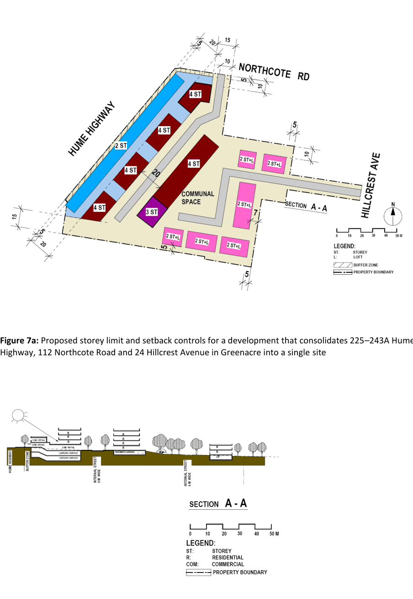
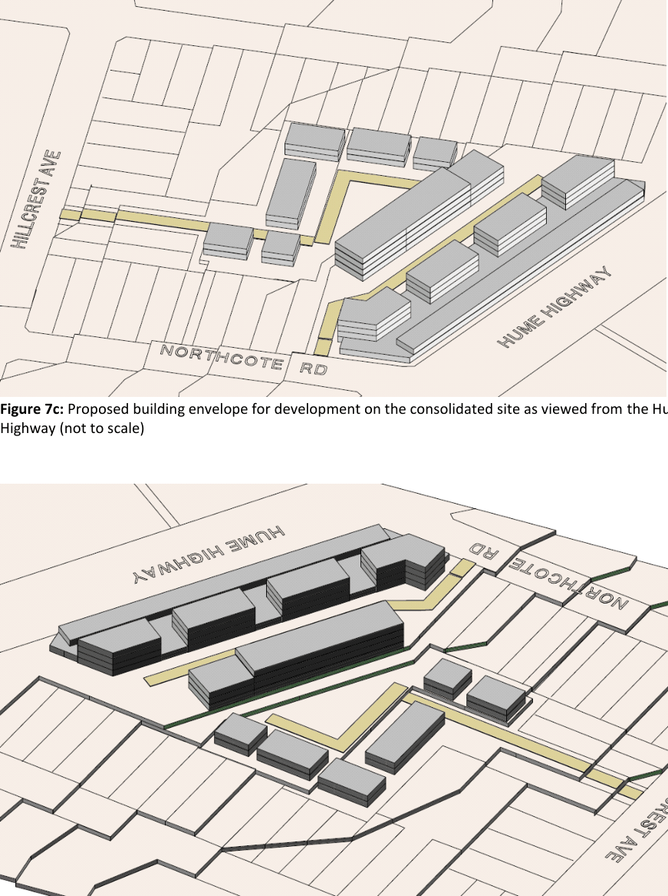
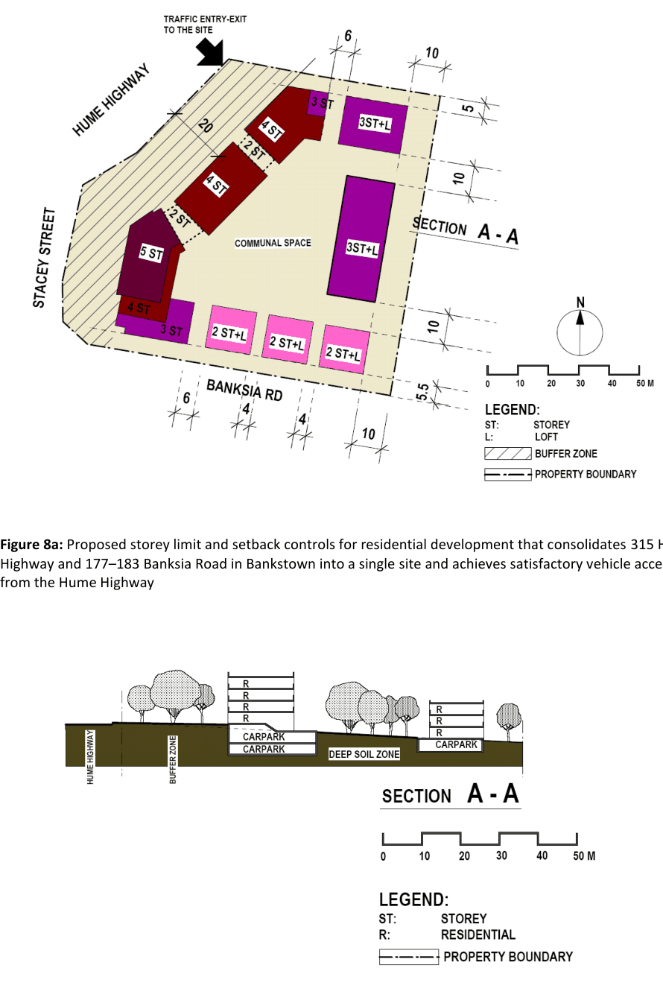
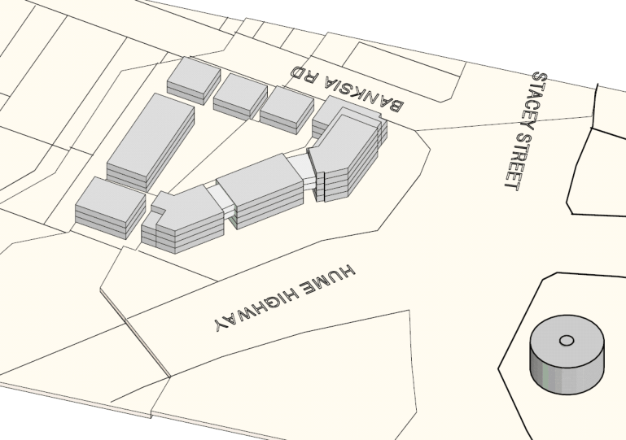
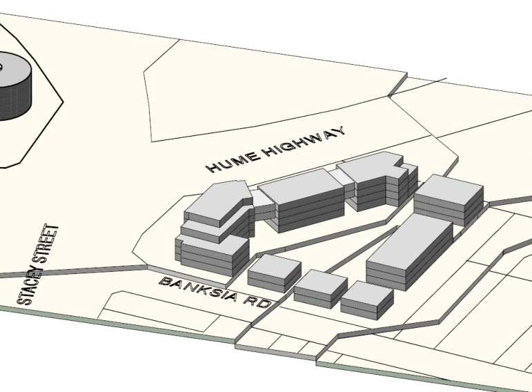

### 6.15 Rooftop solar features and lighting

#### Objectives

O1 To encourage and maximise the use of renewable energy to lessen the carbon footprint of the proposed development.

O2 To avoid adverse implications of light spill/glare to the surrounding residential areas.

#### Development controls

C1 The development will include the installation of a solar photovoltaic (PV) system to supply energy to the common areas of buildings, communal open space including outdoor lighting and any other parts of the development, as appropriate.

C2 The application must provide a roof plan showing the area(s) allocated to PVs, necessary access requirements for cleaning and maintenance, other plant and equipment that may include solar water heater storage tanks, ventilators, wind generators, air conditioning units and satellite dishes and antennae. Details including connections to battery storage within individual apartments are to be provided within application plans.

C3 The solar panels must not adversely affect the architectural presentation of the building or views from the streetscape.

C4 The use, location and placement of photovoltaic solar panels should be considered, taking into account the impact on surrounding built forms and overshadowing impacts.

C5 The development is to minimise light spill into the adjacent residential areas.

## SECTION 7–GREENACRE MOTOR ALLEY (225–243A HUME HIGHWAY, 112 NORTHCOTE ROAD AND 24 HILLCREST AVENUE IN GREENACRE)

#### Explanation

Good design provides a solid basis for a high quality, comfortable environment for people. It achieves a building form that is appropriate to the desired character of the street and surrounding buildings. It achieves a building form that defines the public domain, provides internal amenity and considers neighbours’ amenity.

As part of the design process, applicants must note that a building envelope is not a building, but a three dimensional shape that may determine the bulk and siting of a building. After allowing for building articulation and other development controls, the achievable floor space of a development is likely to be less than the building envelope.

#### Objectives

O1 To provide the Hume Highway Enterprise Corridor with environments that are safe, well-landscaped and achieve high amenity.

O2 To promote business frontages to the Hume Highway.

O3 To provide storey limits.

O4 To achieve good design in terms of building form, bulk, architectural treatment, visual amenity and landscape.

O5 To ensure the building form and design provide appropriate amenity to people who work in, live in and visit the enterprise corridors.

O6 To require setbacks to the Hume Highway that improves the amenity of dwellings in terms of air quality and acoustic privacy.

O7 To provide a landscape buffer zone to the Hume Highway that enhances the Remembrance Driveway landscape corridor and improves the amenity of development.

O8 To provide deep soil zones to manage urban heat and water, and to allow for and support healthy plant and tree growth.

O9 To ensure development is compatible with the prevailing suburban character and amenity of neighbouring residential areas.

#### Development controls

7.1 Council may apply the storey limit (not including basements) shown in Figure 7a to the site at 225–243A Hume Highway, 112 Northcote Road, and 24 Hillcrest Avenue in Greenacre only if it is satisfied that:

(a) development will consolidate all the lots into a single site; and

(b) development within 20m of the Hume Highway boundary of the site does not exceed two storeys; and

(c) development in the remaining area of the site does not exceed four storeys. Council does not allow development with four storeys to have attics.

If in Council's opinion a development does not satisfy this clause, a two storey limit will apply to each lot.

7.2 Development must comply with the minimum setbacks shown in Figure 7a and must ensure:

(a) dwellings are setback a minimum 20m from the Hume Highway boundary of the site;

(b) commercial development is setback a minimum 5m from the Hume Highway boundary of the site; and

(c) development provides appropriate solar access to the existing dwellings that adjoin the side and rear boundaries of the site.

7.3 Development must provide a minimum 5m wide landscape buffer zone to the Hume Highway boundary of the site to enhance the Remembrance Driveway landscape corridor.

7.4 Vehicle access to the site may be permitted from Northcote Road or Hillcrest Avenue and the Hume Highway.

> [Picture on page 36: a picture, saved as a picture (images/ch-08-03-hume-highway-enterprise-corridor-page-36-1.gif, 150 dpi).]

Figure 7a: Proposed storey limit and setback controls for a development that consolidates 225–243A Hume Highway, 112 Northcote Road and 24 Hillcrest Avenue in Greenacre into a single site

Figure 7b: Proposed storey limit for development on the consolidated site

> [Picture on page 37: a picture, saved as a picture (images/ch-08-03-hume-highway-enterprise-corridor-page-37-1.gif, 150 dpi).]

Figure 7c: Proposed building envelope for development on the consolidated site as viewed from the Hume Highway (not to scale)

Figure 7d: Proposed building envelope for development on the consolidated site as viewed from Hillcrest Avenue at the rear (not to scale)

## SECTION 8–GREENACRE MOTOR ALLEY (315 HUME HIGHWAY AND 177–183 BANKSIA ROAD IN BANKSTOWN)

#### Explanation

Good design provides a solid basis for a high quality, comfortable environment for people. It achieves a building form that is appropriate to the desired character of the street and surrounding buildings. It achieves a building form that defines the public domain, provides internal amenity and considers neighbours’ amenity.

As part of the design process, applicants must note that a building envelope is not a building, but a three dimensional shape that may determine the bulk and siting of a building. After allowing for building articulation and other development controls, the achievable floor space of a development is likely to be less than the building envelope.

#### Objectives

O1 To provide the Hume Highway Enterprise Corridor with environments that are safe, well-landscaped and achieve high amenity.

O2 To promote business frontages to the Hume Highway.

O3 To provide storey limits.

O4 To achieve good design in terms of building form, bulk, architectural treatment, visual amenity and landscape.

O5 To ensure the building form and design provide appropriate amenity to people who work in, live in and visit the enterprise corridors.

O6 To require setbacks to the Hume Highway that improves the amenity of dwellings in terms of air quality and acoustic privacy.

O7 To provide a landscape buffer zone to the Hume Highway that enhances the Remembrance Driveway landscape corridor and improves the amenity of development.

O8 To provide deep soil zones to manage urban heat and water, and to allow for and support healthy plant and tree growth.

O9 To ensure development is compatible with the prevailing suburban character and amenity of neighbouring residential areas.

#### Development controls

8.1 Council may apply the storey limit (not including basements) shown in Figure 8a to the site at 315 Hume Highway and 177–183 Banksia Road in Bankstown only if it is satisfied that:

(a) development will consolidate all the lots into a single site; and

(b) development will achieve appropriate vehicle access to the single site from the Hume Highway, and not from Banksia Road;

(c) development adjoining the Banksia Road boundary of the site does not exceed two storeys;

(d) development adjacent to the Hume Highway boundary of the site does not exceed four storeys; and

(e) development adjacent to the Stacey Street boundary of the site does not exceed five storeys; and

(f) development in the remaining area of the site does not exceed three storeys. Council does not allow development with four or more storeys to have attics.

If in Council's opinion a development does not satisfy this clause, a two storey limit will apply to each lot.

8.2 The storey limit for commercial development is two storeys.

8.3 Development must provide a minimum 5m wide landscape buffer zone to the Hume Highway and Stacey Street boundaries of the site to enhance the Remembrance Driveway landscape corridor.

8.4 The minimum setback for commercial development to the Hume Highway and Stacey Street boundaries of the site is 5m.

8.5 Residential development must comply with the minimum setbacks shown in Figure 8a and must ensure a dwelling is setback a minimum 20m from the from the Hume Highway boundary of the site.

8.6 Commercial development or landscape buffer zone or indoor communal space should occupy the minimum 20m setback for dwellings to act as a buffer between the dwellings and the Hume Highway/Stacey Street.

8.7 Vehicle access to the site may be permitted from the Hume Highway, but is not permitted from Banksia Road.

> [Picture on page 40: a picture, saved as a picture (images/ch-08-03-hume-highway-enterprise-corridor-page-40-1.gif, 150 dpi).]

Figure 8a: Proposed storey limit and setback controls for residential development that consolidates 315 Hume Highway and 177–183 Banksia Road in Bankstown into a single site and achieves satisfactory vehicle access from the Hume Highway

Figure 8b: Proposed storey limit for the consolidated site

> [Picture on page 41: a picture, saved as a picture (images/ch-08-03-hume-highway-enterprise-corridor-page-41-1.gif, 150 dpi).]

Figure 8c: Proposed building envelope for development on the consolidated site as viewed from the Hume Highway (not to scale)

> [Picture on page 41: a picture, saved as a picture (images/ch-08-03-hume-highway-enterprise-corridor-page-41-4.gif, 150 dpi).]

Figure 8d: Proposed building envelope for development on the consolidated site as viewed from Banksia Road at the rear (not to scale)

#### APPENDIX 1–SUITABLE TRESS ON THE HUME HIGHWAY

| Australian native species | Common name | Preferred soil–Improved soil conditions, composted garden soil (sand / clay) |
|---|---|---|
| Acmena smithii | Lilli Pilli |  |
| Angophora costata | Smooth Barked Apple |  |
| Brachychiton acerifolius | Illawarra Flame Tree |  |
| Cupaniopsis anarchoides | Tuckeroo |  |
| Elaeocarpus reticulatus | Blueberry Ash | s* |
| Eucalyptus beaureana | Blue Box |  |
| Eucalyptus haemastoma | Scribbly Gum | s* |
| Eucalyptus maculata | Spotted Gum |  |
| Eucalyptus moluccana | Grey Box | c* |
| Flindersia australis | Australian Teak/ Crows Ash |  |
| Harpullia pendula | Tulipwood |  |
| Leptospermum petersonii | Lemon Scented Tea Tree | s/c* |
| Lophostemon conferta | Brushbox |  |
| Stenocarpus sinuatus | Queensland Firewheel Tree |  |
| Syncarpia glomulifera | Turpentine | s/c* |
| Syzygium luehmannii | Small Leaf Lilli Pilli |  |
| Tristaniopsis laurina | Water Gum |  |
| Non-native species | Common name | Preferred soil–Improved organic |
| Gordonia axillaris | Gordonia |  |
| Jacaranda mimosaefolia | Jacaranda |  |
| Koelreutaria paniculata | Pride of China |  |
| Lagerstroemia indica | Crepe Myrtle |  |
| Liriodendron tulipifera | Tulip Tree |  |
| Magnolia grandiflora | Bull Bay Magnolia |  |
| Platanus cuniata | Cut-Leaf Plane |  |
| Platanus x hybrida | London Plane |  |
| Pyrus calleryana | Callery Pear |  |
| Pyrus ussuriensis | Manchurian Pear |  |
| Sapium sebiferum | Chinese Tallowood |  |
| Ulmus parvifolia | Chinese Elm |  |
| Zelkova serrata | Japanese Elm, Keyaki |  |
| * Asterix denotes plant species native to Canterbury-Bankstown. Note: Plants listed will benefit from improved garden soil conditions, irrigation and ongoing maintenance. The above plant list is not exhaustive, additional species may be considered. Planting to be determined with concession to site conditions, aspect, exposure, drainage and surrounding vegetation. |  |  |
