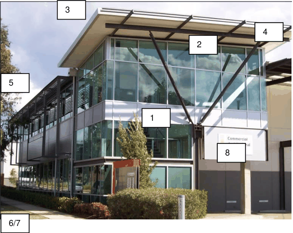
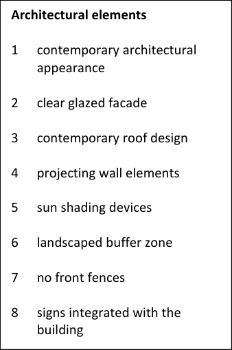

### 2.11 Development must:

(a) retain and protect any existing trees identified by Council on the site and adjoining sites; and

(b) must not change the ground level (existing) within 3m of the base of the trunk or within the dripline, whichever is the greatest.

2.12 Development must plant at least one street tree at 5m intervals along the length of the primary and secondary street frontages. Council may vary this requirement in response to proposed tree species, site constraints limit their inclusion or a street tree already exists in good condition.

2.13 Development must plant trees in the landscaped area at a minimum rate of one canopy tree per 30m2 of the landscaped area. The canopy tree must be capable of achieving a mature height greater than 5m.

2.14 Where development proposes an outdoor car park with 20 or more car parking spaces, the car park design must include at least one tree per 5 car parking spaces to the following specifications:

(a) a tree must be a single trunk species to allow a minimum visibility clearance of 1.5m measured above the ground level (existing); and

(b) a tree must be planted in an island bed that is a minimum 2m in width and 4m in length.

#### Employee amenities

2.15 Development must provide an outdoor employee amenity area with a minimum area of 25m2. This area should include a combination of grass, plantings, pavement, shade, and seating to allow employees to engage in a pleasant working environment.

2.16 Development must locate the employee amenity area away from sources of intrusive noise (such as loading and servicing, and heavy machinery), dust, vibration, heat, fumes, odour or other nuisances.

## SECTION 3–BUILDING DESIGN

#### Explanation

Good design is important to achieve a built form that has good proportions and a balanced composition of elements, reflecting the internal layout and structure. It uses a variety of materials, colours and textures.

Good design also optimises safety and security, within the development and the public domain. It provides opportunities to promote safety by maximising passive surveillance and defining secure access points that are visible and well-lit.

#### Objectives

O1 To achieve good design in terms of architectural treatment and visual amenity.

O2 To ensure the siting and design of buildings contribute to the personal and property security of people.

O3 To maximise natural surveillance so that people feel safe at all times.

O4 To encourage building designs, materials and maintenance programs that reduce the opportunities for vandalism and graffiti.

#### Development controls

#### Facade design

3.1 Development must articulate the facades to achieve a unique and contemporary architectural appearance that:

(a) unites the facades with the whole building form;

(b) composes the facades with an appropriate scale and proportion that responds to the use of the building and the desired contextual character;

(c) combines high quality materials and finishes;

(d) considers the architectural elements shown in Figure 3a; and

(e) considers any other architectural elements to Council's satisfaction.

3.2 Development may have predominantly glazed facades provided it does not cause significant glare nuisance.

3.3 Industrial retail outlets must incorporate shopfront style windows with clear glazing so that people can see into the premises and vice versa. Council discourages the use of obscure or opaque glass, or other types of screening.

3.4 Where development proposes a portal frame or similar construction, Council does not allow the ‘stepping’ of the parapet to follow the line of the portal frame.

> [Picture on page 10: a picture, saved as a picture (images/ch-09-01-general-requirements-page-10-1.gif, 150 dpi).]
> Words printed on the picture (title and legend, copied from the PDF):
> 2
> 5
> 1
> 8
> 6/7

Figure 3a: Architectural elements

#### Facade design (corner sites)

> [Picture on page 10: a picture, saved as a picture (images/ch-09-01-general-requirements-page-10-4.gif, 150 dpi).]
> Words printed on the picture (title and legend, copied from the PDF):
> Architectural elements
> 1 contemporary architectural
> appearance
> 2 clear glazed facade
> 3 contemporary roof design
> 4 projecting wall elements
> 5 sun shading devices
> 6 landscaped buffer zone
> 7 no front fences
> 8 signs integrated with the
> building

3.5 The street facade of development on a corner site must incorporate architectural corner features to add visual interest to the streetscape.

#### Facade design (materials)
