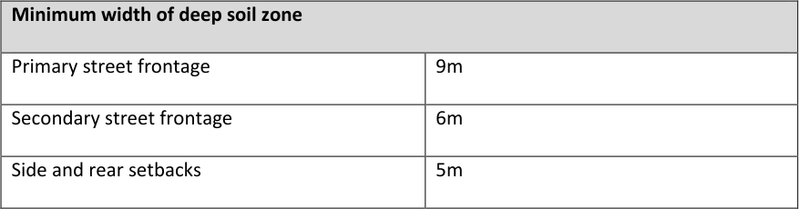

### 4.11 Council may require greater setbacks:

(a) where development adjoins land in Zone E4 General Industrial or state/regional roads or rail corridors, to incorporate measures to protect the amenity of students and staff from air and noise pollutants; or

(b) where the school requires off-street bus bays; or

(c) where the school requires vehicle access to the entry points of administration buildings.

#### Deep soil zones

4.12 Development for the purpose of schools within Zone R2 Low Density Residential, Zone R3 Medium Density Residential, Zone R4 High Density Residential and Zone SP2 Infrastructure must provide deep soil zones that have the following minimum widths around the boundary of the site:

> [Picture on page 13: a picture, saved as a picture (images/ch-10-02-schools-page-13-13.gif, 150 dpi).]

| Minimum width of deep soil zone |  |
|---|---|
| Primary street frontage | 9m |
| Secondary street frontage | 6m |
| Side and rear setbacks | 5m |

The deep soil zones must be landscaped by way of deep soil plantings and canopy trees.

4.13 Council will determine the minimum width for deep soil zones for schools in Zone E1 Local Centre and Zone MU1 Mixed Use based on the setbacks of the street and the surrounding buildings.

#### Free play areas

4.14 Development for the purpose of primary schools must dedicate at least 12m2 of site area per student for the exclusive use of free play areas. The minimum size of the free play areas must equate to the greatest number of students that could use the free play areas at any one time. The free play areas must locate at ground level. In this clause, free play areas mean outdoor useable spaces and playing fields that are for the use of students for physical activities and team games.

4.15 Development for the purpose of secondary schools must dedicate part of the site area for the exclusive use of free play areas. The free play areas must locate at ground level.  In this clause, free play areas mean outdoor useable spaces and playing fields that are for the use of students for physical activities and team games.

4.16 Schools must ensure the location of outdoor areas and free play areas avoids:

(a) Existing native vegetation including under storey native vegetation.

(b) Potential traffic hazard locations where an out-of-control vehicle may injure students.

#### Access

4.17 Schools must be easily accessible to people with disabilities and must comply with the Building Code of Australia and Australian Standard AS 1428.1–2021, Design for access and mobility.

4.18 Provision must be made for access and parking of service and emergency vehicles to service all buildings within the school.

#### Car parks

4.19 The minimum number of car parking spaces required for schools is:

(a) one car space per employee or classroom, whichever is the greater; and

(b) one car space per eight students in year 12.

4.20 The car park/manoeuvring areas and the student set-down and pick-up areas must locate separately behind the front building line.
