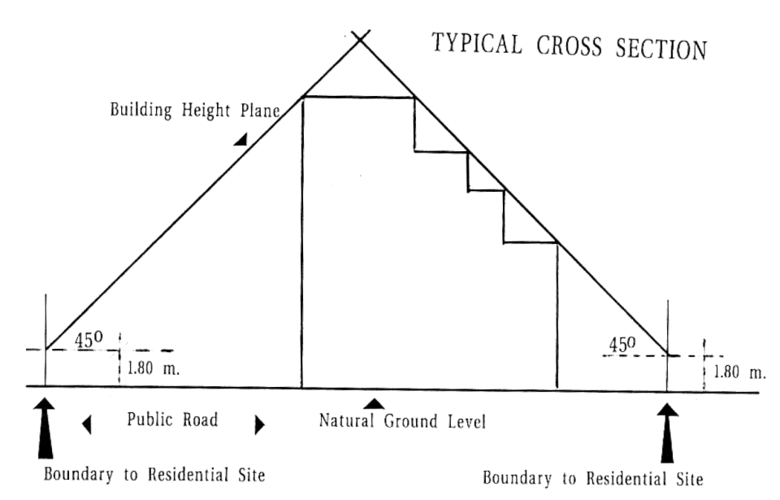

### 3.11 With any waste storage area:

(a) the wall height must ensure people can walk into the waste storage area and the lid of a waste bin can be opened with ease; and

(b) Council may increase the minimum dimensions for a commercial waste storage area depending on the likely use of the business and retail premises and the frequency of collection services.

## SECTION 4–SERVICED APARTMENTS

#### Objectives

O1 To achieve good design in terms of building form, bulk, architectural treatment, visual amenity and landscape.

O2 To ensure the building form and design provide appropriate amenity to residents and visitors in terms of access to sunlight and privacy.

O3 To ensure the building form and design do not adversely impact on the amenity of neighbouring sites in terms of visual bulk, access to sunlight and privacy.

O4 To minimise the visual impact of off-street parking on the streetscape.

O5 To ensure the building design and materials reduce the opportunities for vandalism and graffiti.

O6 To ensure that a change of use from a dwelling in a residential flat building or shop top housing to a serviced apartment does not impact on the amenity, safety or security of residents in the building.

O7 To prevent substandard residential building design by way of converted serviced apartment development.

#### Development controls

#### Isolation of sites

4.1 Council must not grant consent to any development on land within Zone R4 High Density Residential if the proposed development will have the effect of isolating land with an area of less than 1,200m2 and a width of less than 20m at the front building line so as to preclude the reasonable development of that land.

#### Storey limit (not including basements)

4.2 Development must comply with the storey limit that corresponds with the maximum building height shown for the site on the Height of Building Map as follows:

| Maximum building height as shown on the Height of Buildings Map (Canterbury-Bankstown LEP 2023) | Storey limit (not including basements) |
|---|---|
| 10m | 3 storeys (no attic) |
| 13m | 4 storeys (no attic) |
| 16m | 5 storeys (no attic) |
| 19m | 6 storeys (no attic) |
| 25m | 8 storeys (no attic) |

4.3 The siting of serviced apartments and landscape works must be compatible with the existing slope and contours of the site and any adjoining sites. Council does not allow any development that involves elevated platforms on columns; or excessive or unnecessary terracing, rock excavation, retaining walls or reclamation.

4.4 Any reconstituted ground level on the site must not exceed a height of 600mm above the ground level (existing) of an adjoining site except where:

(a) the serviced apartments are required to be raised to achieve a suitable freeboard in accordance with Chapter 2.2 of this DCP; or

(b) the fill is contained within the ground floor perimeter of the serviced apartments to a height no greater than 1m above the ground level (existing) of the site.

#### Setbacks within the former Bankstown Local Government Area

4.5 The minimum setback for a building wall to the primary street frontage is:

(a) 3m for the sites at 1–9 Leonard Street and 74–80 Restwell Street, Bankstown; and

(b) 6m for all other sites.

4.6 The minimum setback for a building wall to the secondary street frontage is 6m.

4.7 For a single or two storey building, the minimum setback to the side and rear boundaries of the site is 0.6 multiplied by the wall height.

4.8 For a building with three or more storeys, the minimum setback to the side and rear boundaries of the site is 4.5m provided the average setback is 0.6 multiplied by the wall height.

4.9 Serviced apartments (including basements) must provide a minimum 5m setback to Ruse Park, Bankstown for the purposes of deep soil landscaping.

4.10 The minimum setback for a basement level to the side and rear boundaries of the site is 2m.

4.11 The minimum setback for a driveway to the side and rear boundaries of the site is 1m.

#### Setbacks within the former Canterbury Local Government Area

4.12 Development, including basement and sub-floor areas, fronting a major road must have a minimum front setback of 9m.

4.13 Development must comply with the minimum setbacks as follows:

(a) A minimum setback of 6m from the front and rear boundary.

(b) A minimum setback of 4m from the side boundaries.

(c) All buildings shall provide a building form comprising a podium base element and an upper element which provides an additional setback in accordance with the table below:

| Total number of storeys | Podium base element | Upper storey elements |
|---|---|---|
| 4 storeys | 3 storeys | 1 storey |
| 5 storeys | 3 storeys | 2 storeys |
| 6 storeys | 4 storeys | 2 storeys |

4.14 A minimum width of deep soil alongside boundaries of 2m and minimum of 5m wide along front/rear boundaries.

#### Private open space

4.15 Development must locate the private open space behind the front building line. This clause does not apply to any balconies where it is used to provide articulation to the street facade.

#### Building design

4.16 Council applies the State Environment Planning Policy (Housing) 2021 (Chapter 4) and the Apartment Design Guide to serviced apartments. This includes buildings that are up to two storeys or contain less than four dwellings.

4.17 Development for the purpose of serviced apartments must demolish all existing dwellings (not including any heritage items) on the site.

4.18 The maximum roof pitch for serviced apartments is 35 degrees.

4.19 Council does not allow serviced apartments to have attics.

4.20 Council does not allow serviced apartments to have roof-top balconies and the like.

4.21 The siting of a plant room, lift motor room, mechanical ventilation stack, exhaust stack, and the like must:

(a) integrate with the architectural features of the building to which it is attached; or

(b) be sufficiently screened when viewed from the street and neighbouring sites.

#### Building design (car parking)

4.22 Development must locate the car parking spaces behind the front building line.

#### Landscape

4.23 Development must retain and protect any significant trees on the site and adjoining sites. To achieve this clause, the development may require a design alteration or a reduction in the size of the serviced apartments.

4.24 Development must landscape the following areas on the site by way of trees and shrubs with preference given to native vegetation endemic to Canterbury-Bankstown (refer to Council’s Landscape Guide):

(a) a minimum 45% of the area between the building and the primary street frontage; and

(b) a minimum 45% of the area between the building and the secondary street frontage; and

(c) plant more than one 75 litre tree between the building and the primary street frontage.

#### Security

4.25 Where the site shares a boundary with a railway corridor or an open stormwater drain, any building, solid fence or car park on the site should, wherever practical, be setback a minimum 1.5m from that boundary. The setback distance must be:

(a) treated with hedging or climbing vines to screen the building, solid fence, or car park when viewed from the railway corridor or open stormwater drain; and

(b) the hedging or climbing vines must be planted prior to the completion of the development using a minimum 300mm pot size; and

(c) the planter bed area must incorporate a commercial grade, sub-surface, automatic, self-timed irrigation system; and

(d) the site must be fenced along the boundary using a minimum 2m high chain-wire fence; and

(e) the fence provides an appropriate access point to maintain the landscaping within the setback area; and

(f) where a car park adjoins the boundary, hedging or climbing vines must also be planted along the sides of any building or solid fence on the site that face the railway corridor or open stormwater drain.

If a setback for landscaping under this clause is not practical, other means to avoid graffiti must be employed that satisfies Council’s graffiti minimisation strategy.

#### Change of use

4.26 Development consent must not be granted for the change of use from a dwelling in a residential flat building or shop top housing to a serviced apartment unless Council is satisfied that the amenity, safety and security of the residents of the dwellings in the building is maintained.

4.27 Development consent must not be granted for the change of use from serviced apartments to a residential flat building, with or without strata subdivision, unless Council is satisfied that the development complies with the design principles of the State Environmental Planning Policy (Housing) 2021 (Chapter 4) and the Apartment Design Guide.

## SECTION 5–OTHER NON-RESIDENTIAL DEVELOPMENT

#### Explanation

This section applies to non-residential development not including health consulting rooms, neighbourhood shops and serviced apartments.

#### Objectives

O1 To ensure non-residential development is compatible with the prevailing suburban character and amenity of the residential areas.

O2 To ensure non-residential development does not adversely impact on the amenity of neighbouring sites.

#### Development controls

5.1 In determining applications that relate to land within Zone R2 Low Density Residential, Zone R3 Medium Density Residential and Zone R4 High Density Residential, Council must take into consideration the following matters:

(a) whether any proposed building is compatible with the height, scale, siting and character of existing residential development within the adjoining residential zone;

(b) whether any goods, plant, equipment and other material used in carrying out the proposed development will be stored or suitably screened from residential development;

(c) whether the proposed development will maintain reasonable solar access to residential development between the hours of 8.00am and 4.00pm at the mid-winter solstice;

(d) whether noise generation from fixed sources or motor vehicles associated with the proposed development will be effectively insulated or otherwise minimised;

(e) whether the proposed development will otherwise cause nuisance to residents, by way of hours of operation, traffic movement, parking, headlight glare, security lighting, fumes, gases, smoke, dust or odours, or the like; and

(f) whether any windows or balconies facing residential areas will be treated to avoid overlooking of private yard space or windows in residences.

5.2 The non-residential component of buildings that adjoin residential zones in the former Canterbury Local Government Area should comply with the Building Height Plane as shown in Figure 5a.

> [Picture on page 13: a picture, saved as a picture (images/ch-10-04-non-residential-land-uses-in-residential-zones-page-13-1.gif, 150 dpi).]

Figure 5a: Building height plane

## SECTION 6–SITE FACILITIES

#### Explanation

Good design ensures sites facilities unify the development appearance and enhance the desired street character.

#### Objectives

O1 To ensure site facilities integrate into the overall building form, and achieve good design in terms of architectural treatment and visual amenity.

O2 To ensure the design, construction, and operation of kitchens and food premises achieve satisfactory standards of hygiene.

#### Development controls

#### Building design (utilities and building services)

6.1 The location and design of utilities and building services (such as plant rooms, hydrants, equipment and the like) must be shown on the plans.

6.2 Utilities and building services are to be integrated into the building design and concealed from public view.

#### Building design (substations)

6.3 The location and design of substations must be shown on the plans.

6.4 Substations should locate underground. Where not possible, substations are to be integrated into the building design and concealed from public view.

6.5 Substations must not locate forward of the front building line.

#### Food premises

6.6 The design, construction, and operation of a food premises must comply with:

(a) Food Act 2003;

(b) Food Regulation 2010;

(c) FSANZ Food Standards Code; and

(d) Australian Standard AS 4674–2004, Design, construction and fitout of food premises.

#### Front fences

6.7 The maximum fence height for front fences is 1.8m.

6.8 The external appearance of a front fence along the primary and secondary street frontages must ensure:

(a) the section of the front fence that comprises solid construction (not including solid piers) does not exceed a fence height of 1m above ground level (existing); and

(b) the remaining height of the front fence comprises open style construction such as spaced timber pickets or wrought iron that enhance and unify the building design.
