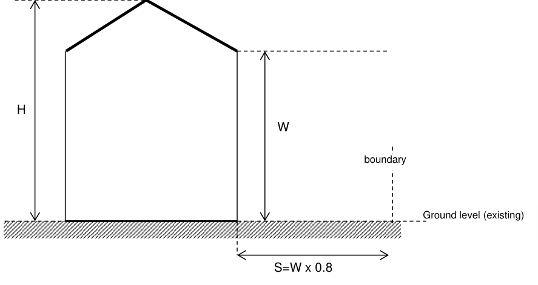

## Chapter 10 Other Development

### 10.5 Places of Public Worship

June 2023 (Amended April 2025)

Welcome to the

### City of Canterbury-Bankstown

#### Great Cities

We believe in creating vibrant, dynamic, and diverse communities that offer opportunities for people to connect, pursue their passions, and contribute to the world around them.

#### Naturally Green

We protect and prioritise nature in and around our city to enhance environmental sustainability and improve the quality of life for our residents.

#### Design Excellence

We encourage buildings, spaces, and objects that are both beautiful and practical, enhancing the beauty, accessibility, and safety of our built environment.

#### People First

We prioritise the needs, preferences, and aspirations of our community in all aspects of urban planning and design, creating supportive and enriching places people love.

#### Community

We engage with our community to ensure their needs and aspirations are reflected in the outcome, creating sustainable, resilient, vibrant, diverse, and inclusive places.

#### Sustainability

We seek designs that reduce negative impacts on the environment while also promoting social and economic well-being.

#### Net-Zero

We encourage our community to design buildings and places that produce as much renewable energy as they consume, reducing greenhouse gas emissions, lowering energy bills, and increasing resilience to environmental shocks and stresses.

#### Join us in creating a City that's liveable, loveable, and sustainable for all!

#### CONTENTS

Section 1 – Introduction ......................................................................................................... 4

Section 2 – Site analysis ......................................................................................................... 6

Section 3 – Location and traffic management ....................................................................... 8

Section 4 – Site layout and building envelopes ................................................................... 11

Section 5 – Energy efficiency and urban design .................................................................. 14

Section 6 – Acoustic privacy and management ................................................................... 16

Section 7 – Open space and landscape ................................................................................ 19

Section 8 – Safety and security ............................................................................................ 21

Section 9 – Site facilities and ancillary uses ......................................................................... 24

## SECTION 1–INTRODUCTION

#### Explanation

Based on population forecasts, Canterbury-Bankstown may see an increase in the number of places of public worship. These places of public worship must find available land in established urban areas. The conflict between the development of these places of public worship and the surrounding amenity of established urban areas is evident.

Places of public worship tend to draw from a regional catchment area which means greater reliance on cars. This has led to traffic congestion in streets and increased demand for on-street parking. Insufficient lot sizes have also led to excessive building sizes.

Council’s statutory responsibility is to manage the orderly development of places of public worship, in a way that addresses community expectations. As part of this responsibility, Council must consider the many planning issues relating to places of public worship if it is to better manage this type of development and address community expectations.

The Canterbury-Bankstown Local Environmental Plan 2023 and Canterbury-Bankstown Development Control Plan 2023 combine to regulate effective and orderly development, consistent with Connective City 2036.

The Canterbury-Bankstown Local Environmental Plan 2023 is Council's principal planning document. It provides objectives, zones and development standards such as lot sizes, floor space ratios and building heights.

The Canterbury-Bankstown Development Control Plan 2023 supports the LEP by providing additional objectives and development controls to enhance the function and appearance of places of public worship (either by the erection of a new building, or extensions to and/or occupation of an existing building). In particular, it aims to protect the amenity of residential areas by limiting the scale of development within Zone R2 Low Density Residential.

This chapter does not apply to schools, except for those places within a school that are to be used for regular public worship.

#### Objectives

O1 To regulate the effective and orderly development of places of public worship in Canterbury-Bankstown.

O2 To ensure places of public worship contribute to the sustainability of Canterbury- Bankstown.

O3 To achieve good design in terms of building form, bulk, architectural treatment, visual amenity and landscape.

O4 To ensure the bulk, scale, height and character of places of public worship are compatible with the predominant characteristics of existing development in the surrounding area.

O5 To protect the amenity of development in the vicinity of places of public worship, and in particular residential areas.

O6 To minimise the physical and visual impact on the amenity of established suburbs.

O7 To encourage places of public worship to locate in areas with good access to public transport.

O8 To ensure places of public worship do not adversely impact on the safety and efficiency of the surrounding road system.

O9 To ensure the long term operation of places of public worship maintains the amenity of surrounding residents and employment areas.

O10 To enhance perceptions of public safety; and ensure the design of buildings and places minimise the opportunities for criminal and anti-social behaviour.

O11 To ensure the development assessment process for a proposed place of public worship is consistent, fair and accessible to all religious groups.

O12 To facilitate ecologically sustainable development.

#### Definitions

ancillary use means administration offices, community facilities, dwellings, kitchens, libraries, or other uses directly associated with a place of public worship.

assembly area means the sum of that portion of the gross floor area of a building to be used for public assembly for the purpose of worship or other purposes and any outdoor area that may be used for public assembly for the purpose of worship or other purposes. It includes:

• halls;

• mezzanines;

• secondary areas of assembly such as choir or musicians' areas, altar areas confessional areas, podiums, staging and the like;

• rooms used for religious instruction;

• any excessive internal circulation space; and

• rooms and any outdoor areas (including covered areas) capable of being used for overspill accommodation of the congregation during a worship service.

Ancillary areas such as kitchens, toilets, washrooms and residential accommodation, which are not normally used for worship, are not considered to be part of the assembly area.

## SECTION 2–SITE ANALYSIS

#### Explanation

The site analysis helps to explain the development capacity by showing the relationship of sites to the surrounding area. This approach to good design ensures places of public worship respond and contribute to the local context. Context can be defined as the key natural and built features of an area. Responding to context involves identifying the desirable elements of a location's character. From experience, Council has found site analysis plans and studies to also be a useful tool to coordinate the expansion of sites over a long period of time.

#### Objectives

O1 To require site analysis plans and studies that:

(a) identify the guiding principles to the development of sites;

(b) demonstrate the opportunities and constraints of sites;

(c) respond and contribute to the local context and to the sustainable growth of Canterbury-Bankstown;

(d) identify the staging of development over a long period of time; and

(e) determine the enrolment numbers of schools over a long period of time.

#### Development controls

2.1 Applications must submit site analysis plans and studies that outline the short and long term proposals for the development of sites. The site analysis plans and studies must consist of a written statement (supported by plans or illustrations) explaining how the design of the development has regard to the following:

(a) The overall strategic vision for the site and how the selection of the site supports the urban structure of Canterbury-Bankstown.

(b) Staging of the development of the place of public worship.

(c) The patterns of land ownership, the patterns of land subdivision or consolidation and the relationship of the site to adjoining sites.

(d) Design principles drawn from the site analysis and the local context including:

(i) context and character studies;

(ii) orientation;

(iii) visual assessment of the site and the local context;

(iv) survey of the site and neighbouring buildings;

(v) flora/fauna survey;

(vi) topography, drainage, erosion, cut and fill;

(vii) noise pollutants, airborne pollutants, toxic residues and site remediation;

(viii) bush fire risk and flood risk;

(ix) deep soil zones and landscaping;

(x) sustainability and energy efficiency outcomes through design;

(xi) passive surveillance;

(xii) traffic, access and parking:

• the links between the location of the place of public worship and surrounding pedestrian, cycle, public transport and road access and circulation networks. This includes details of the internal and

external movement networks, the public transport access routes, the pedestrian and cycle paths, linkages to external networks and pedestrian through-site links;

• assessment of the cumulative traffic impacts of development within the surrounding road network, and the need for internal and external traffic management measures to support the development (including cost and funding responsibilities of such upgrades);

• visitor off-street set-down and pick-up areas, parking provisions, bus stops and delivery/emergency access;

• parking provisions at each stage of the development;

(xiii) built form and aesthetics:

• floor space requirements to meet function requirements;

• the function and capacity of each building and likely hours of operation;

• bulk and overall unity of the development within the context;

• urban design and streetscape guidelines;

• distribution of the land uses, buildings, circulation areas, fences and any public facilities;

• open space provision and function, and landscaping principles;

(xiv) infrastructure, easements and stormwater management;

(xv) outcomes of social impact assessments and any relevant feasibility studies;

(xvi) protection of any heritage items or archaeological sites;

(xvii) staging of special events including:

• calendar dates of all events;

• location and capacity;

• hours of operation;

• management plan.

## SECTION 3–LOCATION AND TRAFFIC MANAGEMENT

#### Explanation

The Canterbury-Bankstown Local Environmental Plan 2023 aims to concentrate intensive trip generating activities in locations most accessible to rail transport. Places of public worship are significant trip generators. For this reason, it can be argued that intensive trip generating places of public worship should locate close to rail transport.

Council also recognises that larger places of public worship have greater impacts and it is important to balance the size of places of public worship with the retention of residential amenity. In locations that are not readily accessible to rail transport, such as the residential and employment zones, Council is seeking places of public worship that would not be regarded as intensive trip generating activities.

Consideration is given to having development controls that ensure places of public worship take into account:

• Public transport and pedestrian movements.

• The impact on traffic efficiency, with the objective to maintain the existing level of service of streets.

• The impact on the amenity of an area, with the objective not to exceed the environmental capacity of streets. Setting traffic limits such as volumes is necessary in and around residential areas as traffic congestion, pedestrian safety and noise are primary concerns at these locations.

• The impact of accommodating additional land uses, shared facilities and special events.

In some streets where the existing level of service is poor or the environmental capacity is exceeded, any small increase in traffic can cause greater increases in delay. In this situation, it is best practice to at least maintain the existing level of absolute delay rather than allow the situation to be made worse.

#### Objectives

O1 To maintain the amenity and character of residential areas.

O2 To ensure the size of the site is suitable to accommodate a place of public worship.

O3 To ensure the most suitable location is achieved, by consideration of the physical constraints of the site.

O4 To encourage intensive trip generating places of public worship in locations most accessible to rail transport.

O5 To ensure the location and size of places of public worship maintain the existing environmental capacity and service levels of streets.

O6 To avoid places of public worship locating within close proximity to another existing or approved place of public worship unless it can be demonstrated that the cumulative impacts relating to traffic generation and on-street parking are within acceptable limits for the area.

O7 To limit the size of places of public worship in and in the vicinity of established residential areas to ensure this type of trip generating activity does not adversely impact on the existing residential amenity.

#### Development controls

#### Location

3.1 A place of public worship must maintain the general amenity of the area.

3.2 A place of public worship must optimise the use of surrounding and potential infrastructure, with a particular emphasis on public transport.

#### General restrictions on development

3.3 A place of public worship may not be within reasonable view of a sex services premises (‘reasonable view’ shall be determined taking into account factors such as topography, vegetation, signage, intervening development and similar factors).

3.4 The boundary of a place of public worship should not be within a 100m radius of a sex services premises.

#### Traffic management – environmental capacity

3.5 Development for the purpose of places of public worship must not result in a street in the vicinity of the site to exceed the environmental capacity maximum. If the environmental capacity maximum is already exceeded, the development must maintain the existing level of absolute delay of that street. This clause applies to places of public worship in the residential zones, the special use zone and the employment zones.

#### Traffic management – level of service

3.6 Development for the purpose of places of public worship must not result in a street intersection in the vicinity of the site to have a level of service below Level B. If the existing level of service is below Level B, the development must maintain the existing level of absolute delay of that street intersection. This clause applies to places of public worship in the residential zones, the special use zone and the employment zones.

#### Traffic impact studies

3.7 Applications must submit a Traffic Impact Study based on the RTA Guide to Traffic Generating Developments to determine:

Existing conditions

(a) Existing volumes and environmental capacity of streets adjacent to the development.

(b) Existing volumes and level of service of street intersections in the vicinity of the development.

(c) Existing public transport services in the vicinity of the development.

(d) Existing clearway and peak period parking restrictions that apply to streets adjacent to the development.

(e) Existing proposals for improvements to the adjacent road system.

Proposed conditions

(f) The proposed amount of traffic generation and trip distribution of the development.

(g) The proposed parking provision of the development.

(h) The proposed number of buses likely to service the development.

(i) The proposed safety and efficiency of access between the development and the adjacent road network.

(j) The proposed safety and efficiency of the internal road layout including the set-down and pick-up areas, bus bays, service areas and car parks.

(k) The impact of the proposed generated traffic on the environmental capacity of streets adjacent to the development.

(l) The impact of the proposed generated traffic on the level of service of street intersections in the vicinity of the development.

(m) The impact of the proposed generated traffic on road safety and traffic noise.

(n) The impact of the proposed generated traffic on other major traffic generating development in close proximity.

(o) Whether the development must take certain measures to reduce the impact of the proposed generated traffic to an acceptable level. Measures may include a reduction in the size of assembly areas or the installation of public traffic management devices at the applicant's expense.

(p) Where there are celebration events or other large events attracting larger than average numbers of vehicles, the Traffic Impact Study must assess the traffic and parking impact of these events on surrounding streets, and the measures proposed to minimise any potential impact.

3.8 To ensure adequate traffic flow, worship services must not commence until thirty minutes have elapsed following the completion of any preceding service. This requirement may be imposed as a condition of development consent.

## SECTION 4–SITE LAYOUT AND BUILDING ENVELOPES

#### Explanation

Council considers it necessary to ensure sites are of sufficient size to accommodate buildings, off-street parking, set-down and pick-up areas, vehicular access and manoeuvring areas, pedestrian access, open space and landscaping. This approach to good design provides:

• Amenity for visitors and staff through the physical, spatial and environmental quality of the development.

• Ensures places of public worship can contain the essential elements that make up the prevailing character of certain areas, particularly residential areas where the prevailing character includes the front setback area and landscaping.

Building envelopes must also be compatible with the scale of the street and the surrounding buildings, noting that the established residential areas predominantly have a single dwelling suburban character.

As part of the design process, applicants must note that a building envelope is not a building, but a three dimensional shape that may determine the bulk and siting of a building. After allowing for building articulation, the achievable floor space of a development is likely to be less than the building envelope.

Where development is in the vicinity of land in Zone R2 Low Density Residential, R3 Medium Density Residential or R4 High Density Residential, Council may reduce the height or require greater setbacks to ensure the development complies with the objectives of this DCP.

#### Objectives

O1 To ensure the design of places of public worship satisfies the needs of visitors and staff, and provides a safe environment and easy access for people.

O2 To ensure places of public worship are compatible with the prevailing character and amenity of the locality of the development.

O3 To ensure places of public worship do not adversely impact on the living environment or amenity of neighbouring dwellings and the surrounding area.

O4 To minimise the impact of street parking in the surrounding area.

O5 To ensure that all parking areas are adequate, easy to use, efficient, and well-designed.

#### Development controls

#### Assembly area

4.1 The maximum area of the assembly area in a place of public worship within Zone R2 Low Density Residential, Zone R3 Medium Density Residential and Zone R4 High Density Residential is 400m2.

4.2 An alteration or addition to an existing place of public worship within Zone R2 Low Density Residential and Zone R3 Medium Density Residential which would result in an assembly area with an area of more than 400m2 is not permitted.

#### Height

4.3 Within Zone R3 Medium Density Residential, Zone R4 High Density Residential and Zone SP2 Infrastructure, the maximum wall height for a place of public worship is 9.5m.

4.4 Within Zone E4 General Industrial, the maximum wall height for a place of public worship that is located adjacent to a residential area is 9.5m.

4.5 Despite clauses 4.5 and 4.6, Council may consider spires, towers, minarets and similar structures, which exceed the wall height limit on the basis of their bulk and scale, the extent of their overshadowing, and their contribution to the streetscape.

4.6 The operational requirements of Bankstown Airport may place certain additional constraints on building heights within some areas of Canterbury-Bankstown. Council may refer certain applications to the airport authority for consideration.

#### Street setbacks

4.7 Minimum setbacks to the street frontage shall apply to residential, special uses and employment zones as follows:

| Setbacks | State and regional roads |  | Other roads |  |
|---|---|---|---|---|
|  | Zones R2, R3, R4 and SP2 | Zone E4 | Zones R2, R3, R4 and SP2 | Zone E4 |
| Primary street frontage | 9m | 15m | 7.5m | 10m |
| Secondary street frontage | 9m | 15m | 7.5m | 3m |

#### Side and rear setbacks

4.8 Within Zones E1, E3 and MU1, setbacks must be consistent with those of neighbouring properties and with the existing streetscape.

Within Zones R2, R3, R4 and SP2; and E4 which adjoin residential zoned land, side and rear setbacks must be in accordance with the following formula: Minimum setback(s) = 0.8 x Wall Height (W) (see Figure 4a).

H  =  Absolute height of building above ground level (existing) W =  Wall height S  =  Minimum Setback

> [Picture on page 13: a picture, saved as a picture (images/ch-10-05-places-of-public-worship-page-13-4.gif, 150 dpi).]
> Words printed on the picture (title and legend, copied from the PDF):
> H
> W
> boundary
> Ground level (existing)
> S=W x 0.8

Figure 4a: Height of building in relation to side and rear boundary setbacks

#### Access to sunlight

4.9 At least one living area of a dwelling on an adjoining site must receive a minimum three hours of sunlight between 8.00am and 4.00pm at the mid-winter solstice. Where this requirement cannot be met, the development must not result with additional overshadowing on the affected living areas of the dwelling.

4.10 A minimum 50% of the required private open space for each dwelling on an adjoining site must receive at least three hours of sunlight between 9.00am and 5.00pm at the equinox. Where this standard cannot be met for a dwelling on an adjoining site, the development must not result with additional overshadowing on the affected private open space.

4.11 Development should avoid overshadowing any existing solar hot water system, photovoltaic panel, or other solar collector on the site and neighbouring sites.

#### Parking

4.12 The car park/manoeuvring areas and the set-down and pick-up areas must locate separately behind the front building line.

## SECTION 5–ENERGY EFFICIENCY AND URBAN DESIGN

#### Explanation

Places of public worship must incorporate energy efficiency measures such as optimum orientation, glazing, sun control, cross ventilation and natural light. This approach to good design provides:

• Amenity for visitors and staff through the physical, spatial and environmental quality of the development. Optimising amenity requires good natural light and ventilation to rooms.

• Ensures places of public worship make efficient use of natural resources, energy and water throughout its full life cycle. Sustainability is integral to the design process. Aspects include layouts and built form, good orientation, passive solar access principles, minimal use of mechanical ventilation, and soil zones for vegetation and reuse of water.

Good quality architecture is also important. Good quality architecture requires the appropriate composition of building elements (i.e. proportion, unity and rhythm), textures, materials and colours. Good quality architecture must also:

• Reflect well resolved internal layouts of the various functions and uses.

• Respond to the environment and context particularly to desirable elements in the existing streetscape.

#### Objectives

O1 To promote good architectural quality.

O2 To ensure facade designs and building footprints integrate into the overall building form and enhance the desired contemporary street character.

O3 To encourage architectural diversity and innovation.

O4 To incorporate energy efficiency measures in the design, construction and occupation of places of public worship.

O5 To ensure front fences are compatible with the building design and have a visually open style and attractive appearance.

#### Development controls

#### Energy efficiency

5.1 Places of public worship must comply with Chapter 3.3 of this DCP to make efficient use of natural resources and optimise amenity in the design, construction and occupation of buildings and facilities, such as:

(a) good orientation and natural light to rooms;

(b) achieving appropriate separation distances between buildings to provide natural light to rooms;

(c) limiting building depth to provide natural cross-ventilation and natural light;

(d) minimal use of mechanical ventilation;

(e) use of sun shading devices;

(f) preventing UV factor to open areas;

(g) reducing stormwater run-off and promoting the use of recycled water; and

(h) ensuring the development adapts to the existing topography by avoiding excessive cut and fill.

#### Facade designs

5.2 Development must articulate the facades to achieve a unique and contemporary architectural appearance that:

(a) unites the facades with the whole building form;

(b) composes the facades with an appropriate scale and proportion that responds to the use of the building and the desired contextual character;

(c) combines high quality materials and finishes;

(d) considers any other architectural elements to Council's satisfaction.

5.3 Development must provide an active frontage to the street.

#### Roof designs
