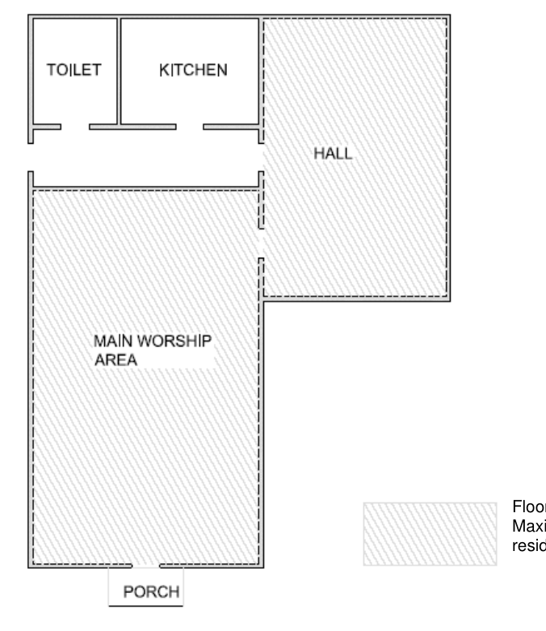
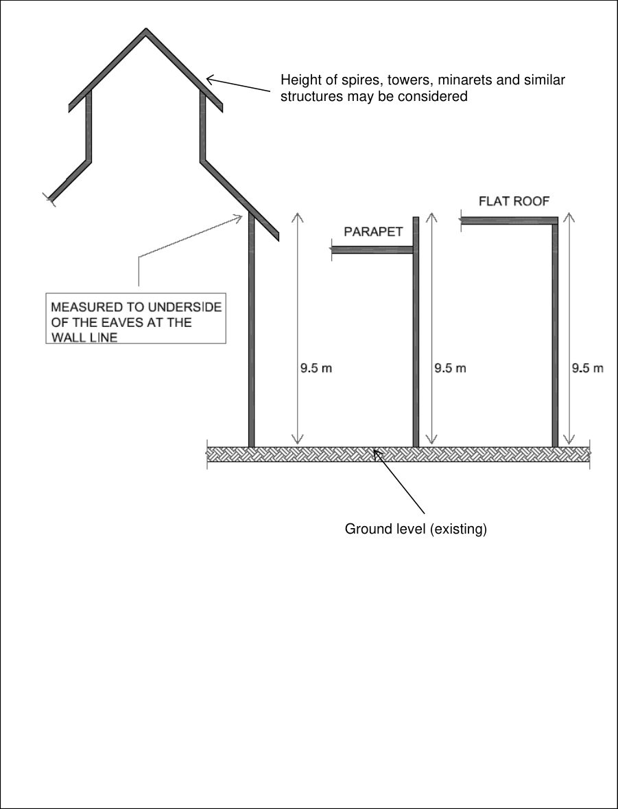

### 5.7 Council does not allow the following types of front fences:

(a) chain wire, metal sheeting, brushwood, and electric fences; and

(b) noise attenuation walls.

## SECTION 6–ACOUSTIC PRIVACY AND MANAGEMENT

#### Explanation

It is important to balance the operation of places of public worship with community expectations. To achieve this outcome, Council considers it necessary to seek appropriate acoustic privacy measures that are compatible with the prevailing character of residential areas. This is the preferred outcome rather than resorting to noise attenuation walls.

There is also recognition that the good long term operation and management of places of public worship can help to ensure development continues to harmoniously co-exist with the surrounding residential amenity.

#### Objectives

O1 To ensure places of public worship do not adversely impact on the residential amenity of adjoining dwellings and the surrounding area.

O2 To allow development to install appropriate acoustic privacy measures which are compatible with the prevailing character of residential areas.

O3 To ensure the ongoing operation and management of places of public worship maintain residential amenity.

#### Development controls

#### Acoustic privacy

6.1 Air conditioning, mechanical ventilation or any other continuous noise source must not exceed the ambient level at any specified boundary by more than 5dB(A).

6.2 The location and design of places of public worship must consider the projection of noise from various activities to avoid any adverse impacts on the residential amenity of adjoining land.

For the purpose of this clause, Council requires applications to submit an Acoustic Report prepared by a suitably qualified acoustic consultant to determine:

(a) existing noise levels at the identified sensitive receiver locations;

(b) likely noise levels to emanate from the place of public worship at the identified sensitive receiver locations;

(c) whether the development must apply measures to ensure noise does not exceed 5dB(A) above the background noise level;

(d) whether the location and setbacks of the development are sufficient to protect the acoustic privacy of adjacent dwellings;

(e) whether the location of the outdoor areas should avoid living areas and bedrooms of adjacent dwellings; and

(f) whether the development must install certain noise attenuation measures to protect the acoustic privacy of adjacent dwellings.

The Acoustic Report must measure the noise readings over a 15 minute period and must provide details of all modelling assumptions including source noise data, noise monitoring positions, receiver heights and locations, prevailing meteorological conditions during the monitoring, confirmation of the methodology adopted along with a copy of the model input and output data.

6.3 The maximum height for noise attenuation walls and fences along the boundary of the site is 2m.

#### Hours of operation

6.4 Council may limit the hours of operation of places of public worship, public access to places of public worship, and special occasions or events.

#### Management plans

6.5 Council requires applications to submit a Management Plan to determine:

(a) hours of operation and days of operation;

(b) special events: a detailed calendar of any festivals and special events must be supplied with the application, together with details of the arrangements for parking during these times;

(c) number of persons attending at any one time, including non-worship and ancillary activities, and proposed measures to minimise impacts on the surrounding amenity;

(d) expected ‘catchment area’ from which the congregation will travel; and

(e) any proposed street parades and road closures;

(f) the function and operation of indoor and outdoor spaces on the site to be used during normal services and special events;

(g) the circulation of people and vehicles within the site and how movements will be managed;

(h) traffic and parking control measures to manage on-site and off-site parking, such as but not limited to pick up/drop off arrangements and parking patrol of surrounding streets;

(i) the complaints handling and resolution procedures, with a complaints register to be submitted to Council annually.

6.6 Council must require the operator of a place of public worship in Zone R2 Low Density Residential, Zone R3 Medium Density Residential and Zone R4 High Density Residential to organise and chair a Neighbourhood Liaison Committee. The purpose of the Committee is for the operator and neighbours to resolve any issues, such as traffic and noise, arising from the operation of the place of public worship. The operation of the Committee must ensure:

(a) The membership of the Neighbourhood Liaison Committee must include residents who live next to and opposite the place of public worship.

(b) The Neighbourhood Liaison Committee must meet at least four times during the first 24 months of the place of public worship.

(c) The operator of the place of public worship must forward the meeting minutes to Committee members.

(d) The operator of the place of public worship may forward the meeting minutes to Council for information purposes.

(e) The operator of the place of public worship may terminate the Committee once it meets at least four times during the first 24 months of the place of public worship operating, or may choose to extend the function of the Committee over a longer period of time.

6.7 Council may require the operator of a place of public worship in zones other than the residential zones to organise and chair a Neighbourhood Liaison Committee.

## SECTION 7–OPEN SPACE AND LANDSCAPE

#### Explanation

Landscape design builds on the existing site's natural and cultural features in responsible and creative ways. It enhances the development's natural environmental performance by coordinating water and soil management, solar access, microclimate, tree canopy and habitat values. It contributes to the positive image and contextual fit of development through respect for streetscape and neighbourhood character.

For example, the landscaping of front yards in the residential areas is canopy trees and deep soil plantings. The front setback area of places of public worship in the residential areas must therefore contain generous landscaping to be compatible with the prevailing character. Car parks and hard surfaces should not dominate the front setback area.

#### Objectives

O1 To reduce the impact of non-residential structures in residential areas.

O2 To screen the development from adjoining properties and to ensure maximum privacy for these properties and their uses.

O3 To improve the visual appearance of and provide shade for parking areas.

O4 To maximise porous landscaped areas and provide deep soil zones to manage urban heat and water, and to allow for and support healthy plant and tree growth.

O5 To ensure facilities are visually integrated with a development.

O6 To provide useable open space on the street frontage for canopy trees and deep soil zones.

#### Development controls

#### Landscaping

7.1 Applications must submit a detailed landscape plan prepared by a qualified landscape architect consistent with Council’s Landscape Guide.

7.2 New car parking areas are to be furnished with canopy trees. For every ten parallel spaces in a row parking arrangement a canopy tree must be provided. The planting hole dimension is 2m by 2m minimum area. Protective furnishing must be provided to the tree surround.

7.3 Screen planting capable of achieving 3m in height shall be provided to the common boundary between the new development and existing residential buildings where the setback from property boundaries is greater than 3m.

7.4 Screen planting shall be provided in the required setback areas between the road and car park areas, and between adjoining residential buildings and car parking areas.

#### Deep soil zones

7.5 Development for the purpose of places of public worship must provide deep soil zones that have the following minimum widths around the site boundaries:

| Minimum width of deep soil zone | State or regional roads |  | Other roads |  |
|---|---|---|---|---|
|  | Zones R2, R3, R4 and SP2 | Zone E4 | Zones R2, R3, R4 and SP2 | Zone E4 |
| Primary street frontage | 9m | 9m | 6m | 9m |
| Secondary street frontage | 9m | 9m | 6m | 3m |
| Side and rear setbacks | 5m | 5m | 5m | 5m |

The deep soil zones must be landscaped by way of deep soil plantings and canopy trees.

7.6 Council will determine the minimum width for deep soil zones for places of public worship in Zone E1, E3 and MU1 based on the setbacks of the street and the surrounding buildings.

## SECTION 8–SAFETY AND SECURITY

#### Explanation

Good design optimises safety and security, both internal to the development and for the public domain. This is achieved by maximising overlooking of public and communal spaces while maintaining internal privacy, avoiding dark and non-visible areas, maximising activity on streets, providing clear, safe access points, providing lighting appropriate to the location and desired activities, and clear definition between public and private spaces.

#### Objectives

O1 To ensure the siting and design of buildings contribute to the personal and property security of people.

O2 To ensure a development is integrated with the public domain and contribute to an active pedestrian-orientated environment.

O3 To maximise natural surveillance so that people feel safe at all times.

O4 To minimise the potential for intruders to enter buildings and private open spaces.

O5 To ensure entrances and exits are clearly visible from the street.

O6 To ensure facilities are located in highly visible areas with high levels of activity.

O7 To encourage building designs, materials, and maintenance programs that reduce the opportunities for vandalism and graffiti.

O8 To ensure developments are easily accessible to people with disabilities.

#### Development controls

#### Entrances, fences and natural surveillance

8.1 The front door to a building should face the street.

8.2 An external entry path and the foyer to a building should be direct to avoid potential hiding places.

8.3 Windows on the upper floors of a building should, where possible, overlook the street.

8.4 For a fence located forward of the front building line, the solid construction of the fence must not exceed a height of 1m above the ground level (existing). The remaining height of the fence must comprise an open style construction such as spaced timber pickets, wrought iron, or lattice. Metal sheet, chain wire, brushwood or unframed lattice is not permitted along the primary frontage of the site.

#### Security devices

8.5 A security alarm system should be installed in a building.

8.6 All windows and doors on the ground floor should ordinarily be made of toughened glass to reduce the opportunities for ‘smash and grab’ and ‘break and enter’ offences, with the exception of special features such as stained glass windows. Where possible, such special features should be above ground floor level.

8.7 Access to a basement car park must only be available to the public during operating hours and via a security door or gate with an intercom, code, or card lock system.

8.8 Unless impractical, access to an outdoor car park should be closed to the public outside of operating hours via a lockable gate.

8.9 Lighting must be provided to the following areas of a building to promote safety and security at night:

(a) an external entry path, foyer, driveway, and car park to a building; and

(b) the main entrance. This may be in the form of motion sensitive lighting or timer lighting.

8.10 A pedestrian entry path and driveway to a car park that are intended for night use must be well lit using a vandal resistant, high mounted light fixture.

8.11 The lighting in a car park must conform to the Australian Standards AS 1158.1.1, AS

1680.1 and AS 2890.1.

#### Railway corridors and open stormwater drains

8.12 Where the site shares a boundary with a railway corridor or an open stormwater drain, any building, solid fence, or car park on the site should, wherever practical, be setback a minimum 1.5m from that boundary. The setback distance must be:

(a) treated with hedging or climbing vines to screen the building, solid fence, or car park when viewed from the railway corridor or open stormwater drain, and

(b) the hedging or climbing vines must be planted prior to the completion of the development using a minimum pot size of 300mm, and

(c) the planter bed area must incorporate a commercial grade, sub-surface, automatic, self-timed irrigation system, and

(d) the site must be fenced along the boundary using a minimum 2m high chain-wire fence, and

(e) where a car park adjoins the boundary, hedging or climbing vines must also be planted along the sides of any building or solid fence on the site that face the railway corridor or open stormwater drain.

If a setback for landscaping under this clause is not practical, other means to avoid graffiti must be employed that satisfies Council’s graffiti minimisation strategy.

#### Access

8.13 Development must be easily accessible to people with disabilities and must comply with the Building Code of Australia and Australian Standard AS 1428.1–2021, Design for access and mobility.

## SECTION 9–SITE FACILITIES AND ANCILLARY USES

#### Explanation

Good design ensures sites facilities (including utilities and building services) and ancillary development unify the development appearance and enhance the desired street character.

Good design also ensures ancillary uses do not adversely impact on the prevailing character of the area or the amenity of neighbouring dwellings. Ancillary uses include to places of public worship include administration offices, community facilities, dwellings, kitchens, libraries and other uses directly associated with a place of public worship.

#### Objectives

O1 To ensure site facilities integrate into the overall building form, and achieve good design in terms of architectural treatment and visual amenity.

O2 To ensure the design, construction, and operation of kitchens and food premises achieve satisfactory standards of hygiene.

O3 To ensure ancillary uses are compatible with the prevailing character and amenity of the locality of the area.

O4 To ensure ancillary uses do not adversely impact on the residential amenity of neighbouring dwellings and the surrounding area.

#### Development controls

#### Waste storage areas

9.1 The design, location, and screening of waste and recyclable receptacle areas must be to the satisfaction of Council.

#### Building design (site facilities)

9.2 The location and design of utilities and building services (such as plant rooms, hydrants, equipment and the like) must be shown on the plans.

9.3 Utilities and building services are to be integrated into the building design and concealed from public view.

#### Building design (substations)

9.4 The location and design of substations must be shown on the plans.

9.5 Substations should locate underground. Where not possible, substations are to be integrated into the building design and concealed from public view.

9.6 Substations must not locate forward of the front building line.

#### Food premises

9.7 The design, construction, and operation of kitchens and food premises must comply with:

(a) Food Act 2003;

(b) Food Regulation 2010;

(c) FSANZ Food Standards Code; and

(d) Australian Standard AS 4674–2004, Design, construction and fitout of food premises.

#### Ancillary uses

9.8 It will be necessary to submit with the application details of any proposed ancillary uses, including the nature of the use, how many people will attend, duration and noise impacts.

9.9 The design, construction and operation of ancillary uses must take into consideration the following matters:

(a) whether any proposed building is compatible with the height, scale, siting and character of existing residential development within the adjoining residential zone;

(b) whether any goods, plant, equipment and other material used in carrying out the proposed development will be stored or suitably screened from residential development;

(c) whether the proposed development will maintain reasonable solar access to residential development between the hours of 8.00am and 4.00pm at the mid-winter solstice;

(d) whether noise generation from fixed sources or motor vehicles associated with the proposed development will be effectively insulated or otherwise minimised;

(e) whether the proposed development will otherwise cause nuisance to residents, by way of hours of operation, traffic movement, parking, headlight glare, security lighting, fumes, gases, smoke, dust or odours, or the like; and

(f) whether any windows or balconies facing residential areas will be treated to avoid overlooking of private yard space or windows in residences.

#### APPENDICES

Appendix 1–State and regional roads in the former Bankstown Local Government Area

#### State roads

| Road | From | To |
|---|---|---|
| Alfords Point Road | Davies Road | City Boundary |
| Boronia Road | Hume Highway | Waterloo Road |
| Brunker Road | Rookwood Road | Hume Highway |
| Canterbury Road | Milperra Road | Punchbowl Road |
| Davies Road | Fairford Road | Alfords Point Road |
| Fairford Road | Stacey Street | Davies Road |
| Henry Lawson Drive | Hume Highway | City Boundary |
| Hume Highway | City Boundary | City Boundary |
| Juno Parade | Waterloo Road | Punchbowl Road |
| Milperra Road | Newbridge Road | Canterbury Road |
| Newbridge Road | City Boundary | Milperra Road |
| Punchbowl Road | Canterbury Road | City Boundary |
| Roberts Road | Hume Highway | Wiley Avenue |
| Rookwood Road | Hume Highway | City Boundary |
| Stacey Street | Rookwood Road | Fairford Road |
| M5 Motorway | City Boundary | City Boundary |
| Wiley Avenue | Roberts Road | Koala Road |
| Woodville Road | Hume Highway | City Boundary |

#### Regional roads

| Road | From | To |
|---|---|---|
| Allder Street | Brunker Road | Railway Bridge |
| Alma Road | Davies Road | Faraday Road |
| Ashford Avenue | Bullecourt Avenue | Milperra Road |
| Auburn Road | Water Pipeline | Hume Highway |
| Beaconsfield Street | The River Road | Horsley Road |
| Birdwood Road | Owen Road | Georges Crescent |
| Braesmere Road | Tower Street | Park Road |
| Brandon Avenue | Chapel Road | Greenwood Avenue |
| Brunker Road | Rookwood Road | Allder Street |
| Bullecourt Avenue | Horsley Road | Ashford Avenue |
| Carlingford Road | Water Pipeline | Waldron Road |
| Chapel Road | Canterbury Road | Brandon Avenue |
| Chapel Road | Rickard Road | Hume Highway |
| Christina Road | Waldron Road | River Avenue |
| Edgar Street | Milperra Road | Hume Highway |
| Faraday Road | Alma Road | Uranus Road |
| Ferrier Road | Railway Bridge | Auburn Road |
| Gibson Avenue | Watson Road | Canterbury Road |
| Greenwood Avenue | Brandon Avenue | Marion Street |
| Haig Avenue | Georges Crescent | Henry Lawson Drive |
| Hector Street | Hume Highway | Water Pipeline |
| Horsley Road | Beaconsfield Street | Bullecourt Avenue |
| Koala Road | Wattle Street | Wiley Avenue |
| Macauley Avenue | Stacey Street | Chapel Road |

| Road | From | To |
|---|---|---|
| Marion Street | Greenwood Avenue | Meredith Street |
| Meredith Street | Marion Street | Rickard Road |
| Miller Road | Hume Highway | Waldron Road |
| Owen Road | Marion Street | Birdwood Road |
| Park Road | Braesmere Road | Maclaurin Avenue |
| Queen Street | Beaconsfield Street | Milperra Road |
| Rickard Road | Stacey Street | Chapel Road |
| Rickard Road | Meredith Street | Chapel Road |
| Roberts Road | Wiley Avenue | Wattle Street |
| Sphinx Avenue | Gibson Avenue | The River Road |
| The River Road | Henry Lawson Drive | M5 Motorway |
| Tower Street | The River Road | Braesmere Road |
| Uranus Road | Faraday Road | The River Road |
| Waldron Road | Carlingford Road | Christina Road |
| Waterloo Road | Wattle Street | Hume Highway |
| Watson Road | Fairford Road | Gibson Avenue |
| Wattle Street | Koala Road | Stacey Street |
| Wellington Road | Auburn Road | Woods Road |
| Woods Road | Wellington Road | Carlingford Road |

#### Appendix 2–Calculating the assembly area (not to scale)

> [Picture on page 28: a picture, saved as a picture (images/ch-10-05-places-of-public-worship-page-28-2.gif, 150 dpi).]

Floor area of assembly area: Maximum 400m2 in the residential zones

Appendix 3–Maximum wall height (not to scale) within Zones R3, R4, SP2, E4 which adjoin residential zoned land

> [Picture on page 29: a picture, saved as a picture (images/ch-10-05-places-of-public-worship-page-29-3.gif, 150 dpi).]
> Words printed on the picture (title and legend, copied from the PDF):
> Height of spires, towers, minarets and similar
> structures may be considered
> Ground level (existing)
