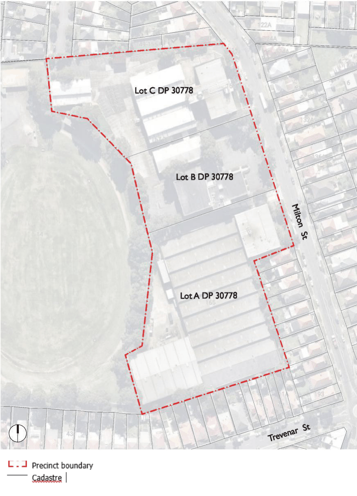
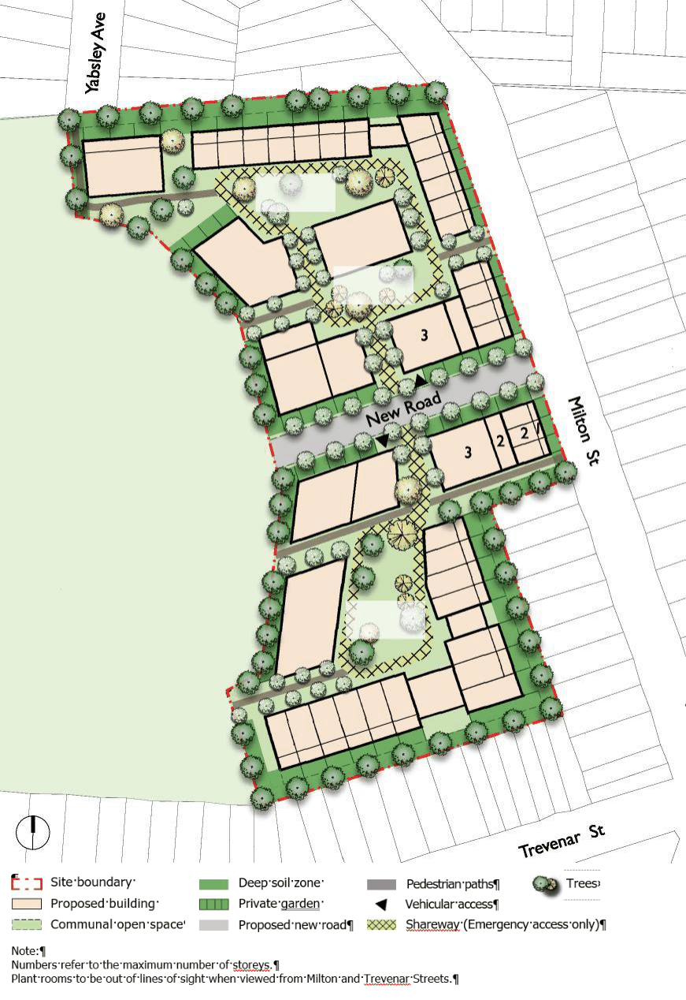
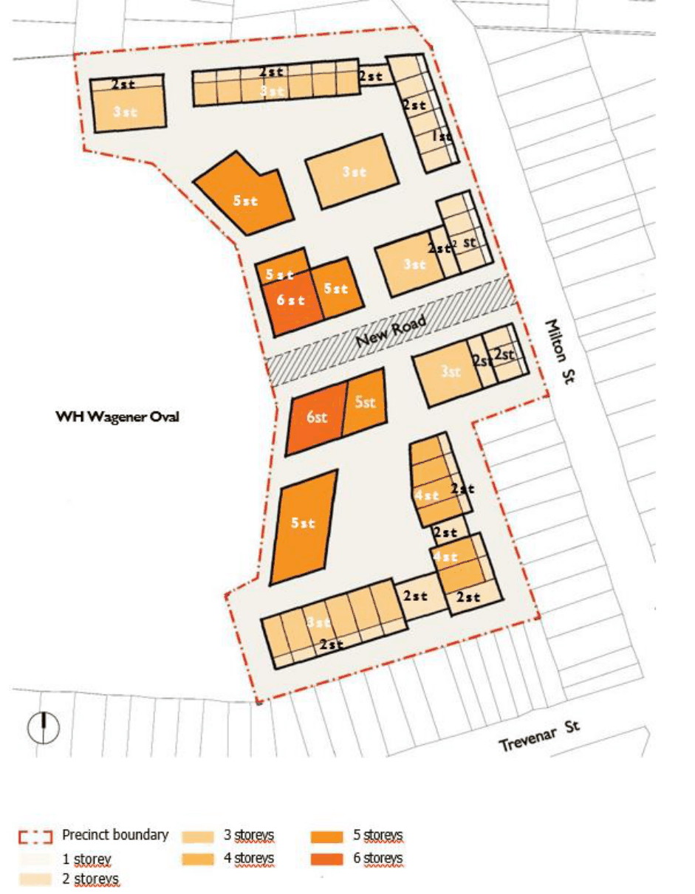
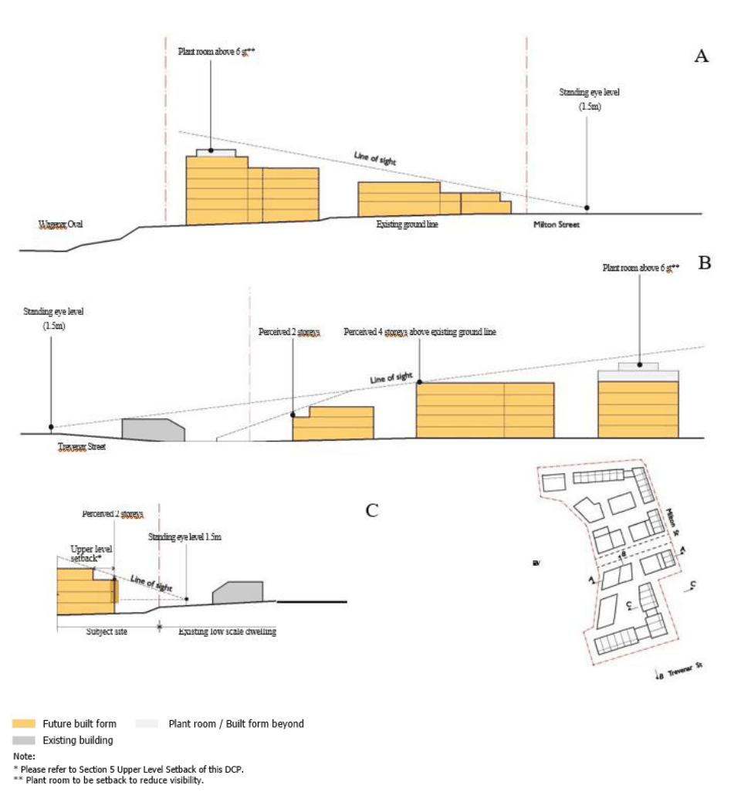
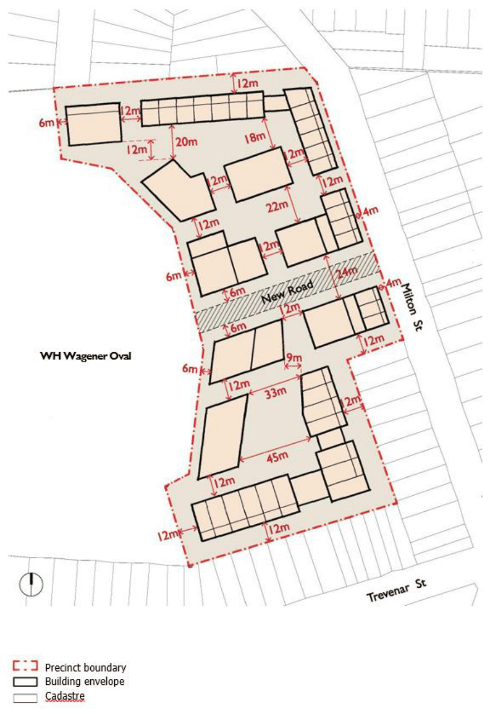
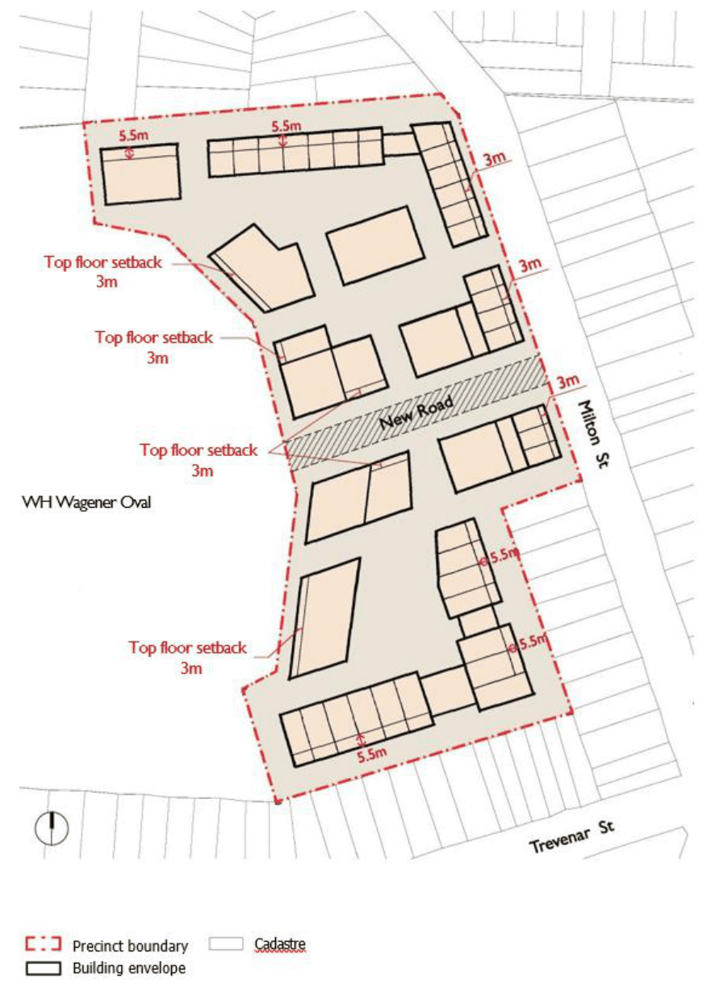
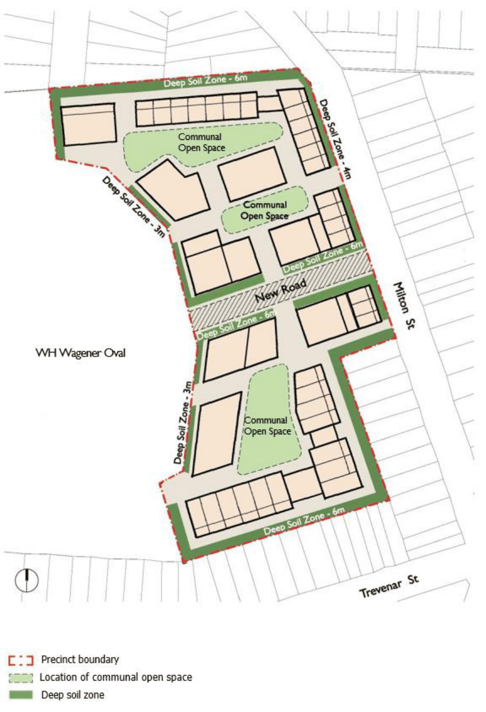
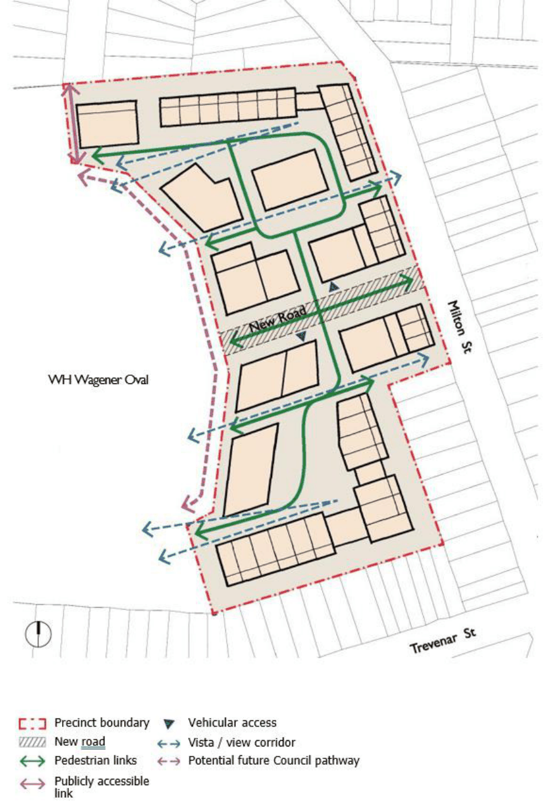
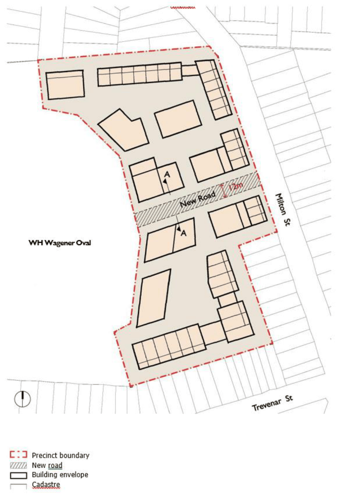
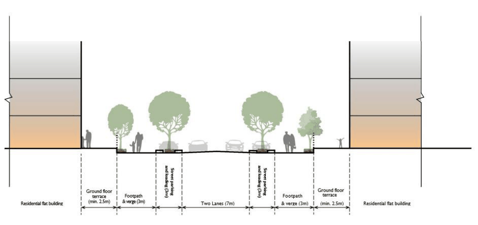

# Canterbury-Bankstown Development Control Plan 2023 - Chapter 11.1 149–171 Milton Street, Ashbury

Source PDF: [2024.08.06 - DCP 2023 - AMENDMENT 4 - Chapter 11.1 - Milton Street.pdf](https://planfortomorrow.sharepoint.com/sites/Planfortomorrow/Shared%20Documents/00%20NSW-Planning-Resources/dcp/canterbury-bankstown-development-control-plan-2023/ch-11-01-149-171-milton-street-ashbury/2024.08.06%20-%20DCP%202023%20-%20AMENDMENT%204%20-%20Chapter%2011.1%20-%20Milton%20Street.pdf)

### Canterbury-Bankstown Development Control Plan 2023

## Chapter 11 Key Development Sites

11.1 149–171 Milton Street,

### Ashbury

June 2023 (Amended August 2024)

Welcome to the

### City of Canterbury-Bankstown

#### Great Cities

We believe in creating vibrant, dynamic, and diverse communities that offer opportunities for people to connect, pursue their passions, and contribute to the world around them.

#### Naturally Green

We protect and prioritise nature in and around our city to enhance environmental sustainability and improve the quality of life for our residents.

#### Design Excellence

We encourage buildings, spaces, and objects that are both beautiful and practical, enhancing the beauty, accessibility, and safety of our built environment.

#### People First

We prioritise the needs, preferences, and aspirations of our community in all aspects of urban planning and design, creating supportive and enriching places people love.

#### Community

We engage with our community to ensure their needs and aspirations are reflected in the outcome, creating sustainable, resilient, vibrant, diverse, and inclusive places.

#### Sustainability

We seek designs that reduce negative impacts on the environment while also promoting social and economic well-being.

#### Net-Zero

We encourage our community to design buildings and places that produce as much renewable energy as they consume, reducing greenhouse gas emissions, lowering energy bills, and increasing resilience to environmental shocks and stresses.

#### Join us in creating a City that's liveable, loveable, and sustainable for all!

#### CONTENTS

Section 1 – Introduction ....................................................................................................... 4

Section 2 – Siting the development ..................................................................................... 7

Section 3 – Building height and density ............................................................................... 9

Section 4 – Setbacks ........................................................................................................... 11

Section 5 – Upper level setbacks ........................................................................................ 14

Section 6 – Building separation .......................................................................................... 15

Section 7 – View corridors ................................................................................................. 16

Section 8 – Building depth ................................................................................................. 17

Section 9 – Deep soil zones ................................................................................................ 18

Section 10 – Communal open space .................................................................................. 19

Section 11 – Vehicular and pedestrian entries ................................................................... 20

Section 12 – New road ....................................................................................................... 21

Section 13 – Basement parking .......................................................................................... 23

Section 14 – Excavation...................................................................................................... 24

Section 15 – Drainage ........................................................................................................ 25

Section 16 – Tree retention ................................................................................................ 26

Section 17 – Waste management ...................................................................................... 27

## SECTION 1–INTRODUCTION

#### Explanation

The Canterbury-Bankstown Local Environmental Plan 2023 and Canterbury-Bankstown Development Control Plan 2023 combine to regulate effective and orderly development, consistent with Connective City 2036.

The Canterbury-Bankstown Local Environmental Plan 2023 is Council's principal planning document. It provides objectives, zones and development standards such as lot sizes, floor space ratios and building heights.

The Canterbury-Bankstown Development Control Plan 2023 supports the LEP by providing additional objectives and development controls to enhance the function, design and amenity of the Milton Street Precinct. Note: If applicable to an application, the development controls of Chapter 11.1 of this DCP will prevail if there is an inconsistency with any other development controls in this DCP.

#### Objectives

The objectives of this chapter are:

O1 To achieve design excellence in any new development.

O2 To achieve a high quality development outcome that is responsive to the natural and built form context around the site.

O3 To improve connectivity for pedestrians and cyclists through the site to Milton Street, Yabsley Avenue, WH Wagener Oval and Whitfield Avenue.

O4 To enhance the existing Milton Street streetscape and provide a new street and pedestrian pathways that enhance the landscape character of the area.

O5 To achieve a high quality landscape response to the site, Milton Street and the WH Wagner Oval edges.

O6 To minimise the visibility of any taller development within the precinct from surrounding streets and achieve a transition in scale of development from Milton Street and the rear boundaries of existing residential lots edging the site to the oval edge, responding to the topography of the site.

O7 To locate the tallest development on the site along the new street to ensure the topography minimises its impact and visibility.

O8 To achieve a high standard of residential amenity to adjacent development and new development within the precinct.

O9 To minimise the visual impact to the Ashbury Heritage Conservation Area.

#### Desired character

The Milton Street Precinct is located to the north of Ashbury, with the border of Inner West Council located on the northern boundary. It is bounded by WH Wagener Oval to the west, Milton Street to the east and lower scale residential dwellings, predominantly single dwellings, to the north and south. The Ashbury Heritage Conservation area is immediately to the east and south of the precinct.

The land within this precinct is currently occupied by industrial and commercial development, and surface carparking serving these uses. The site is an anomaly within an otherwise low scale residential area. The presentation of these industrial and commercial uses to both Milton Street and WH Wagener Oval detracts from the predominant residential character of the area.

Revitalisation and redevelopment of the site is a key objective for the precinct. New development is to create a new residential character for the site that provides a lower scale and density to Milton Street, grading up to taller development towards the edge of the WH Wagener Oval.

Redevelopment along Milton Street is to sensitively respond to the residential lot subdivision pattern and scale of dwellings within the street reinterpreted into a contemporary terrace typology. Terraces are to be low scale with breaks between the terrace grouping offering view glimpses and pedestrian permeability into the site.

A new street from Milton Street to WH Wagener Oval will provide vehicular, pedestrian and cycle access into and through the site whilst also offering a view corridor to the oval lined with trees and the front gardens of apartments.

The site edges shared with existing low scale residential lots on Milton Street, Trevenar Street, and Yabsley Avenue are to achieve a transition in scale by lower height development and a significant landscaped setback to moderate amenity impacts to the existing dwellings and their rear garden areas.

The oval interface with the site is able to sustain taller development which will offer improved passive surveillance and residential activation to the edge of the oval. Any development along this part of the site is to ensure that it is not visible from Milton Street, Trevenar Street, and Yabsley Avenue over the existing houses along these streets.

Taller development also marks and defines the edges of the new street as the topography falls away towards the oval with development centrally within the site moderating between the taller oval edges and the low scale forms to Milton Street.

The street and pathway network through the site will improve the permeability of the site and access across the site from Yabsley Avenue to Milton Street and WH Wagener Oval. A well connected pedestrian network with high pedestrian amenity shall be provided within the precinct.

The landscape quality throughout the site and along the site edges to Milton Street, adjacent residential lots and the oval will be high quality. It will provide dense landscape buffers to property boundaries, street trees and landscaped front gardens to Milton Street and the new internal access road, and landscaped mounding to the oval edges with large trees to reinforce the existing significant tree plantings around the oval perimeter. The retention of existing trees within the site and along the site edges is to be maximised through the location of built form, the new road, and positioning of basements.

The architectural character will enhance the precinct, using materials and proportions that are sympathetic to the Ashbury Heritage Conservation area.

A sensitive relationship with the adjoining low scale houses will be provided to the precinct edges. Low to medium scale built form shall be designed to minimise privacy impacts to the adjacent low scale houses. The provision of landscaped buffers will improve the quality of the outlooks towards the site from these dwellings.

The new developments within the precinct shall assist the transformation of the industrial land into a high quality residential community integrated into the surrounding neighbourhood.

The indicative master plan for the site is shown in Figure 12.1.2.

## SECTION 2–SITING THE DEVELOPMENT

#### Objectives

O1 To create a site layout and built form that is both appropriate to and enhances the character of the Milton Street and WH Wagener Oval area.

O2 To maximise the opportunities for high quality landscape within the site and to all site edges including Milton Street and WH Wagener Oval.

O3 To improve the permeability and connectivity of the precinct.

O4 To create a site layout and built form which will provide high residential amenity within the precinct and minimise the impacts on adjoining properties.

O5 To maximise the opportunity for deep soil within the site and along its edges.

O6 To provide view corridors and links through the site that offer view glimpses to the Oval whilst also providing breaks in the building form to minimise bulk.

O7 To ensure areas of open space are consolidated and provide landscape and visual relief between building forms and along site edges.

O8 To ensure all buildings located on the internal areas have active edges to roads, pathways, and communal open space areas.

#### Development controls

2.1 Locate building form within the development in accordance with the building footprints and envelopes shown in Figure 12.1.3 Number of Storeys and Figure 12.1.5 Minimum Setbacks and Building Separation.

2.2 Any variation from the building footprints and heights shown in these figures must demonstrate that it achieves a higher quality outcome in terms of:

• Scale transition across the site.

• Response to the conservation character and scale of Milton Street.

• Amenity to adjacent residential lots, the oval and dwellings within the site itself.

• Visibility to and visual impact from the conservation area.

• Visual and physical permeability through and into the site.

• Consolidated landscape areas throughout the site.

2.3 The buildings backing onto the internal pathways shall be designed to address the internal public domain with active edges to all roads, pathways and communal open space.

2.4 Communal open space throughout is to be designed as public domain with active street edges, street furniture, lighting and planting.

2.5 All buildings (other than those facing Milton Street), must have an entry and identifiable address to a street or pathway within the development, with clear and legible pathways for residents, visitors and deliveries.

2.6 Any proposed future developments will also need to comply with the requirements of this DCP and the Apartment Design Guide and be subject to a design peer review.

## SECTION 3–BUILDING HEIGHT AND DENSITY

#### Objectives

O1 To achieve an appropriate distribution of built form and height transition across the site to respond to existing character and context within the maximum building height provisions in the Canterbury-Bankstown Local Environment Plan 2023 in clause 4.3.

O2 To provide an appropriate scale and massing sensitive to the Ashbury Heritage Conservation Area and Milton Street.

O3 To minimise the visual impact of development to adjoining sensitive residential uses.

O4 To ensure that any taller development within the precinct is not visible over the existing housing when viewed from the surrounding streets and public domain areas.

O5 To consider the visibility of the precinct and future development from key vantage points around WH Wagener Oval.

O6 To locate taller development in locations of high quality amenity and outlook over the oval.

O7 To reinforce the sense of enclosure to WH Wagener Oval by providing taller buildings along its edge while ensuring sufficient gaps and openings are provided to allow for views through the development.

O8 To ensure the greatest height is only located along the western end of the new street within the site.

#### Development controls

#### Height

3.1 The detailed distribution of height within the maximum height allowed within the precinct is to be in accordance with the height in metres in the following table and the maximum height in storeys designated in Figure 12.1.3 Number of Storeys.

| Number of storeys | Maximum height in metres |
|---|---|
| 1 storey | 3.9m |
| 2 storeys Roof form | 6.2m plus roof form 8.5m to top of ridge |
| 2 storey transition to residential lots at side boundaries | 6.2m plus 1m allowance for the balustrade to any third floor balconies setback above |
| 3 storeys including allowance for plant, lift overrun and roof form | 11m |

| Number of storeys | Maximum height in metres |
|---|---|
| 4 storeys including allowance for plant, lift overrun and roof form | 14m |
| 5 storeys including allowance for plant, lift overrun and roof form | 18m |
| 6 storeys including allowance for plant, lift overrun and roof form | 21m |

3.2 The floor-to-floor height of all apartments is to be a minimum of 3.1m.

3.3 Floor to floor heights less than those specified in control 3.2 above to try to achieve an additional storey within the maximum building height will not be supported.

3.4 The additional height allowance between the top storey and the maximum height is to be used to achieve an interesting roof form and building silhouette appropriate to its context on the site and to accommodate lift overruns and plant only. The expression of party walls to development along Milton Street to respond to the ‘grain’ of the traditional lot widths is encouraged.

3.5 The street wall heights to Milton Street are to comply with Figure 12.1.6 Upper Level Setbacks.  Building form above this street wall height is to be either incorporated within an attic roof form or setback a minimum of 3m from the line of the building below.

3.6 The maximum perceived height of development should be two storeys when viewed by a standing person with an average eye level of 1.5m (refer to Figure 12.1.4 Scale Relationship to R2 Zone) from:

• Section A – The eastern footpath of Milton Street as seen over the roofs of existing houses (other than when directly opposite the new road within the site where taller development may be perceived).

• Section B – The southern footpath of Trevenar Street as seen over the roofs of existing houses.

• Section C – The centre of an adjoining residential rear private open space area (i.e. boundaries of the site shared with the rear or side boundaries of adjoining lots).

3.7 Taller development along the edge of WH Wagener Oval is not to be visible above the canopy line of the tallest existing mature tree on the eastern edge of the oval.

#### Density

3.8 The maximum floor space ratio may not be achievable if adverse visual, acoustic or privacy amenity impacts occur to neighbouring dwellings or dwellings within the development.

3.9 The majority of the new dwellings are to be located within the centre of the precinct to the western end of the new street and along the centre part of the WH Wagener Oval boundary to minimise privacy, scale and acoustic impacts to adjoining residential dwellings.

## SECTION 4–SETBACKS

#### Objectives

#### Front setbacks

O1 To provide building setbacks that are consistent with the existing setbacks to Milton Street and Yabsley Avenue.

O2 To facilitate semi private courtyard front gardens within the front setbacks along Milton Street.

O3 To retain existing trees along Milton Street to maintain the landscape character of the site.

O4 To provide deep soil in the front setback to create a landscape setting including large canopy trees within the front garden setbacks to enhance the current landscape character of Milton Street.

O5 To encourage informal interaction between residents in the area.

O6 To provide passive surveillance to Milton Street.

O7 To provide a public/private transition from the street to the dwellings and apartment buildings along the street, internal roads, pathways and communal open space.

#### Side and rear setbacks

O8 To minimise bulk and scale adjacent to neighbouring residential dwellings.

O9 To provide a quality outlook and reasonable visual and acoustic privacy for existing dwellings on land adjoining the precinct.

O10 To provide sufficient setback to accommodate generous landscape buffers as well as private open space to new dwellings along all the precinct side and rear boundaries.

O11 To enhance the landscape character of the site and allow for larger canopy trees within the rear and side setbacks.

O12 To maximise the opportunity to retain existing trees along the oval edge and site edges.

O13 To mitigate the impact of bulk to WH Wagener Oval and public domain areas.

O14 To provide for consolidated areas of deep soil along all precinct boundaries.

O15 To reinforce landscape and fauna corridors within the rear gardens of adjoining lots.

#### Development controls

#### General controls

4.1 Provide building setbacks in accordance with Figure 12.1.5 Minimum Setbacks and Building Separation.

#### Front setbacks

4.2 The minimum front setback to Milton Street is to be 4m.

4.3 The front setback area is to be free from any projections or encroachments from any part of new buildings.

4.4 Existing mature trees are to be retained wherever possible and entries to new development are to be designed to maximise retention.

#### Side and rear setbacks

4.5 Provide side and rear setbacks in accordance with Figure 12.1.5 Minimum Setbacks and Building Separation.

#### Street address and landscaped setting

4.6 Each ground level dwelling to Milton Street is to be provided with its own direct access from Milton Street.

4.7 Provide articulation to building frontages through expression of party walls, deep eaves, projecting bays, setbacks to the second floor to provide balconies (if attic forms are not used) or canopies over entries.

4.8 Paved areas within the front setback are to be associated with either the front door or living areas and are to be a maximum of 2.4m in depth within the front setback zone.

4.9 A level difference of a maximum of 800mm is encouraged to differentiate private open space from the landscaped setback area.

4.10 Provide front fencing to the street boundary that is complimentary to the height and design of the predominant fencing type in Milton Street (maximum height to be 1.1m).

4.11 A minimum of one canopy tree is to be provided in the front garden setback of each dwelling to Milton Street.

4.12 Within the required side and rear setbacks a heavily planted landscape buffer is to be provided with a minimum width of 3m.

4.13 Deep soil is to be provided as required and indicated in Figure 12.1.7 Deep Soil Zone and Communal Open Space to all side and rear boundaries for a minimum width of between 3m and 6m.

4.14 Groupings of large canopy trees are to be provided within all side and rear setbacks. Deep soil is to be provided where these trees are located.

## SECTION 5–UPPER LEVEL SETBACKS

#### Objectives

O1 To mitigate the scale of buildings adjacent to Milton Street and side boundaries adjacent to low scale residential lots.

O2 To minimise the visibility of higher built from when viewed from adjoining residential properties and surrounding public domain and conservation area.

O3 To reduce amenity impacts to adjoining properties and the public domain.

O4 To provide definition to the top of higher building forms.

#### Development controls

5.1 The minimum upper level setbacks are to be in accordance with Figure 12.1.6 Upper Level Setbacks. The setback for the building(s) with the four storey limit shall apply to the third and fourth floors.

5.2 The final setback to upper storeys for built form adjacent to side boundaries is to be determined by the line of sight when viewed by a standing person with an average eye level of 1.5m from the centre of neighbouring backyards on an adjoining residential property – Figure 12.1.4 Scale Relationship to R2 Zone.

5.3 Upper level setbacks must be free of any projections or encroachments from any part of building.

5.4 All plant rooms and lift overruns are to be positioned to minimise their visibility to the surrounding public domain.

## SECTION 6–BUILDING SEPARATION

#### Objectives

O1 To ensure that development has appropriate spacing between buildings to balance the scale of the building.

O2 To allow for high quality amenity for residents, adjoining properties and public domain areas.

O3 To provide generous spaces between buildings to create an appropriate opportunity for a landscape setting, view corridors between building forms, sky exposure and communal open space where appropriate.

O4 To moderate building length for taller building forms.

O5 To provide building groupings to Milton Street that are reasonable relative to the conservation area character.

#### Development controls

6.1 Provide minimum separation distances between building forms in accordance with Figure 12.1.5 Minimum Setbacks and Building Separation.

6.2 Where the minimum separation distance is less than the separation required by the Apartment Design Guide (ADG) for habitable rooms or balconies the building is to be designed to ensure the room uses are appropriate to the separation to ensure compliance with the ADG.

6.3 Areas of deep soil are to be provided below the large courtyard areas to ensure a high quality outlook for future residents.

6.4 The minimum separation distances between the narrow ends of building forms are to be clear of projections other than window bays to bedrooms or secondary windows to living rooms. The maximum projection of such elements is to be 1.5m within the separation distance.

## SECTION 7–VIEW CORRIDORS

#### Objectives

O1 To protect and enhance opportunities for vistas to WH Wagener Oval and its mature tree canopy from Milton Street.

O2 To provide opportunities for longer distance vistas from the communal area courtyards between the buildings within the precinct to the Oval.

#### Development controls

7.1 View corridor and breaks between building forms are to be in the locations shown in Figure 12.1.8 Links, View Corridors and Vehicle Entry Points.

7.2 The minimum width of a view corridor is to be in accordance with Figure 12.1.5 Minimum Setbacks and Building Separation.

7.3 Landscape within view corridors should frame views and should not block eye line level views to the oval.

7.4 Street trees with higher canopies are to be provided along the length of the new street to frame views towards the oval.

## SECTION 8–BUILDING DEPTH

#### Objectives

O1 To limit the depth of buildings to ensure a high level of amenity and sufficient space and separation to adjacent buildings and neighbouring lots.

O2 To mitigate bulk and scale to Wagener Oval and the adjacent heritage conservation area.

O3 To provide view corridors through the site and pedestrian permeability.

O4 To maximise opportunities for cross ventilation and high levels of solar access.

#### Development controls

8.1 The maximum building length is 40m.

8.2 Indentations or recesses must be provided every 20m to provide articulation and mitigate building length. The depth of indentations is to be a minimum of 3m.

8.3 The maximum overall building depth is 18m from glass line to glass line for buildings within the precinct and along the new street and the edge of the oval.

8.4 Building depth to the Milton Street frontage and to the northern side boundary adjacent to residential lots is to be a maximum of 15m including balconies.

## SECTION 9–DEEP SOIL ZONES

#### Objectives

O1 To allow for mature trees.

O2 To provide a pleasant outlook and contribute to the amenity of the precinct.

O3 To soften the scale of buildings.

O4 To maximise the environmental benefits to the precinct.

O5 To minimise stormwater runoff and facilitate rainwater infiltration.

#### Development controls

9.1 A minimum of 15% of the site area is to be provided as deep soil zone.

9.2 The locations of deep soil areas shall be in accordance with the Figure 12.1.7 Deep Soil Zone and Communal Open Space.

9.3 The minimum width of 3m to 6m of deep soil is to be provided to all boundaries in accordance with Figure 12.1.7 Deep Soil Zone and Communal Open Space.

9.4 A minimum of 3m of deep soil is to be provided to the boundary with Wagener Oval.

9.5 Deep soil is to be provided to the site edges, the verges of the new street and within the communal open spaces to support substantial tree planning.

## SECTION 10–COMMUNAL OPEN SPACE

#### Objectives

O1 To ensure residents are provided with a reasonable level of outdoor amenity.

O2 To provide high quality open space for residents.

#### Development controls

10.1 Communal open spaces are to be provided in accordance with Figure 12.1.7 Deep Soil Zone and Communal Open Space.

10.2 Communal open space should be designed as public domain with active edges, street furniture, lighting, and planting.

10.3 The layout of internal roads and pathways should be clear and legible for occupants, visitors and deliveries, with clearly articulated building entrances.

10.4 Clear view corridors in and out of the communal open space are to be maintained.

10.5 Larger communal open spaces should be designed as public parks with appropriate facilities and shade structures.

## SECTION 11–VEHICULAR AND PEDESTRIAN ENTRIES

#### Objectives

O1 To improve permeability to and within of the precinct.

O2 To enhance pedestrian safety and activity at street level.

O3 To limit the impacts of vehicular access and encourage pedestrian movements within the precinct.

O4 To provide for pedestrian access from east to west across the site to Wagener Oval.

O5 To facilitate access between the site and Yabsley Avenue.

O6 To design the interface along the western edge of the site with Wagener Oval in a way that creates an integrated landscape with possible future facilities such as pathways, furniture, and lighting within Wagener Oval.

#### Development controls

11.1 The number of basement entries is to be minimised.

11.2 Vehicular access shall be provided generally in the locations shown in Figure 12.1.8 Links, View Corridors and Vehicle Entry Points.

11.3 No vehicular entry points apart from the new road are to be provided from Milton Street.

11.4 Basement ramps must be within the built form. Exposed basement ramps are not permitted.

11.5 A well-designed pedestrian movement network is to be provided in accordance with Figure 12.1.8 Links, View Corridors and Vehicle Entry Points.

11.6 A pedestrian access point is to be provided from the site to Yabsley Avenue.

11.7 The interface along the western edge of the site with Wagener Oval is to be designed in collaboration with Council to integrate the landscape and tree planting with potential pedestrian and cycle pathways, furniture and lighting within Wagener Oval taking into consideration privacy and safety issues.

## SECTION 12–NEW ROAD

#### Objectives

O1 To deliver a well-designed new road in accordance with relevant standards.

O2 To provide a human scale streetscape along the new road.

O3 To provide a pedestrian friendly environment along new road.

O4 To provide a public pedestrian link from Milton Street to WH Wagener Oval.

#### Development controls

12.1 The location of the new road shall be generally along the common boundary and shared equally between both lots. It is to be generally in accordance with Figure

12.1.9 New Road.

12.2 The minimum width of the road carriageway is 13m. It shall be allocated equally on both side of the common boundary.

12.3 The road section must be in accordance with Figure 12.1.10 New Road Section (A-A Section).

12.4 A 1.5m footpath together with a 1.5m verge for tree planting must be provided to either side of the New Road in accordance with Figure 12.1.10 New Road Section (A- A Section).

12.5 The road shall have a turning circle at an appropriate location to enable vehicles to enter and leave the site in a forward direction without reversing. Details are to be provided at the application stage. The turning circle shall be designed to provide for separate pedestrian access that is not on the road carriageway, to enable safe access to Wagener Oval.

12.6 Site owners are encouraged to build the new road together.

12.7 If one site wishes to develop independently of the other and is unable to procure land from the adjoining site for the road, then the first site development is to provide a fully functioning road serving that development. This will include:

(a) 10.1m for the road reserve comprising 1.5m footpath, 1.5m verge for tree planting, 6.5m wide carriageway, and 0.6m clearance to the boundary.

(b) A turning circle is to be provided to at an appropriate location to enable vehicles to enter and leave the site in a forward direction without reversing.

(c) The ability for this roadway to be reconfigured to form a completed access road when the other site redevelops.

Under this scenario the provision of this road will reduce the area available for site development.

12.8 The road is to be appropriately designed to prevent vehicular movements onto Wagener Oval.

12.9 The road shall provide for pedestrian access to Wagener Oval at the western end. It shall be designed to provide an attractive entrance treatment to Wagener Oval including landscaping, entrance wall treatment, lighting and seating. Details are to be provided at the application stage.

12.10 The road shall be constructed in the first stage of a development. Details are to be provided at the application stage.

12.11 The road reserve is to remain in private ownership with an easement to permit access by Council and the public.

12.12 The road is to be designed and constructed in accordance with Council specifications and to the satisfaction of Council.

Note: Applicants should consult with Council’s Operations Division to discuss road requirements at an early stage in the process.

## SECTION 13–BASEMENT PARKING

#### Objectives

O1 To ensure all resident parking is within basements.

O2 To encourage limited or street parking for visitors along New Road.

O3 To minimise the excavation of the land.

O4 To ensure basement parking allows for adequate deep soil area.

O5 To ensure that basement areas are designed to permit access by heavy rigid vehicles including larger garbage disposal trucks that will service this development.

#### Development controls

13.1 Basement car parking is to be generally located below natural ground level. Any protrusion above natural ground level is not to exceed 1m.

13.2 Basement walls visible above natural ground level must be appropriately finished and appear as an integrated part of the building or landscaping.

13.3 Basements are to be located directly below building footprints.

13.4 Basements may be located under common courtyard areas, where it reduces the depth of excavation and deep soil requirements can still be met.

13.5 On-site waste collection points are to be located within basements which are to be designed to allow access by heavy rigid vehicles including larger garbage disposal trucks with a minimum entry height of 4.5m. The design shall allow vehicles to enter and leave the site in a forward direction.

## SECTION 14–EXCAVATION

#### Objectives

O1 To respond appropriately to the fine grain character of the heritage conservation area.

O2 To minimise ground disturbance across the site.

#### Development controls

14.1 Units more than 1m below natural ground level are not permitted.

## SECTION 15–DRAINAGE

#### Objectives

O1 To ensure that surface and groundwater flows from the development site are satisfactorily conveyed to the stormwater drainage system.

O2 To mitigate the entry of water from the site to Wagener Oval.

#### Development controls

15.1 Surface and groundwater flows (subject to approval) from the development site are to be satisfactorily conveyed to the stormwater drainage system.

15.2 Easements are to be used or created on the development site to drain water in accordance with Council’s requirements from the development site to the drainage system. No further easements will be permitted to be created on Wagener Oval.

15.3 The applicant shall comply with Council’s requirements for the mitigation of water entering Wagener Oval from the development site.

Note: Applicants should consult with Council’s Operations Division to discuss drainage requirements at an early stage in the process.

## SECTION 16–TREE RETENTION

#### Objectives

O1 To identify and retain key existing trees on site.

O2 To utilise existing trees to screen new development.

O3 To protect trees during the construction phase of development.

#### Development controls

16.1 Existing key trees on the site are to be retained, especially those that screen development particularly on the western side of the site. Building setbacks may need to be varied to protect trees.

16.2 Any future application(s) are to include a comprehensive arborist report for the site and the trees within Wagener Oval on the western side of the site. This is to identify the location, species, and condition of existing trees, and to identify appropriate building setbacks and deep soil areas to ensure existing trees are easily retained.

16.3 All existing trees are to be protected during construction phase and proposed measures are to be outlined in the arborist report.

## SECTION 17–WASTE MANAGEMENT

#### Explanation

This section is intended to supplement controls on waste management contained in the DCP, in order to ensure adequate provision for waste management on this site. Where there is an inconsistency in requirements, this section shall prevail in relation to the site. Applicants should consult with Council to discuss waste requirements at an early stage in the process.

#### Objectives

O1 To maximise resource recovery through waste avoidance, source separation and recycling.

O2 To ensure that the disposal of waste is managed appropriately, efficiently and provides for maximum resource recovery or reuse.

O3 To ensure well-designed and responsive bin storage and collection facilities that are convenient and accessible to occupants.

O4 To require that bin storage and collection facilities are designed so that they can be integrated with and comply with the requirements for Council’s domestic waste services.

O5 To ensure all waste streams being handled, stored and collected in a manner to reduce risk to health and safety of all users, including residents, maintenance (e.g. caretakers), collection staff, and contractors (and required vehicles and equipment).

O6 To allow for kerbside waste collection only for those dwellings facing Milton Street. For all other dwellings waste collection is to occur in the basement area.

O7 To ensure that bin storage for unit dwellings Milton Street are stored on individual properties and do not impact negatively on the streetscape.

#### Development controls

#### Residential development

17.1 Residents in properties facing Milton Street are to utilise kerbside waste collection. Bins shall be stored on individual properties and are to be suitably screened from view from the street. Bin carting routes are not to pass through any internal doorways.

17.2 The communal storage area(s) of residential flat building development must be of sufficient size to accommodate all allocated bins, bulky waste and the additional recycling service. This is to be achieved through the provision of a waste communal bin storage area(s) within the basement footprint of the development, which:

(a) Provides direct and convenient access for the occupants of the development, at a maximum distance of 30m from each dwelling.

(b) Allows for the safe and direct transfer of all bins from the bin storage area to the collection point (if required).

(c) Does not adversely impact the occupants within and adjoining the development in relation to visual amenity, noise and odour.

(d) Does not interfere with car parking, landscaping and any existing trees and vegetation.

Note: At pre-application stage the applicant shall contact Council’s Team Leader Resource Recovery and Major Projects Waste to discuss waste requirements. This may include requirements for communal bin areas for each “block”, the need for a larger communal bin storage room, and the need for 240 litre and 1,100 litre bins and/or the need for decanting equipment.

The location and design of the communal storage area(s) must comply with the requirements of Council’s Waste Design for New Developments Guide.

17.3 Development must designate an on-site collection point that is integrated into the design of the development. The collection point can be directly from the storage area(s) or a nominated holding area within the site. It will be the responsibility of the property manager or caretaker to move bins from the storage area(s) to the holding area. The bin-carting route is to have or be:

(a) No more than 30m in length.

(b) Paved and a minimum 2.5m wide.

(c) Non-slip, free from obstacles and steps.

(d) A maximum grade of 1:30.

Note: Bin carting equipment (such as a motorised trolley) will be required if the cartage route is greater than 30m or if bins are larger than 240 litres. The design of the on-site collection point must comply with the requirements of Council’s Waste Design for New Developments Guide.

17.4 The development is to be designed to integrate with Council’s standard heavy rigid vehicle waste service and to enable all allocated bins, bulky waste and additional recycling to be collected on-site. The on-site collection point must be designed to:

(a) Allow collection vehicles to enter and exit in a forward direction, with minimal reversing.

(b) Designed to best practice standards for the provision of adequate space for heavy rigid class vehicles to turn around on site, or the provision of truck turn table, as per the Australian Standard AS 2890.2.

(c) A minimum basement height of 4.5m to allow sufficient overhead clearance heights to ensure collection vehicles to enter basement and operate to empty waste and recycling bins.

(d) Should a hook lift bin system be utilised the clearance height for the vehicle will increase to 6m where the bins are to be positioned.

(e) Comply with the any specific requirements detailed in Council’s Waste Design for New Developments Guide.

The design of the on-site collection point must comply with the requirements of Council’s Waste Design for New Developments Guide.

#### Bulky waste storage

17.5 Separate bulky waste storage areas or rooms are to be provided for residents to store bulky waste (e.g. white goods, mattresses, furniture) awaiting collection to prevent the illegal dumping of materials on the kerbside or in common areas.

The bulky waste storage areas or rooms are to be designed to comply with the requirements detailed in Council’s Waste Design for New Developments Guide.

The areas or rooms are to be separate to the bin storage areas or rooms, and must be both lockable and accessible to residents.

The areas or rooms must not be visible from any street frontage. Where there are multiple buildings, separate areas or rooms must be provided.

The space should be appropriate with the minimum size being:

• 6 to 20 units: 4m2 total space.

• 21 to 40 units: 4m2 + 1m2 for every 10 additional units above 20 units (or part thereof).

• 41 to 100 units: 8m2 + 1m2 per 20 additional units (or part thereof) above 40 units.

• 101 units and over: 12m2 + 2m2 per 50 additional units above 100 units (or part thereof).

17.6 On-site collection of bulky waste is required where waste and recycling bins are collected on-site. The bulky waste storage room must be within 5m to the nominated collection point.

The carting route from the bulky storage area(s) to the collection point is to be:

(a) Direct and short as possible.

(b) Paved and a minimum 2.5m wide.

(c) Non-slip, free from obstacles and steps.

(d) A maximum grade of 1:30.

#### Additional recycling storage

17.7 Separate additional recycling storage areas or rooms are to be provided for residents to store additional recyclable household items (e.g. clothing, mattresses, polystyrene, cardboard and electronic waste) awaiting collection, to prevent the illegal dumping of materials on the kerbside or in common areas.

The minimum area required is 9m2 and the area is to be designed to comply with the requirements detailed in Council’s Waste Design for New Developments Guide.

The area or rooms must be separate to the bin storage area or room(s) and the bulky waste storage room.

The area or room(s) must not be visible from any street frontage. Where there are multiple buildings, separate areas or rooms must be provided.

17.8 On-site collection of additional recycling materials is required where waste and recycling bins are collected on-site. The additional recycling collection area or room must be within 5m of the nominated collection point.

The carting route from the bulky storage area(s) to the collection point is to be:

(a) Direct and short as possible.

(b) Paved and a minimum 2.5m wide.

(c) Non-slip, free from obstacles and steps.

(d) A maximum grade of 1:30.

#### Chute system and recycling cupboard

17.9 Waste chute disposal points (hoppers) are to be provided on each residential level of the development for the five and six storey buildings. A recycling cupboard is to be located adjacent to the chute hopper.

The hopper and recycling cupboard are to be located no more than 30m travelling distance from each dwelling.

The chute should be behind a cupboard door to improve resident’s amenity and reduce odour in the lobby/corridor.

The chute is to be designed to minimise noise and fire risk. It is to terminate in the bin storage room and discharge directly into a bulk bin.

Signage is to be placed on the chute hopper and recycling cupboard on every residential level providing instructions on how to use the system effectively.

#### Chute service and bin storage rooms

17.10 These must be located directly under where the chute terminates and allow a space large enough for the bin to fit under the chute base and at the correct angle.

The bin storage room must be large enough to fit the allocated number of bins with additional room for manoeuvring bins and lift lids.

There must be sufficient bin volume under the chute for a minimum of three days waste generation.

Where volume-handling equipment is required to automatically change the bin under the chute when it becomes full (such as bin lifting equipment or linear tracks or carousels), the bin storage room must be of adequate size to accommodate all required equipment and operate it.

Resident access to the volume handling equipment will be restricted. Bin storage room and chute service room may be two separate rooms but next to each other.

#### Easement

17.11 Council must be provided with an easement for unimpeded access to and from the waste collection locations for Council and its contractors to enter and exit for the purpose of waste and recycling collection. The development is also required to indemnify Council and its contractors against claims for loss or damage or wear and tear of access roads or to other parts of the building. A positive covenant shall be placed on the property title, such as section 88B certificate.

Note: By entering into an agreement with Council for waste collection, the development will be required to operate in full compliance with Council’s waste management collection requirements. The provision of Council’s waste collection service will not commence until formalisation of the agreement.

> [Picture on page 32: a picture, saved as a picture (images/ch-11-01-149-171-milton-street-ashbury-page-32-1.gif, 150 dpi).]

Figure 12.1.1: Location diagram

> [Picture on page 33: a picture, saved as a picture (images/ch-11-01-149-171-milton-street-ashbury-page-33-1.gif, 150 dpi).]

Figure 12.1.2:  Indicative Master Plan

> [Picture on page 34: a picture, saved as a picture (images/ch-11-01-149-171-milton-street-ashbury-page-34-1.gif, 150 dpi).]

Figure 12.1.3: Number of storeys

Note: Plant rooms to be out of line of sight when viewed from Milton and Trevenar Street

> [Picture on page 35: a picture, saved as a picture (images/ch-11-01-149-171-milton-street-ashbury-page-35-1.gif, 150 dpi).]

Figure 12.1.4: Scale relationship to R2 zone

> [Picture on page 36: a picture, saved as a picture (images/ch-11-01-149-171-milton-street-ashbury-page-36-1.gif, 150 dpi).]

Figure 12.1.5: Minimum setbacks and building separation

> [Picture on page 37: a picture, saved as a picture (images/ch-11-01-149-171-milton-street-ashbury-page-37-1.gif, 150 dpi).]

Figure 12.1.6: Upper level setbacks

> [Picture on page 38: a picture, saved as a picture (images/ch-11-01-149-171-milton-street-ashbury-page-38-1.gif, 150 dpi).]

Figure 12.1.7: Deep soil zone and communal open space

> [Picture on page 39: a picture, saved as a picture (images/ch-11-01-149-171-milton-street-ashbury-page-39-1.gif, 150 dpi).]

Figure 12.1.8: Links view corridors and vehicular entry points

> [Picture on page 40: a picture, saved as a picture (images/ch-11-01-149-171-milton-street-ashbury-page-40-1.gif, 150 dpi).]

Figure 12.1.9: New road

> [Picture on page 41: a picture, saved as a picture (images/ch-11-01-149-171-milton-street-ashbury-page-41-1.gif, 150 dpi).]

Figure 12.1.10: New road section (A-A section)
