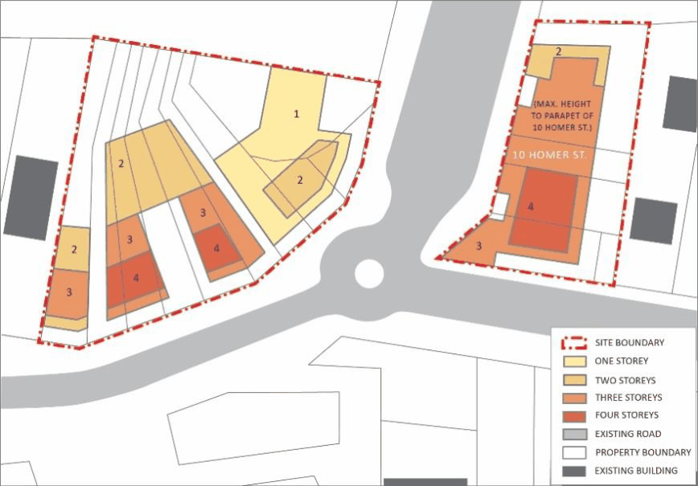
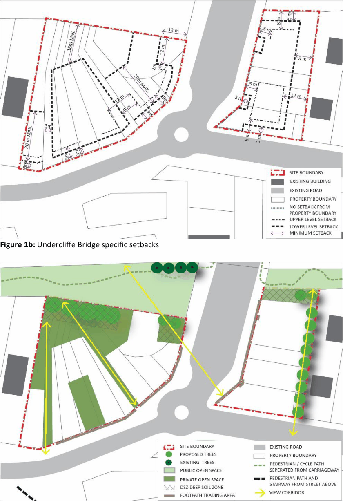

## SECTION 1–UNDERCLIFFE BRIDGE PRECINCT

#### Explanation

The Canterbury-Bankstown Local Environmental Plan 2023 and Canterbury-Bankstown Development Control Plan 2023 combine to regulate effective and orderly development, consistent with Connective City 2036.

The Canterbury-Bankstown Local Environmental Plan 2023 is Council's principal planning document. It provides objectives, zones and development standards such as lot sizes, floor space ratios and building heights.

The Canterbury-Bankstown Development Control Plan 2023 supports the LEP by providing additional objectives and development controls to enhance the function, design and amenity of the Undercliffe Bridge Precinct. Note: If applicable to an application, the development controls of Chapter 11.2 of this DCP will prevail if there is an inconsistency with any other development controls in this DCP.

#### Objectives

O1 To promote the Undercliffe Bridge Precinct as a mixed use activity hub, set within the green topography on the southern banks of the Cooks River.

O2 To maintain and improve the precinct’s relationship with the Cooks River.

O3 To respect the scale and proportions of the existing Adora Chocolate Shop building at 10 Homer Street due to its important role in establishing the streetscape of the precinct.

O4 To ensure that buildings relate to the Cooks River foreshore and residential properties.

O5 To protect the visual amenity and views of the precinct’s most significant building (10 Homer Street).

O6 To encourage a consistent built form edge along Homer Street, activating and uniting the area, and encouraging a sense of the precinct as a hub.

O7 To complement open space areas, particularly on the foreshore.

O8 To maintain curtilage and views of the facade of 10 Homer Street.

#### Development controls

1.1 Future development is to step buildings down in accordance with Figure 1a.

> [Picture on page 4: a picture, saved as a picture (images/ch-11-02-undercliffe-bridge-precinct-earlwood-page-4-3.gif, 150 dpi).]

Figure 1a: Undercliffe Bridge specific heights

1.2 Heights, in conjunction with setbacks, are to result in podium style development.

Note: The storey controls of this section of the DCP must be read in conjunction with the maximum permissible height of building provisions prescribed in the LEP. The definition of height of building is defined under LEP.

1.3 Provide setbacks at street level and at podium level in accordance with Figure 1b.

1.4 Site and design buildings to permit view corridors through to foreshore open space and do not impede views of the River along Homer Street as per Figure 1c.

1.5 Provide landscaping at the boundary with the River Corridor to reinforce the tree lined character of the foreshore as per Figure 1c.

> [Picture on page 5: a picture, saved as a picture (images/ch-11-02-undercliffe-bridge-precinct-earlwood-page-5-1.gif, 150 dpi).]

Figure 1b: Undercliffe Bridge specific setbacks

Figure 1c: Undercliffe Bridge open space and view corridors
