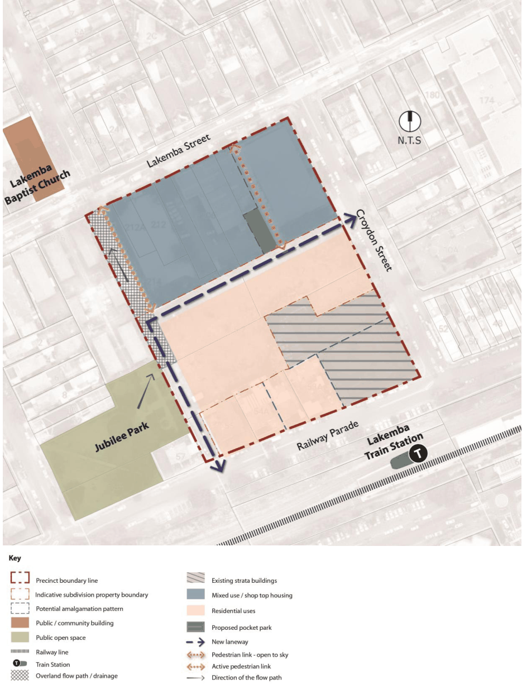

## SECTION 2–CHARACTER STATEMENT

#### Explanation

The Croydon Street Precinct (the precinct) is located to the north of Lakemba Train Station bounded by Croydon Street to the east, Lakemba Street to the north, Railway Parade to the south and Jubilee Park to the west. The precinct contains two different zones: E1 zone (local centre) to the north along Lakemba Street, and R4 zone (high density residential) for the rest of the precinct.

The key objectives of this section are to revitalise the precinct, achieve design excellence, improve pedestrian permeability and vehicular access.

#### Desired character

The character of the precinct is to be enhanced by high-quality architecture using natural materials and finishes that are sympathetic to the predominant character of the locality and exhibits a high degree of design excellence.

A new laneway connecting Croydon Street to Railway Parade is to be introduced through the precinct to improve the pedestrian permeability, enhance vehicular access and provide future developments with a strong and legible street address.

A continuous tree canopy along the streets and laneway reinforced by generous deep soil areas will enhance the public interface and provide a green and leafy character to the precinct.

Future residential developments provided along the new laneway (within the R4 zone) should respond to the streetscape along Croydon Street while transitioning to the adjacent low strata buildings at 11 and 15–19 Croydon Street that are unlikely to be redeveloped in the near future. Taller buildings will be located along the western side of the precinct overlooking Jubilee Park to the west.

Well-considered separation distances between the buildings within the precinct will ensure good amenity of the future residents, allow for local view corridors and landscape buffers.

An overland flow path will be retained in the north-western side of the precinct creating a new view corridor to Jubilee Park and Railway Parade. The edge to the path (within the E1

zone) should be treated to create an active interface with a raised pedestrian walkway above the freeboard.

Redevelopment of the sites along Railway Parade shall respond to the residential streetscape character by providing medium rise residential flat buildings with generous front and rear setbacks for high quality landscaping. Design solutions should be considered to mitigate the noise level for apartments facing the railway.

> [Picture on page 7: a picture, saved as a picture (images/ch-11-04-croydon-street-precinct-lakemba-page-7-1.gif, 150 dpi).]

Figure 2a: Structure Plan
