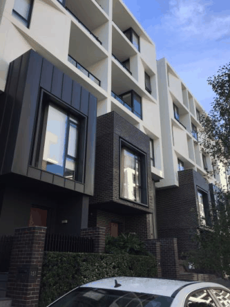
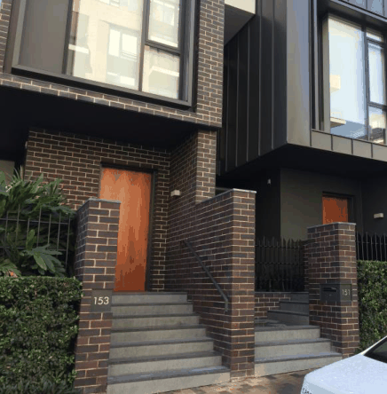

## SECTION 7–BUILDING ARTICULATION

#### Objectives

O1 To create visual interest.

O2 To moderate and reduce bulk and scale.

O3 To respond to the traditional lot pattern.

O4 To create a contemporary architectural character by using durable natural and high quality materials and finishes.

#### Development controls

#### Building exteriors

7.1 Facades shall be articulated and elements such as fins, bays and insets shall be used to reduce scale and provide visual interest.

7.2 External colours and materials shall reflect the local identity and shall provide a good contextual fit.

7.3 High quality and durable materials and finishes shall be used within the precinct.

7.4 Painted render shall be minimised. Low maintenance and graffiti resistant materials are encouraged within the precinct.

7.5 Extensive expanses of blank glass or solid walls are not supported.

7.6 A combination of solid and glass balustrades to balconies is encouraged to screen cloth drying areas.

#### Corner buildings

Buildings located on corner sites play a particularly important role in the streetscape, strengthening the form of blocks, streets, and intersections. Corners play an important role in centres by identifying junctions and pedestrian routes.

7.7 Corner buildings should address both frontages and use architectural features and materials to reinforce the corner.

7.8 Additional height is not supported to reinforce corners.

> [Picture on page 20: a picture, saved as a picture (images/ch-11-04-croydon-street-precinct-lakemba-page-20-1.gif, 150 dpi).]

Figure 7a: Examples of articulation of facades – Zone R4

> [Picture on page 20: a picture, saved as a picture (images/ch-11-04-croydon-street-precinct-lakemba-page-20-3.gif, 150 dpi).]
